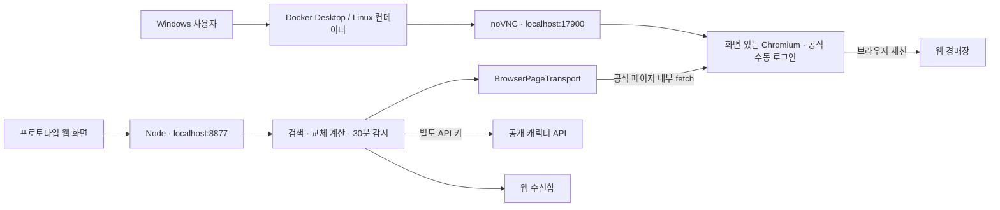

# 현재 구현과 검증 범위

2026-10-23 기준. 아래 항목은 같은 브랜치의 소스와 함께 읽는다.

## 실제 실행 구조

UI의 8877 포트는 컨테이너 내부에서만 사용한다. Windows 사용자는 17900 원격 화면 안에서 해당 UI를 조작한다. 개인 PC의 브라우저에 확장을 설치하는 방식은 별도 실행 모드로 남아 있다.

## 코드 위치

| 파일 | 역할 |
| --- | --- |
| [compose.yaml](../tools/maple-local-prototype/compose.yaml) | 독립 Compose 프로젝트, localhost 원격 화면, 프로필/캐시 볼륨, CPU·메모리 설정 |
| [Dockerfile](../tools/maple-local-prototype/Dockerfile) · [docker/](../tools/maple-local-prototype/docker/) | Node·Chromium·Xvfb·noVNC 실행, 비밀번호 파일, healthcheck, 프로필 잠금 |
| [server.mjs](../tools/maple-local-prototype/src/server.mjs) | HTTP API, Host·Origin·CSRF 확인, 메모리 키 입력 |
| [docker-server.mjs](../tools/maple-local-prototype/src/docker-server.mjs) | 도커 서버와 브라우저 시작 |
| [browser-transport.mjs](../tools/maple-local-prototype/src/browser-transport.mjs) | 공식 탭 안에서 조회·검색, 관찰한 클라이언트 헤더, 계정 변경·401 처리 |
| [domain.mjs](../tools/maple-local-prototype/src/domain.mjs) | 본인 캐릭터 선택, ±30% 가격, 점수/가성비, 한도, 감시·중복 억제 |
| [bridge.mjs](../tools/maple-local-prototype/src/bridge.mjs) | 조회·검색 URL 허용 목록과 별도 Windows 확장 연결 |
| [public/](../tools/maple-local-prototype/public/) | 검색·계산·감시 UI |
| [vendor/UPSTREAM.md](../tools/maple-local-prototype/vendor/UPSTREAM.md) | MIT 공개 구현의 출처·고정 커밋·수정 사항 |
| [test/](../tools/maple-local-prototype/test/) | 단위·통합 테스트, 가상 데이터 전용 브라우저 검증 |

## 데이터와 인증

- 웹 경매장: 원격 Chromium의 공식 페이지에서 사용자가 로그인·OTP를 직접 완료한다. 쿠키를 추출해 Node로 전달하지 않는다.
- 캐릭터 계산: 사용자가 발급한 공개 캐릭터 API 키를 앱 화면에 입력한다. 경매장 인증과 별개다. 키 없이 검색만 가능하다.
- 메모리: API 키·선택 캐릭터·검색 결과·감시·수신함. 재시작하면 초기화한다.
- 볼륨: 공식 로그인 프로필과 공개 캐릭터 데이터 캐시. 세션 유효 기간은 제공자 정책에 따른다.
- 기본 캐릭터: **에반이였솜**, 에반은 마력 축으로 계산한다. 실제 계정 목록에서 조회된 경우에만 선택한다.

## 구현된 검색·계산·감시

- 아이템 이름 한 개, 부위, 기준 예산, 스타포스·잠재 등급·옵션 조건.
- 예산 B의 70~130%. 30억이면 21억~39억이며 예산 초과 제외를 선택할 수 있다.
- 현재 장비 100점, 교체 점수 `100 + 모델 개선율(%)`, 가성비 `개선율 / 가격(억)`.
- 미지원 비교는 점수를 비워 두며 전체 시장 최고 매물로 표시하지 않는다. 현재 조회 페이지 안에서 정렬한다.
- 단일 감시, 기간 1/3/7일, 30분 간격. 최초 결과는 기준선, 이후 새로운 매물만 웹 수신함에 남긴다.
- 전체 결과가 한 페이지에 담기는 조건만 감시한다. 검색 잔여량을 확인하지 못하거나 소진되면 새 검색을 하지 않는다.
- 계정·브라우저 연결 변경 시 기존 캐릭터/감시를 무효화한다. 자동 구매·판매는 없다.

## 확인한 것과 남은 것

| 항목 | 상태 |
| --- | --- |
| `npm test` | 18개 통과 |
| 도커 빌드·실행·원격 화면·health | Codex Linux에서 확인 |
| 실제 headed Chromium에서 캐릭터→계산→검색→감시 | API 응답을 가상 route로 대체하여 통과 |
| 30분 감시·중복 억제 | 가상 시계로 확인. 실제 30분 운영 성공 기록은 아님 |
| 컨테이너 교체와 프로필/캐시 볼륨 유지 | 비밀이 아닌 테스트 파일로 확인. 메모리 가상 키 삭제 확인 |
| 프로필 잠금 오류 | 재현·수정. 배타적 flock 후 오래된 Singleton 링크만 정리 |
| 실제 로그인·OTP·실제 매물·실제 장비 정확도 | 미검증. 다음 로컬 작업의 핵심 |
| Discord 계정 연결·명령·DM·감시 DB 복원 | 미구현 |

검증 당시 도커는 Node 24.22.1 / Chromium 155였다. 앞으로 빌드되는 OS 패키지와 브라우저 버전은 달라질 수 있으므로 로컬 결과에 실제 버전을 남긴다.
