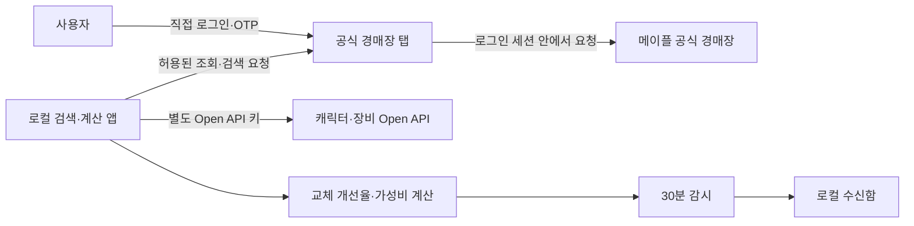
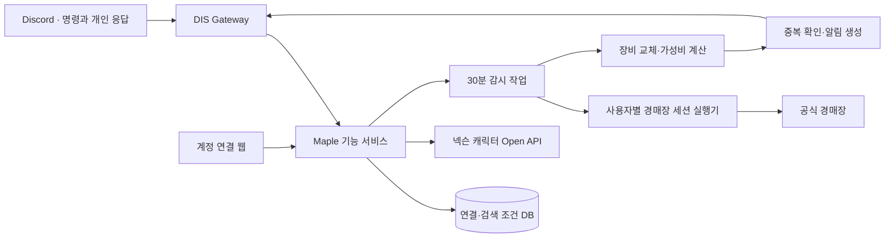

# 메이플 경매장 추천·감시 프로젝트 기록

> 2026-10-23 프로토타입과 검증 기록을 기준으로 2026-11-03 정리
> 이 문서는 현재 구현 범위, 만들면서 정한 원칙, 실제 계정 검증 순서와 DIS 연동 방향을 한곳에 남긴다. 세부 실행 상태는 [CURRENT_STATE.md](CURRENT_STATE.md), 바로 진행할 작업은 [NEXT_PLAN.md](NEXT_PLAN.md)에서 관리한다.

## 1. 한눈에 보기

이 기능의 목표는 캐릭터 이름과 예산을 입력하면 현재 장비를 기준으로 경매장 매물을 비교하고, 조건에 맞는 새 매물이 올라왔을 때 알려 주는 것이다.

현재는 DIS 운영 봇과 분리된 개인용 프로토타입까지 만들었다. Windows Chrome 확장 방식과 Linux Docker 브라우저 방식이 있으며, 아래 흐름을 한 화면에서 실행할 수 있다.

1. 공식 경매장 화면에서 사용자가 직접 로그인한다.
2. 로그인한 계정의 캐릭터 중 비교할 캐릭터를 선택한다.
3. 넥슨 Open API로 캐릭터 장비를 불러온다.
4. 부위, 아이템 이름, 예산, 잠재 조건으로 매물을 검색한다.
5. 현재 장비를 해당 매물로 바꿨을 때의 개선율과 가격 대비 개선율을 계산한다.
6. 선택한 조건을 30분마다 다시 검색하고 새 매물을 로컬 수신함에 남긴다.

다만 **실제 넥슨 계정으로 로그인한 뒤 실제 매물을 검색하는 마지막 검증은 아직 끝나지 않았다.** 클라우드 검증 환경에서 넥슨 로그인 SDK가 차단되어 가상 응답으로 전체 흐름을 확인했다. 따라서 지금 단계는 “계산과 감시 로직이 동작하는 프로토타입”이지 “운영 가능한 서비스”가 아니다.

## 2. 시작한 이유

경매장에서 장비를 찾을 때는 매물 가격만 봐서는 판단하기 어렵다. 같은 부위라도 스타포스, 잠재옵션, 에디셔널, 추가옵션이 다르고, 지금 착용한 장비와 비교했을 때 실제로 얼마나 좋아지는지 따로 계산해야 한다. 괜찮은 매물이 없으면 같은 검색을 며칠 동안 반복하기도 한다.

처음부터 모든 직업에 통하는 완성형 추천기를 만들기보다 다음 두 가지가 실제로 가능한지 먼저 확인하기로 했다.

- 로그인한 본인의 경매장 세션으로 매물을 안전하게 조회할 수 있는가
- 현재 장비와 후보 장비를 같은 기준으로 비교하고, 30분 간격으로 새 매물을 구분할 수 있는가

이 두 가지가 실제 계정에서도 확인된 뒤에 Discord 입력 화면, DM 알림, 다중 사용자 저장소를 붙이는 순서로 진행한다.

## 3. 개발하면서 정한 원칙

### 실제로 확인한 것만 완료로 본다

모의 데이터 테스트가 통과해도 실제 로그인, 실제 검색, 실제 신규 매물 발견은 별도 항목으로 남긴다. 화면이 열렸다는 이유만으로 로그인 성공이나 경매장 연동 성공으로 기록하지 않는다.

### 로그인 정보는 공식 화면 밖으로 꺼내지 않는다

넥슨 비밀번호, OTP, 로그인 쿠키를 Discord나 Node 서버가 직접 받지 않는다. 사용자가 공식 페이지에서 로그인하고, 경매장 요청도 로그인된 브라우저 안에서 실행한다. 자동 로그인과 자동 구매·판매는 범위에 넣지 않는다.

### Discord 채팅으로 비밀 값을 받지 않는다

현재 계산용 Open API 키는 로컬 화면에서 입력해 메모리에만 보관한다. DIS에 연결할 때도 Discord 모달이나 명령어로 키를 받지 않고 별도 웹 연결 화면을 사용한다. 로그와 오류 메시지에도 키, 쿠키, 전체 서명 URL을 남기지 않는다.

### 추천 결과에는 이유가 있어야 한다

AI가 매물을 바로 고르는 구조로 시작하지 않는다. 장비 교체 개선율, 가격, 가격 대비 개선율, 필터 통과 이유를 먼저 계산한다. AI를 붙이더라도 이 결과를 설명하거나 후보를 요약하는 역할로 제한한다.

### 사용자의 캐릭터를 임의로 바꾸지 않는다

요청한 캐릭터가 로그인 계정에 없거나 공개 데이터 조회에 실패하면 다른 캐릭터로 대신 계산하지 않는다. 계정, 캐릭터, 검색 조건이 바뀌면 기존 검색과 감시가 여전히 유효한지 다시 확인한다.

### 외부 인터페이스가 바뀔 수 있음을 전제로 한다

경매장 검색은 넥슨 Open API의 공개 경매장 API가 아니라 로그인된 공식 경매장 웹 페이지의 내부 요청을 사용한다. 이 경로는 외부 개발자를 위한 계약이 아니므로 주소나 응답 형식이 바뀔 수 있다. 반복 실패 시 우회 호출을 늘리지 않고 호환성을 먼저 점검한다.

### 검색 횟수를 기능보다 먼저 관리한다

30분 감시는 조건 하나당 하루 최대 48번의 정기 검색을 사용한다. 남은 검색량을 확인하지 못하거나 한도가 소진되면 검색을 중단한다. 감시 수를 무제한으로 늘리지 않고, 실제 한도를 측정한 뒤 사용자별 제한을 정한다.

## 4. 현재 구현 범위

프로토타입 코드는 [`tools/maple-local-prototype`](../tools/maple-local-prototype)에 있다.

| 구분 | 현재 상태 | 비고 |
| --- | --- | --- |
| Windows 로컬 실행 | 구현 | Node.js 서버와 unpacked Chrome 확장을 같은 PC에서 실행 |
| Linux Docker 실행 | 구현 | Chromium, Xvfb, noVNC, Node 앱을 한 컨테이너에서 실행 |
| 공식 페이지 로그인 | 사용자 직접 수행 | 비밀번호·OTP 자동화 없음 |
| 로그인 계정 캐릭터 조회 | 구현 | 브라우저 세션을 사용하며 요청 경로 제한 |
| 캐릭터 고정 | 구현 | 기본 검증 대상은 `에반이였솜`, 없으면 대신 선택하지 않음 |
| 공개 캐릭터·장비 조회 | 구현 | 별도 Nexon Open API 키 필요 |
| 예산 검색 | 구현 | 입력 예산의 -30%~+30% 범위 |
| 매물 정보 표시 | 구현 | 가격, 스타포스, 잠재, 에디, 추옵 등 |
| 장비 교체 비교 | 구현 | 현재 장비 대비 모델 개선율 계산 |
| 가성비 계산 | 구현 | 개선율 ÷ 가격(억) |
| 30분 감시 | 구현 | 기준선, 신규 매물, 중복 억제, 만료, 한도 처리 |
| 알림 | 일부 구현 | 로컬 웹 수신함만 제공 |
| Discord 명령·DM | 미구현 | 운영 봇과 아직 연결하지 않음 |
| 감시 조건 영구 저장 | 미구현 | 서버 재시작 시 초기화 |
| 다중 사용자 격리 | 미구현 | 현재는 개인 단일 사용자용 |
| 실제 계정·실제 매물 검증 | 미완료 | 사용자 PC 또는 허용된 Linux 서버에서 확인 필요 |

### 실행 형태

Windows 방식에서는 Chrome 확장이 로컬 앱과 공식 경매장 탭을 연결한다. Docker 방식에서는 서버 안의 Chromium을 noVNC 화면으로 열어 사용자가 직접 로그인한다. 두 방식 모두 쿠키를 읽어 파일로 내보내거나 Node 서버로 복사하지 않는다.

### 검색과 계산

- 예산 30억을 입력하면 21억~39억 매물을 조회한다.
- 지원되는 장비는 현재 착용 장비를 후보 매물로 교체한 독립 모델로 개선율을 계산한다.
- 현재 장비를 100점으로 보고 `100 + 개선율(%)`을 비교 점수로 보여 준다.
- 가성비는 `개선율(%) / 가격(억)`으로 표시한다.
- 반지와 펜던트처럼 같은 종류를 여러 개 착용하는 부위는 교체했을 때 개선율이 가장 큰 슬롯을 선택한다.
- 계산할 수 없는 매물은 0점으로 만들지 않고 키 없음, 착용 불가, 미지원 부위, 데이터 오류 등 사유를 표시한다.

이 점수는 환산주스탯의 템환산 공식과 같지 않다. 현재 모델은 보스 방어율 380%를 가정하며 직업 스킬, 쿨타임 감소, 버프 등 모든 실전 변수를 재현하지 않는다. 따라서 초기 제품에서는 “절대 점수”보다 “같은 조건의 후보를 비교하는 보조 지표”로 사용한다.

### 30분 감시

감시를 시작하면 최초 검색 결과를 기준선으로 저장한다. 이후 30분마다 새 검색을 만들고, 처음 보는 매물 중 조건을 만족하는 것만 수신함에 추가한다. 같은 매물을 반복해서 알리지 않으며, 감시 기간이 끝나거나 검색 한도를 확인할 수 없으면 멈춘다.

현재 제한은 다음과 같다.

- 한 번에 감시 조건 하나만 유지한다.
- 결과 전체가 한 페이지에 들어오는 검색 조건만 감시한다.
- 놓친 실행을 나중에 몰아서 호출하지 않는다.
- 재시작하면 감시, 검색 결과, API 키, 수신함이 초기화된다.
- 제공자 반영 지연이나 확인 전에 판매된 매물은 놓칠 수 있다.

## 5. 지금까지 검증한 내용

2026-10-23 기준으로 다음 항목을 확인했다.

- `npm test` 18개 통과
- 예산 ±30%, 에반 마력 축, 장비 교체 계산, 가성비, 미지원 점수 처리
- 30분 감시의 기준선, 신규 매물, 중복 억제, 만료, 검색 한도 처리
- 외부 Origin, 잘못된 Host, 요청 토큰 누락, 페어링되지 않은 연결 거절
- 쿠키와 Authorization 헤더를 Node 서버로 전달하지 않는 경계
- 구매·판매 요청 및 임의 목적지 호출 차단
- Docker 이미지 빌드와 실제 컨테이너 실행, healthcheck 통과
- Chromium, noVNC, Node 앱 동시 실행과 VNC 비밀번호 인증
- 컨테이너 교체 뒤 브라우저 프로필·캐시 유지, 메모리 키·감시 초기화
- 가상 브라우저 응답을 이용한 캐릭터 선택 → 장비 조회 → 검색 → 점수 → 두 차례 30분 감시 흐름

검증 세부 내용은 [`VALIDATION.md`](../tools/maple-local-prototype/VALIDATION.md)에 기록되어 있다.

아직 확인하지 못한 항목은 다음과 같다.

- Windows에서 `start-windows.cmd`와 unpacked 확장을 실제로 설치하는 과정
- 본인 계정 로그인·OTP 이후 캐릭터 목록 조회
- 실제 경매장 검색 응답과 현재 내부 요청 버전의 호환성
- `에반이였솜`의 실제 장비와 계산 결과 대조
- 실제 30분 경과 뒤 신규 매물 발견과 검색량 차감
- 세션 만료 후 재로그인과 감시 재개

## 6. 실제 계정 검증 순서

운영 기능을 추가하기 전에 아래 순서대로 한 단계씩 확인한다. 실패한 단계를 건너뛰고 다음 기능을 붙이지 않는다.

### 1단계: 읽기 전용 연결

1. Windows 또는 개인 Linux 서버에서 Docker 프로토타입을 실행한다.
2. 공식 경매장 탭에서 사용자가 직접 로그인·OTP를 완료한다.
3. 연결 확인으로 로그인 계정의 캐릭터 목록을 불러온다.
4. `에반이였솜`이 목록에 있을 때만 선택한다.

통과 기준은 실제 캐릭터 목록을 읽고, 앱 로그나 파일에 쿠키·비밀번호가 남지 않는 것이다.

### 2단계: 실제 검색

1. 자동 구매와 관련 없는 좁은 조건으로 한 번 검색한다.
2. 공식 경매장 화면과 프로토타입 결과의 매물 수·가격·옵션을 대조한다.
3. 검색 횟수 차감과 응답 오류 코드를 기록한다.
4. 페이지를 새로 열거나 세션이 만료됐을 때 더 호출하지 않고 멈추는지 확인한다.

통과 기준은 동일 조건에서 주요 매물 정보가 일치하고, 인증 실패 때 검색 POST가 차단되는 것이다.

### 3단계: 실제 장비 비교

1. 계산용 Open API 키를 로컬 화면에서 메모리에 적용한다.
2. 실제 착용 장비를 공식 캐릭터 정보와 대조한다.
3. 옵션이 단순한 후보부터 수동 계산과 모델 결과를 비교한다.
4. 미지원 옵션이 있는 매물은 추천 대상에서 제외하고 사유를 남긴다.

통과 기준은 지원 범위가 명확하고 같은 입력에서 같은 점수가 다시 나오는 것이다.

### 4단계: 실제 30분 감시

1. 결과가 한 페이지에 들어오는 조건으로 감시를 시작한다.
2. 최소 두 번 이상 정기 검색이 실행되는 동안 검색 키가 새로 생성되는지 확인한다.
3. 기존 매물은 알리지 않고 새 매물만 한 번 표시하는지 확인한다.
4. 세션 만료, 한도 부족, 컨테이너 재시작을 각각 확인한다.

통과 기준은 검색량을 예상할 수 있고, 중복 알림과 인증 실패 후 호출이 없는 것이다.

## 7. DIS에 붙일 때의 사용자 흐름

실제 계정 검증이 끝나면 Discord에서는 다음 흐름을 목표로 한다.

### 최초 연결

1. 사용자가 `/메이플 연결`을 실행한다.
2. 본인에게만 보이는 응답에서 연결 웹 페이지를 연다.
3. 웹 페이지에서 Discord 계정을 확인하고, 넥슨 로그인은 공식 화면에서 진행한다.
4. 계산용 API 키가 계속 필요하다면 Discord가 아닌 웹 화면에서 등록·교체·삭제한다.
5. 연결 완료 뒤 Discord에는 계정 식별 정보 대신 연결 상태와 해제 버튼만 보여 준다.

넥슨 로그인만으로 개발자용 Open API 키가 자동 발급되는 흐름은 현재 확인되지 않았다. 경매장 로그인 세션과 공개 캐릭터 API 키를 같은 자격 정보로 취급하지 않는다.

### 매물 검색

기본 명령은 `/아이템 캐릭터명:에반이였솜`으로 시작한다.

1. 부위 선택 박스에서 검색할 장비 부위를 하나 이상 선택한다.
2. 예산을 입력한다. 검색 범위는 기본값으로 -30%~+30%를 보여 주고 수정할 수 있게 한다.
3. 잠재, 에디, 스타포스 등 추가 조건을 체크박스와 입력창으로 정한다.
4. 봇은 먼저 검색 조건을 요약해 본인에게만 보여 준다.
5. 검색 결과는 점수순, 가성비순, 가격순으로 바꿔 볼 수 있게 한다.
6. 각 매물에는 현재 장비 대비 변화, 가격, 점수를 받은 이유, 계산하지 못한 항목을 함께 표시한다.

### 감시와 알림

검색 결과 화면에서 `이 조건 감시`를 누르면 1일, 3일, 7일 중 기간과 최소 개선율을 선택한다. 저장된 조건은 30분마다 확인한다. 새 매물이 조건을 만족하면 Discord DM 또는 사용자가 선택한 개인 알림 채널로 다음 내용을 보낸다.

- 캐릭터와 부위
- 매물 이름과 가격
- 현재 장비 대비 개선율과 가성비
- 주요 옵션과 추천 이유
- 처음 발견한 시각과 검색 조건
- 감시 중지 버튼

품절되기 전에 확인하지 못할 수 있으므로 “구매 가능 보장” 문구는 사용하지 않는다.

## 8. 목표 아키텍처

구현 단위를 미리 나누되 처음부터 별도 서비스 여러 개를 만들지는 않는다. 실제 사용량이 작을 때는 Maple 기능 서비스 안에서 연결, 검색, 감시를 모듈로 분리하고, 브라우저 세션 실행기만 보안 경계를 위해 따로 둔다. 감시량이나 브라우저 수가 늘어날 때 작업 큐와 실행기를 수평 확장한다.

### 저장할 데이터 초안

| 데이터 | 용도 | 보관 원칙 |
| --- | --- | --- |
| Discord 사용자 연결 | 요청자 확인과 알림 대상 | Discord ID와 내부 사용자 ID만 연결 |
| 경매장 세션 참조 | 사용자별 검색 실행 | 원문 쿠키를 일반 DB·로그에 저장하지 않음 |
| 캐릭터 프로필 | 비교 기준과 캐시 | 조회 시각과 원본 기준일을 함께 저장 |
| 감시 조건 | 부위, 예산, 옵션, 기간 | 사용자가 조회·중지·삭제 가능 |
| 후보 매물 지문 | 신규/중복 판단 | 필요한 최소 필드와 최초 발견 시각만 저장 |
| 알림 이력 | 중복 전송 방지와 장애 확인 | 성공 여부와 사유, 비밀 값은 제외 |

암호화가 필요한 값은 애플리케이션 데이터와 키를 분리하고, 연결 해제 시 삭제 범위를 명확히 한다. 운영 전에는 보관 기간, 백업 포함 삭제, 관리자 접근 기록을 정한다.

## 9. 발전 계획

기존 계획과 새 문서의 단계 이름을 `P0~P7`로 통일했다. 진행 여부와 세부 완료 조건은 [NEXT_PLAN.md](NEXT_PLAN.md)에서 갱신한다.

### P0 · 실제 계정으로 로컬 연결

- Windows Docker Desktop에서 프로토타입 실행
- 공식 경매장 로그인·OTP 후 본인 캐릭터 조회
- `에반이였솜`을 실제 계정 목록에서 선택

**완료 조건:** 가상 데이터가 아닌 본인 계정 응답으로 읽기 전용 연결이 재현된다.

### P1 · 실제 검색 호환성

- 좁은 조건으로 실제 매물 검색
- 공식 화면과 매물 ID·가격·옵션·판매 상태 대조
- 검색 한도와 인증 실패 동작 기록

**완료 조건:** 동일 조건의 주요 결과가 일치하고 실패 시 추가 검색 없이 멈춘다.

### P2 · 계산 정합성

- 실제 착용 장비와 공개 캐릭터 데이터 대조
- 단순한 옵션부터 수동 계산과 모델 개선율 비교
- 직업·부위·옵션별 지원 범위 표시

**완료 조건:** 같은 입력은 같은 결과를 내며 계산하지 못한 항목이 0점으로 숨겨지지 않는다.

### P3 · 실제 30분 감시

- 새 검색 키 생성과 잔여 검색량 차감 확인
- 최초 결과 기준선, 신규 매물, 중복 억제 확인
- 실제 회차 시각과 신규 0건도 그대로 기록

**완료 조건:** 최소 두 번의 실제 정기 검색이 한도 안에서 실행되고 중복 알림이 없다.

### P4 · 개인용 장기 실행과 복원

- 감시 조건과 수신함 영구 저장
- 재시작, 절전, 세션 만료, 계정 변경 복구
- 한 조건을 24시간 이상 실행해 지연·누락 기록

**완료 조건:** 한 사용자가 며칠 동안 사용할 수 있고, 계정이 맞을 때만 감시를 복원한다.

### P5 · DIS 검색과 알림 연결

- `/메이플 연결`, `/아이템 캐릭터명`과 본인 전용 조작 화면 구현
- 부위, 예산, 옵션, 정렬을 Discord 컴포넌트로 입력
- 사용자별 감시 조건과 30분 작업 큐 연결
- 신규 조건 충족 매물 DM, 실패 수신함, 감시 중지 구현

**완료 조건:** 비밀 값을 채팅에 입력하지 않고 검색부터 결과·감시·중지까지 이어진다.

### P6 · 추천 품질 개선

- 수동 비교 사례를 평가 데이터로 축적
- 같은 조건의 가격 분포와 유사 매물 비교
- 규칙과 수치로 추천 이유 제공
- AI는 검증된 상위 후보를 설명하고 질문에 답하는 범위로 제한

**완료 조건:** 추천 결과를 사람이 다시 계산해 확인할 수 있고 오차 가능성이 드러난다.

### P7 · 여러 사용자에게 공개

- 사용자별 브라우저 세션 격리와 자원 제한
- 연결 정보 암호화, 키 교체, 접근 감사, 탈퇴 삭제
- 동시 검색·감시 부하 테스트와 사용자별 할당량
- 실패율, 감시 지연, 중복 알림, 세션 만료 지표와 호출 차단 장치

**완료 조건:** 한 사용자의 세션과 결과가 다른 사용자에게 섞이지 않고 운영자가 사용량과 장애를 확인할 수 있다.

## 10. 중단하거나 설계를 바꿔야 하는 조건

아래 중 하나라도 해당하면 Discord 기능 개발보다 접근 방식을 다시 검토한다.

- 공식 정책상 현재 방식의 자동 조회가 허용되지 않음
- 내부 요청 변경이 잦아 개인용으로도 유지하기 어려움
- 검색 한도가 30분 감시를 안정적으로 지원하지 못함
- 로그인 세션을 안전하게 격리·폐기할 방법이 없음
- 장비 교체 모델의 오차가 커서 후보 비교에 사용하기 어려움
- 알림 지연이나 누락이 잦아 사용자에게 잘못된 기대를 줌

이 경우 경매장 자동 검색을 줄이고, 사용자가 붙여 넣은 매물 비교나 공개 캐릭터 장비 분석처럼 공식 Open API만 사용하는 기능으로 범위를 바꾼다.

## 11. 다음 작업 체크리스트

- [ ] 개인 PC에서 Docker 프로토타입 실행
- [ ] 공식 경매장 로그인·OTP 완료
- [ ] 실제 계정 캐릭터 목록에서 `에반이였솜` 확인
- [ ] 좁은 조건으로 실제 검색 1회 실행
- [ ] 공식 화면과 가격·옵션·결과 수 대조
- [ ] Open API 키를 메모리에 적용하고 실제 착용 장비 확인
- [ ] 단순 옵션 매물로 수동 계산과 개선율 비교
- [ ] 30분 감시를 두 회차 이상 실행하고 검색량·중복 확인
- [ ] 세션 만료와 재로그인 복구 확인
- [ ] 결과를 [`VALIDATION.md`](../tools/maple-local-prototype/VALIDATION.md)에 날짜와 함께 추가
- [ ] 실제 검증을 통과한 뒤 DIS 명령과 DB 설계를 시작

## 12. 관련 문서

- [현재 구현과 검증 범위](CURRENT_STATE.md)
- [다음 구현 계획](NEXT_PLAN.md)
- [Windows 로컬 실행과 실증 순서](LOCAL_WORKFLOW.md)
- [참고 자료와 확인할 코드](REFERENCES.md)
- [로컬 프로토타입 실행 안내](../tools/maple-local-prototype/README.md)
- [Docker 실행 안내](../tools/maple-local-prototype/DOCKER.md)
- [검증 기록](../tools/maple-local-prototype/VALIDATION.md)
- [Windows 로컬 작업 인계](../tools/maple-local-prototype/LOCAL_HANDOFF.md)
- [참고 구현의 출처와 수정 내역](../tools/maple-local-prototype/vendor/UPSTREAM.md)

