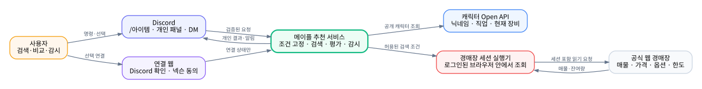
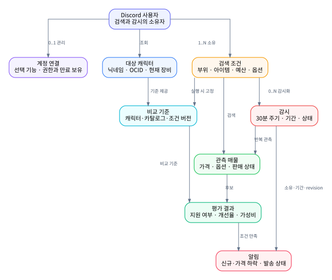
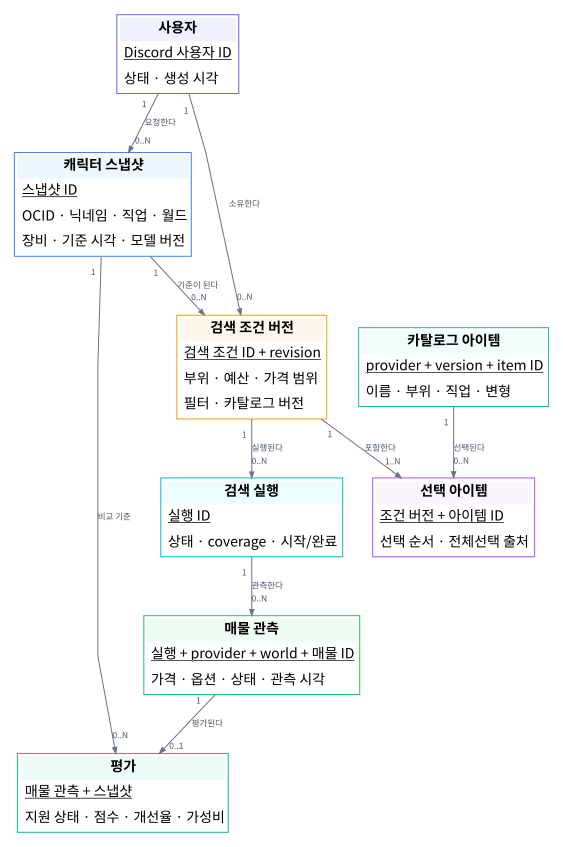
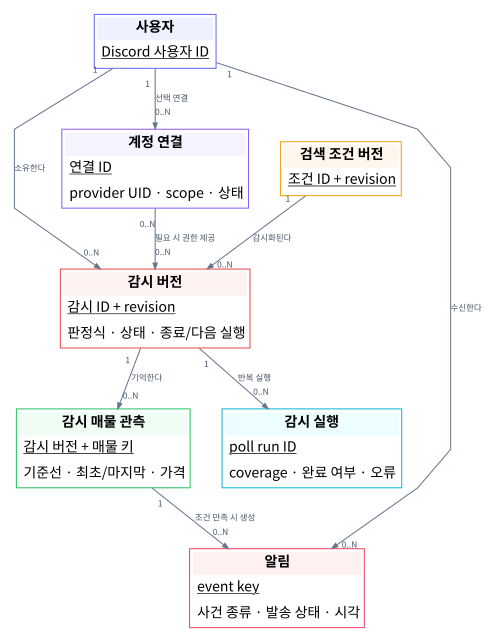
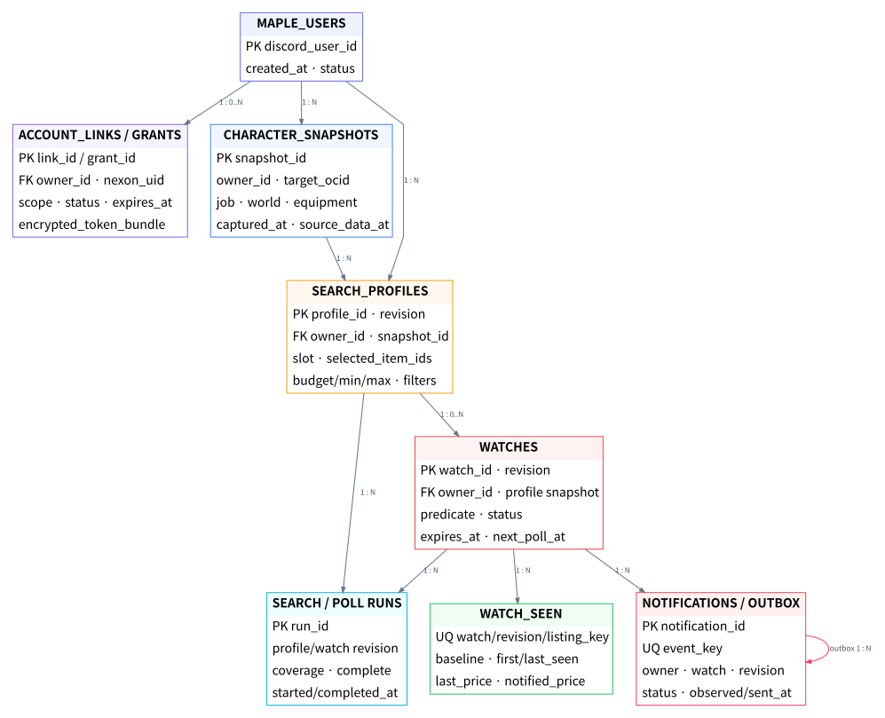
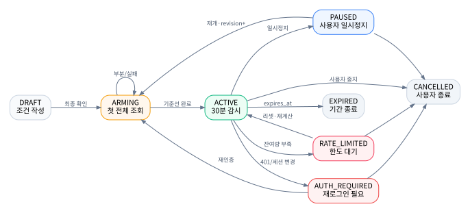

<section class="cover">
  <div class="eyebrow">DIS · MAPLE MARKET DESIGN</div>
  <h1>장비를 사기 전에<br>계산과 기다림을 대신한다</h1>
  <p class="subtitle">메이플 경매장 매물 비교·30분 감시 서비스<br>요구사항 · 개념설계 · 화면설계 · 논리설계</p>
  <div class="cover-rule"></div>
  <div class="cover-grid">
    <div><span>문서 상태</span><strong>개념·논리 설계 기준본</strong></div>
    <div><span>현재 단계</span><strong>로컬 프로토타입 · 실제 계정 검증 전</strong></div>
    <div><span>작성 기준</span><strong>2026-11-03</strong></div>
    <div><span>대상 프로젝트</span><strong>som141 / DIS</strong></div>
  </div>
  <p class="cover-note">이 문서는 구현 완료 보고서가 아니다. 확인한 코드·가상 테스트와 앞으로 만들 서비스를 구분해 기록한다.</p>
</section>

<div class="page-break"></div>

# 문서 안내

## 개념설계와 논리설계는 무엇이 다른가

둘의 차이는 상세함의 정도보다 **대답하는 질문**에 있다.

| 구분 | 대답하는 질문 | 이 서비스의 예 | 이 단계에서 정하지 않는 것 |
| --- | --- | --- | --- |
| 요구사항 | 사용자는 어떤 불편을 겪고 무엇을 받아야 하는가 | “30억 전후 장갑 중 현재 장비보다 나은 매물을 찾고, 3일 동안 새 매물을 알려 달라” | 데이터 구조와 배포 방식 |
| 개념설계 | DBMS와 무관하게 어떤 엔터티·관계·속성·도메인·식별자가 필요한가 | 사용자·캐릭터·검색 조건·매물·감시·알림의 ER/EER 모델과 참여·카디널리티 | 관계 테이블 변환, 인덱스, 저장 구조 |
| UI 설계 | 사용자가 어떤 순서와 화면으로 그 개념을 조작하는가 | `/아이템` → 부위·예산 선택 → 결과 비교 → 감시 설정 → DM | DB 조인과 서버 배치 수 |
| 논리설계 | ER 모델을 관계 모델로 어떻게 변환·정규화하고 무결성을 보장할 것인가 | 관계 스키마, PK·FK·UQ, 1NF~3NF 검증, 사용자 뷰와 트랜잭션 검증 | 인덱스 선택, 파일 배치, 파티션·테이블스페이스 |
| 물리설계 | 목표 DBMS에서 어떤 저장 구조와 접근 경로로 구현할 것인가 | PostgreSQL 자료형·인덱스·파티션, 저장 용량, 배치와 성능 튜닝 | 서비스 목적과 업무 규칙 |

개념설계에서는 `사용자 1명은 0개 이상의 감시를 소유한다`는 관계와 감시의 속성·식별자를 ER 모델로 표현한다. 논리설계에서는 이를 `WATCH`, `WATCH_REVISION`, `WATCH_PREDICATE` 관계로 변환하고 PK·FK·정규형·무결성 제약을 검증한다. PostgreSQL 자료형과 인덱스는 물리설계에서 확정한다.

<div class="callout accent">
  <strong>이 문서의 범위</strong>
  요구사항, 개념설계, 화면설계, 논리설계까지 확정한다. 물리설계는 실제 계정 검색과 호출 한도를 검증한 뒤 별도 문서에서 정한다.
</div>

## 목차

1. 서비스 정의 — 무엇을 대신하고 무엇을 약속하지 않는가
2. 요구사항 — 기능 F01~F16과 품질 조건
3. 개념설계 — 사용자·캐릭터·검색·매물·감시의 관계
4. UI 설계 — Discord와 연결 웹에서의 실제 대화 흐름
5. 논리설계 — 데이터, 상태, 계산, 중복 방지, 권한
6. 검증 설계 — 요구사항 추적과 출시 전 확인 항목
7. 현재 구현과 발전 계획 — 프로토타입과 목표 서비스의 간격

<div class="page-break"></div>

# 1. 서비스 정의

## 한 문장 목적

**경매장의 가격 목록을 ‘내 장비를 바꿀 가치가 있는가’라는 판단으로 바꾸고, 같은 검색을 반복하는 시간을 30분 감시로 대체한다.**

이 서비스는 최저가 검색기가 아니다. 사용자가 정한 캐릭터의 현재 장비를 기준으로 후보 매물을 비교하고, 계산 가능한 범위와 계산하지 못한 범위를 함께 보여 주는 의사결정 보조 도구다.

## 해결하려는 장면

사용자가 30억 메소의 장갑을 찾는다고 가정한다. 경매장에는 가격, 스타포스, 잠재, 에디셔널, 추가옵션이 제각각인 매물이 섞여 있다. 25억 매물이 싸 보여도 현재 장비보다 나쁘면 살 이유가 없고, 38억 매물이 더 강해도 개선량 대비 가격이 낮을 수 있다. 괜찮은 매물이 없으면 사용자는 다음 날 같은 조건을 다시 입력한다.

서비스가 대신할 일은 세 가지다.

1. **조건 정리:** 캐릭터, 부위, 아이템, 예산 ±30%, 추가 옵션을 하나의 검색 조건으로 고정한다.
2. **교체 비교:** 후보 장비로 바꿨을 때의 모델 개선율과 1억 메소당 개선량을 같은 기준으로 계산한다.
3. **반복 관측:** 최초 결과는 기준선으로만 저장하고, 이후 처음 발견한 조건 충족 매물만 알린다.

## 사용자에게 돌려주는 결과

| 결과 | 사용자가 알 수 있는 것 |
| --- | --- |
| 검색 결과 | 가격·수량·월드·판매 상태·스타포스·잠재·에디·추옵과 관측 시각 |
| 개인 비교 | 현재 장비 100점 기준 교체점수, 개선율, 1억당 개선량, 비교 슬롯 |
| 계산 불가 표시 | 키 없음, 모델 미지원, 착용 불가, 원천 데이터 부족 등 구체적 사유 |
| 감시 상태 | 다음 확인 시각, 마지막 정상 조회, 남은 기간, 인증·한도·오류 상태 |
| 알림 | 처음 발견한 시각, 검색 조건, 가격, 개선율, 가성비, 중지·관리 진입점 |

## 하지 않는 일

- 자동 구매·입찰·판매
- 품절 전 구매 가능 보장
- 모든 매물을 빠짐없이 실시간 감지한다는 약속
- 환산주스탯 내부 공식 또는 템환산과 동일하다는 표현
- AI가 근거 없이 “좋은 매물”을 자유 판단하는 방식
- 사용자의 넥슨 비밀번호·OTP·로그인 쿠키를 Discord에서 수집하는 방식
- 개인 브라우저 프로필 하나를 여러 Discord 사용자가 공유하는 방식

## 성공을 판단하는 기준

초기 성공은 이용자 수가 아니라 **판단 가능성과 반복 가능성**으로 본다.

- 동일 입력에서 동일한 교체 점수가 나온다.
- 공식 화면과 검색 결과의 핵심 필드가 일치한다.
- 지원하지 않는 계산을 0점이나 추천으로 표시하지 않는다.
- 첫 조회의 기존 매물은 알림으로 쏟아지지 않는다.
- 같은 매물·같은 사건은 논리적으로 한 번만 알림 후보가 된다.
- 사용자가 감시를 중지하거나 연결을 해제하면 대기 알림도 중단된다.
- 30분 감시가 실제 제공자 한도 안에서 가능한지 수치로 설명할 수 있다.

<div class="page-break"></div>

# 2. 요구사항 수집과 확정

## 조사 방법과 근거

수업 자료의 사실 수집 방법인 인터뷰, 기존 문서 조사, 작업 관찰, 연구를 이 프로젝트에 맞게 적용했다. 한 사람의 희망 기능만 바로 데이터 모델로 옮기지 않고, 실제 경매장 사용 과정과 외부 계약을 함께 확인했다.

| 방법 | 이번 프로젝트에서 확인한 것 | 남은 한계 |
| --- | --- | --- |
| 사용자 인터뷰 | 캐릭터명 기준 검색, 부위·아이템 전체 선택, 예산 ±30%, 30분 감시, Discord 밖의 로그인 요구 | 현재 주 사용자가 1명이므로 다른 직업·월드 사용자의 용어 차이를 추가 확인해야 함 |
| 기존 시스템·문서 역공학 | DIS gateway/worker, 로컬 프로토타입, 경매장 공개 JS·참고 구현, 기존 기능·기술 명세 | 내부 웹 인터페이스는 공식 외부 계약이 아니며 변경될 수 있음 |
| 작업 관찰 | 경매장 조건 입력 → 후보 옵션 비교 → 반복 검색이라는 실제 작업 흐름 | 실제 계정 로그인 뒤 검색·한도 차감·30분 신규 매물 관찰은 미완료 |
| 공식 자료 조사 | 공개 캐릭터 API, Open ID의 UID·scope·토큰 수명, 공개 경매장 화면의 한도 안내 | Open ID 승인과 경매장 검색 권한은 별도이며 서버 상시 조회 허용 범위 미확정 |
| 프로토타이핑 | Windows 확장·Docker 브라우저, 검색·계산·감시 UI와 fixture 전체 흐름 | 가상 응답 성공을 실제 계정 성공으로 볼 수 없음 |

## 업무 사례·범위·이해관계자

| 항목 | 결정 |
| --- | --- |
| 정당성 | 여러 옵션을 사람이 반복 비교하는 비용과 같은 조건을 다시 검색하는 시간을 줄인다 |
| 직접 수혜자 | 자기 캐릭터의 장비 교체 후보를 찾는 Discord 사용자 |
| 운영 이해관계자 | DIS 운영자, Discord gateway 관리자, 외부 API·경매장 provider |
| 불리할 수 있는 대상 | 알림을 절대적 구매 조언으로 오해하는 사용자. 이를 막기 위해 모델 범위와 관측 시각을 표시 |
| 초기 범위 | 읽기 전용 검색, 독립 교체 모델, 일회성 비교, 조건 하나의 30분 감시, 개인 알림 |
| 범위 밖 | 자동 구매·판매, 무제한 다중 조건, 환산 내부 공식 복제, 실시간 전체 시장 수집 |
| 예상 규모 | 지인 약 30명의 DIS에서 소규모 검증 후 확장 여부 판단. 실제 감시 수는 provider 한도로 결정 |
| 응답·처리 목표 | Discord 초기 ACK 3초, 검색은 비동기, 정상 관측 뒤 알림 처리 p95 60초 목표 |
| 외부 인터페이스 | Discord interaction/DM, 연결 웹, Nexon 캐릭터 Open API, Open ID, 공식 웹 경매장 세션 |
| 수명과 변화 | 내부 경매장 요청·카탈로그·직업별 모델 변경 가능성이 크므로 provider와 모델 버전을 데이터에 포함 |

## 데이터 요구사항

- 요청자 Discord 계정과 비교 대상 캐릭터를 서로 다른 식별자로 보관한다.
- 캐릭터 snapshot은 OCID, 직업, 월드, 현재 장비, 수집 시각과 원천 기준 시각을 포함한다.
- 검색 조건은 부위, 카탈로그 버전, 선택 아이템 집합, 예산 범위, 추가 필터와 revision을 보존한다.
- 매물 관측은 provider scope, 월드, 안정적인 매물 식별자, 가격, 수량, 판매 상태, 옵션, 관측 시각과 coverage를 포함한다.
- 감시는 검색 조건의 특정 revision, 판정식, 시작·종료·다음 실행 시각, 상태와 기준선을 보존한다.
- 알림은 어떤 감시와 매물 사건에서 만들어졌는지, 발송 결과가 성공·차단·불명 중 무엇인지 남긴다.
- 연결 정보는 Discord 사용자, provider UID, 실제 동의 scope, 만료·철회 상태를 보존하되 비밀 원문을 일반 로그에 남기지 않는다.

## 처리 요구사항과 사용자 트랜잭션

| ID | 사용자 트랜잭션 | 유형 | 주요 데이터 | 예상 빈도·응답 목표 |
| --- | --- | --- | --- | --- |
| T01 | 닉네임으로 캐릭터 확인 | 조회 | 사용자, 캐릭터 snapshot | 명령 시작마다, 초기 ACK 3초 이내·조회는 비동기 |
| T02 | 계정 연결·갱신·해제 | 혼합 | 계정 연결, grant, scope | 드물게, 일회용 링크 5분 |
| T03 | 검색 조건 작성·수정 | 갱신 | 검색 프로필, 선택 아이템, 필터 | 검색마다, 화면 조작 즉시 반영 |
| T04 | 매물 검색·교체 평가 | 혼합 | search run, listing, evaluation | 사용자 요청 시, coverage와 외부 지연 표시 |
| T05 | 감시 시작 | 갱신 | watch, revision, predicate, baseline run | 사용자 확인 시 1회 |
| T06 | 정기 감시 실행 | 혼합 | poll run, listing, watch seen | 감시당 기본 30분, 하루 48회 |
| T07 | 감시 일시정지·재개·종료 | 갱신 | watch status, revision | 사용자 요청 즉시, 발송 직전 재검사 |
| T08 | 신규 매물 알림 발송 | 혼합 | notification, outbox, inbox | 적합 사건 발생 시, 관측 뒤 p95 60초 목표 |
| T09 | 감시·알림 내역 조회 | 조회 | watch, last poll, notification | 사용자가 관리 화면을 열 때 |

개념 모델은 T01~T09가 필요로 하는 데이터를 빠짐없이 표현해야 하고, 논리 모델은 각 트랜잭션이 PK·FK와 무결성 제약을 깨지 않고 수행되는지 검증해야 한다.

## 사용자가 직접 정한 조건

| 요구 | 설계에 반영한 내용 |
| --- | --- |
| 캐릭터 이름을 `/아이템`에 넣는다 | 명령의 필수 문자열 `캐릭터`를 OCID로 고정하고 이후 화면에서 다시 입력시키지 않는다 |
| 부위와 해당 아이템을 전부 선택할 수 있어야 한다 | 부위 선택, 다중 선택, 전체 선택, 선택 수 표시와 페이지 간 선택 유지 |
| 예산 주변 매물을 보고 싶다 | 기준 예산의 70~130%를 포함 경계로 계산하고 실제 범위를 화면에 표시 |
| 추가 옵션을 고른다 | 스타포스·잠재 등급·주요 옵션을 구조화 필터로 처리하고 미지원 조건을 숨기지 않는다 |
| 일정 기간 좋은 매물이 나오면 알린다 | 1/3/7일, 기본 30분, 첫 결과 기준선, 신규 매물 중복 억제 |
| API 키를 Discord 채팅에 쓰고 싶지 않다 | 공개 조회는 서비스 키, 선택 계정 연결은 별도 웹, 비밀 값은 Discord 컴포넌트에 넣지 않음 |
| 넥슨 로그인과 Discord 계정을 연결하고 싶다 | 승인 가능한 NEXON Open ID와 Discord OAuth를 별도 웹에서 연결하는 목표 설계 |
| AI 분석도 고려한다 | 점수·필터·가격 비교가 먼저이며 AI는 상위 후보 설명과 질의응답만 보조 |

## 기능 요구사항

| ID | 기능 | 완료 기준 |
| --- | --- | --- |
| F01 | 연결 시작 | `/메이플 연결` 또는 `/api`에서 5분 유효 일회용 웹 링크를 본인에게만 표시 |
| F02 | Discord 본인 확인 | 웹 Discord OAuth ID와 링크를 발급받은 요청자 ID가 다르면 연결 거절 |
| F03 | 넥슨 계정 연결 | 승인된 Open ID 동의 뒤 UID·실제 scope·만료 정보를 확인하고 토큰을 암호화 저장 |
| F04 | 연결 관리 | 상태 확인, 재동의, 연결 해제, refresh 회전, 철회 시 의존 작업 중지 |
| F05 | 닉네임 기준 조회 | `/아이템 캐릭터:닉네임`으로 OCID·직업·월드·현재 장비 snapshot 조회 |
| F06 | 부위·아이템 선택 | 착용 가능한 카탈로그, 다중 선택, 전체 선택·해제, 25개 초과 페이지 선택 유지 |
| F07 | 예산 범위 | B의 `ceil(0.7B)`~`floor(1.3B)` 포함 검색, 엄격 상한 선택 시 범위 재표시 |
| F08 | 추가 조건 | 지원된 스타포스·잠재·에디·옵션 필터, 미지원 조건은 오류 또는 안내 |
| F09 | 검색·비교 결과 | 판매 상태·가격·옵션·관측 시각과 지원 후보의 점수·개선율·가성비 제공 |
| F10 | 기간 감시 등록 | 1/3/7일 중 하나, 최종 조건·종료 시각·예상 주기를 확인한 뒤 활성화 |
| F11 | 좋은 매물 판정 | 공통 하드 필터와 사용자가 정한 개선율·가성비 임계값의 AND 규칙 |
| F12 | 신규 매물 알림 | 첫 전체 조회는 기준선, 이후 처음 관측한 적합 매물만 알림 후보로 생성 |
| F13 | 감시 관리 | 목록, 일시정지, 재개, 수정, 종료, 마지막 정상 조회와 지연 이유 표시 |
| F14 | 개인 수신함 | DM 성공·차단·불명 상태와 알림 내역 제공, 공개 채널 자동 대체 금지 |
| F15 | 대상 캐릭터 고정 | 요청자 ID와 대상 OCID를 분리 저장하고 다른 검색이 기존 감시 대상을 변경하지 않음 |
| F16 | 내 캐릭터 확인 | 동의받은 계정 캐릭터 목록에 대상 OCID가 있을 때만 ‘내 캐릭터’로 표시 |

## 품질 요구사항

| 분류 | 요구사항 |
| --- | --- |
| 보안 | 비밀번호·OTP·쿠키 미수집, 토큰 암호화, 로그 비밀 제거, 사용자별 세션·결과 격리 |
| 일관성 | 검색 조건과 캐릭터 snapshot을 revision으로 고정하고 지연된 이전 결과를 폐기 |
| 중복 방지 | 감시 revision과 매물 ID를 포함한 고유키, 알림과 Outbox의 원자 저장 |
| 설명 가능성 | 점수 산식·필터 통과 이유·미지원 사유·데이터 시점을 결과에 표시 |
| 실패 표현 | 0건, 부분 조회, 인증 실패, 한도 대기, 제공자 장애를 서로 다른 상태로 제공 |
| 시간 | 정상 관측 뒤 DM 처리 목표 p95 60초. 등록부터 관측은 기본 0~30분+외부 지연 |
| 한도 | 조건 1개 48회/일을 기본으로 최초·수동·재시도 비용까지 계산해 사전 차단 |
| 회귀 | JDA·gateway 변경 뒤 기존 음악·음성·주식 명령의 응답 흐름을 다시 검증 |

## 외부 조건과 확인되지 않은 부분

<div class="callout warning">
  <strong>설계상의 결론</strong>
  Open ID 연결 성공을 경매장 검색 권한 성공으로 간주하지 않는다. 경매장 capability가 확인되지 않으면 검색·감시는 비활성화하고 공개 캐릭터 분석만 제공한다.
</div>

공개 캐릭터 API와 경매장 검색은 같은 권한이 아니다.

- 닉네임·OCID·공개 장비 조회는 서비스 소유 Nexon Open API 키를 쓰는 목표 설계다.
- 선택 계정 연결은 NEXON Open ID 승인·scope·토큰에 종속된다. 로그인이 개인 API 키를 자동 발급하지 않는다.
- 경매장 검색은 조사한 공개 Open API 명세에 없었다. 현재 프로토타입은 로그인된 공식 경매장 페이지의 내부 요청을 사용한다.
- 공식 화면에서 검색은 하루 최대 100회 안내가 관찰됐지만 집계 경계, 검색 키 수명, GET 갱신 의미는 실제 계정 검증이 남았다.

<div class="page-break"></div>

# 3. 개념설계

## 서비스 경계

{.diagram}

Discord는 명령과 개인 결과를 전달하는 입구다. 연결 웹은 선택 계정 연결만 담당한다. 메이플 추천 서비스는 캐릭터 기준·검색 조건·평가·감시를 소유한다. 캐릭터 Open API와 경매장 세션 실행기는 서로 다른 외부 capability로 취급한다.

## 핵심 개념과 관계

{.diagram .tall}

| 개념 | 책임 | 다른 개념과의 관계 |
| --- | --- | --- |
| Discord 사용자 | 검색·감시·알림의 소유자 | 여러 검색 조건과 감시를 소유하며 선택적으로 계정을 연결 |
| 대상 캐릭터 | 비교의 기준 | 공개 닉네임으로 조회되며 요청자·넥슨 UID와 다른 식별자 |
| 계정 연결 | 본인 확인과 동의 데이터 접근 | 선택 기능이며 scope·만료·철회 상태를 가짐 |
| 검색 조건 | 부위·아이템·예산·옵션 묶음 | 실행 시 캐릭터·카탈로그 버전과 함께 고정 |
| 관측 매물 | 외부에서 읽은 후보 | 가격·옵션·판매 상태·관측 시각을 가짐 |
| 평가 결과 | 현재 장비 대비 판단 | 지원 여부, 개선율, 가성비와 탈락 이유를 가짐 |
| 감시 | 검색 조건의 기간 반복 | 상태·다음 실행·종료 시각과 기준선을 가짐 |
| 알림 | 조건을 만족한 사건 | 신규·가격 하락 사건과 발송 상태를 가짐 |

## 개념 ER 모델

검색·평가와 감시·알림을 한 장에 억지로 넣지 않고 두 사용자 뷰로 나눠 작성한 뒤 같은 `사용자`, `검색 조건 버전`을 기준으로 통합했다. 이는 수업 자료의 view integration 접근을 적용한 것이다.

### 검색·평가 사용자 뷰

{.diagram .erd}

### 감시·알림 사용자 뷰

{.diagram .erd}

`선택 아이템`은 검색 조건과 카탈로그 아이템의 N:M 관계에 선택 순서·전체 선택 출처가 붙으므로 연관 엔터티로 모델링했다. `평가`도 매물 관측과 캐릭터 snapshot 사이의 관계에 점수·지원 상태가 붙는 연관 엔터티다. `감시 매물 관측`은 감시 버전 없이는 존재할 수 없는 ID-의존 엔터티다.

## 엔터티 타입 사전

| ID | 엔터티 타입 | 정의·발생 시점 | 별칭 | 독립성 |
| --- | --- | --- | --- | --- |
| E01 | 사용자 | Discord에서 검색·감시를 소유하는 사람. 최초 명령 또는 연결 시 발생 | 요청자, owner | 독립 |
| E02 | 계정 연결 | 사용자와 외부 provider 계정 사이의 검증된 선택 연결 | account link, grant owner | 사용자 의존 |
| E03 | 캐릭터 스냅샷 | 특정 시점의 대상 캐릭터·직업·월드·현재 장비·모델 입력 | 비교 기준, character snapshot | 사용자와 OCID에 의존한 이력 |
| E04 | 카탈로그 아이템 | provider·카탈로그 버전 안에서 선택 가능한 장비 정의 | 상품, item variant | 기준 정보 |
| E05 | 검색 조건 버전 | 대상 캐릭터, 부위, 예산, 필터를 재현 가능한 한 묶음 | profile revision, query | 사용자·snapshot 의존 |
| E06 | 선택 아이템 | 한 검색 조건 버전에 포함된 카탈로그 아이템 | profile item | E05·E04에 ID-의존 |
| E07 | 검색 실행 | 검색 조건 버전으로 외부 매물을 읽은 한 번의 실행 | search run, poll result | E05에 의존한 사건 |
| E08 | 매물 관측 | 한 검색 실행에서 관측한 provider 매물의 상태 | listing observation | E07에 ID-의존 |
| E09 | 평가 | 한 매물을 한 캐릭터 snapshot 기준으로 비교한 결과 | score, comparison | E08·E03 연관 엔터티 |
| E10 | 감시 버전 | 검색 조건을 기간·판정식과 함께 반복 실행하는 버전 | watch revision | 사용자·E05 의존 |
| E11 | 감시 실행 | 감시 스케줄러가 수행한 한 회차 | poll run | E10에 의존한 사건 |
| E12 | 감시 매물 관측 | 감시 버전에서 매물 키를 기준선·신규·가격변경으로 기억 | watch seen | E10에 ID-의존 |
| E13 | 알림 | 조건을 만족한 매물 사건과 개인 발송 상태 | notification, inbox item | E10·E12에 의존한 사건 |

## 관계 타입·다중성·참여

| 관계 | 부모 쪽 | 자식 쪽 | 참여·업무 의미 |
| --- | ---: | ---: | --- |
| 사용자가 계정 연결을 관리한다 | 사용자 1 | 연결 0..N | 선택 관계. 공개 닉네임 조회는 연결 없이 가능 |
| 사용자가 캐릭터 snapshot을 요청한다 | 사용자 1 | snapshot 0..N | snapshot은 요청 소유자가 반드시 존재 |
| 사용자가 검색 조건을 소유한다 | 사용자 1 | 조건 0..N | 조건은 반드시 한 사용자 소유 |
| snapshot이 검색 조건의 기준이 된다 | snapshot 1 | 조건 0..N | 조건 버전은 정확히 한 snapshot을 사용 |
| 검색 조건이 선택 아이템을 포함한다 | 조건 1 | 선택 1..N | 빈 선택 집합으로 검색 실행 불가 |
| 카탈로그 아이템이 선택된다 | 아이템 1 | 선택 0..N | 선택은 정확히 한 카탈로그 항목 참조 |
| 검색 조건이 실행된다 | 조건 1 | 실행 0..N | 실행은 조건의 revision을 반드시 고정 |
| 검색 실행이 매물을 관측한다 | 실행 1 | 관측 0..N | 결과 0건은 정상적인 발생 |
| 매물 관측이 평가된다 | 관측 1 | 평가 0..1 | 모델 미지원도 평가 상태로 남기며 점수는 null 가능 |
| 검색 조건이 감시화된다 | 조건 1 | 감시 0..N | 한 조건에서 기간·임계값이 다른 감시 생성 가능 |
| 감시가 정기 실행된다 | 감시 1 | 실행 0..N | ARMING 전에는 0회일 수 있음 |
| 감시가 매물을 기억한다 | 감시 1 | 관측 기억 0..N | 기준선 완료 후 누적 |
| 감시 매물 관측이 알림을 만든다 | 관측 기억 1 | 알림 0..N | 신규·가격 하락 등 서로 다른 사건 가능 |

## 주요 속성·도메인

개념설계의 도메인은 특정 DBMS 자료형이 아니라 허용 값의 의미와 범위다.

| 엔터티 | 속성 | 도메인·제약 |
| --- | --- | --- |
| 사용자 | Discord 사용자 ID | 양의 64비트 snowflake를 손실 없이 표현하는 식별자 문자열 |
| 계정 연결 | provider UID | provider가 발급한 불변 사용자 식별자. 캐릭터 OCID와 혼용 금지 |
| 계정 연결 | 상태 | `CONNECTED / REFRESHING / REAUTH_REQUIRED / REVOKED` |
| 캐릭터 snapshot | OCID | 공개 캐릭터 API가 반환한 캐릭터 식별자 |
| 캐릭터 snapshot | 기준 시각 | UTC instant. 수집 시각과 원천 데이터 기준 시각을 분리 |
| 검색 조건 버전 | 예산·최소·최대 가격 | 1 이상의 메소 정수, 최소≤최대, 오버플로 금지 |
| 검색 조건 버전 | revision | 조건 ID 안에서 1부터 단조 증가하는 양의 정수 |
| 검색 실행 | coverage | `COMPLETE / PARTIAL / UNKNOWN` |
| 매물 관측 | 매물 키 | provider scope·world·listing ID의 합성 식별 값 |
| 매물 관측 | 판매 상태 | `ACTIVE / SOLD / EXPIRED / UNKNOWN` |
| 평가 | 지원 상태 | `SUPPORTED / UNSUPPORTED / INVALID_INPUT / SOURCE_INCOMPLETE` |
| 평가 | 점수·개선율·가성비 | 지원 상태가 SUPPORTED일 때만 유효한 정밀 수치 |
| 감시 | 상태 | `DRAFT / ARMING / ACTIVE / PAUSED / AUTH_REQUIRED / RATE_LIMITED / EXPIRED / CANCELLED` |
| 감시 | 기간 | 시작<종료, 사용자 선택 1/3/7일을 UTC instant로 변환 |
| 알림 | 발송 상태 | `PENDING / CLAIMED / SENT / BLOCKED / UNKNOWN / FAILED / CANCELLED` |

## 식별자·후보키·대체키

| 엔터티 | 주 식별자 | 추가 후보키 또는 대체키 |
| --- | --- | --- |
| 사용자 | Discord 사용자 ID | 없음 |
| 계정 연결 | 연결 ID | 활성 범위의 `(사용자, provider, client, provider UID)` |
| 캐릭터 snapshot | snapshot ID | 동일 수집을 식별할 `(요청자, OCID, 수집 시각, 모델 버전)` 후보 |
| 카탈로그 아이템 | `(provider, catalog version, item ID, variant ID)` | provider가 보장하는 경우 정규 상품 코드 |
| 검색 조건 버전 | `(profile ID, revision)` | 없음 |
| 선택 아이템 | `(profile ID, revision, catalog item 식별자)` | 없음 |
| 검색 실행 | run ID | idempotency key가 있으면 대체키 |
| 매물 관측 | `(run ID, provider scope, world, listing ID)` | 없음 |
| 평가 | `(매물 관측, snapshot ID, model version)` | 없음 |
| 감시 버전 | `(watch ID, revision)` | 생성 요청 idempotency key |
| 감시 매물 관측 | `(watch ID, revision, provider scope, world, listing ID)` | 없음 |
| 알림 | notification ID | 사건의 의미를 나타내는 `event key` |

## EER 적용과 중복 검사

- 연결 credential은 Open ID grant와 경매장 세션 참조가 서로 다른 속성·수명을 갖는다. 물리 상속을 강제하지 않고 `인증 수단`의 역할을 공통 개념으로 두며 subtype 분리는 논리 변환 시 결정한다.
- 검색 실행과 감시 실행은 모두 외부 조회 사건이지만 시작 원인·소유 revision이 다르다. 하나의 엔터티로 합치면 선택적 속성이 늘어나므로 공통 속성만 상위 개념으로 보고 사용자 뷰에서는 분리한다.
- `사용자→검색 조건→감시`와 `사용자→감시` 관계가 중복처럼 보이지만 직접 소유자 관계는 권한 검사에 필요한 업무 사실이다. 단, 두 경로의 사용자가 불일치하지 못하도록 제약한다.
- 매물의 이름·옵션을 카탈로그 아이템과 자동 동일시하지 않는다. provider variant와 관측 당시 옵션이 다르기 때문이다.
- 파생 속성인 최소·최대 가격, 개선율, 가성비는 원본 예산·가격·모델 입력과 계산 버전을 함께 보존할 때만 저장 후보가 된다. 논리설계에서 재계산 가능성과 조회 비용을 다시 검토한다.

## 개념 모델의 사용자 트랜잭션 검증

| 트랜잭션 | 필요한 엔터티·관계 | 검증 결과 |
| --- | --- | --- |
| T01 캐릭터 확인 | 사용자→캐릭터 snapshot | 요청자와 대상 OCID를 분리해 표현 가능 |
| T03 검색 조건 작성 | 사용자→조건→선택 아이템, snapshot→조건 | 다중 선택과 조건 revision 표현 가능 |
| T04 검색·평가 | 조건→검색 실행→매물 관측→평가←snapshot | 0건·부분 수집·미지원 평가 표현 가능 |
| T05 감시 시작 | 조건→감시, 사용자→감시 | 소유권·기간·판정식과 기준선 준비 상태 표현 가능 |
| T06 정기 감시 | 감시→감시 실행, 감시→매물 관측 기억 | 회차와 장기 중복 기억을 분리 가능 |
| T08 알림 | 감시 매물 관측→알림→사용자 | 신규와 가격 하락을 별도 사건으로 표현 가능 |
| T02 연결 해제 | 사용자→계정 연결, 연결↔감시 의존 | grant가 필요한 감시만 중지하는 관계 필요 확인 |

## 개념 수준 사용자 흐름

```text
캐릭터 지정
  → 비교 기준 snapshot 생성
  → 부위·아이템·예산·옵션 선택
  → 매물 검색 및 정규화
  → 지원 후보 계산 / 미지원 후보 표시
  → 일회성 결과 확인
  → 선택 시 감시 조건과 기간 확정
  → 첫 전체 조회를 기준선으로 저장
  → 30분마다 새 관측
  → 처음 본 조건 충족 매물만 개인 알림
```

## 경계가 필요한 이유

요청자 Discord ID, 비교 대상 OCID, 넥슨 UID, 경매장 `characterId`는 서로 다른 의미다. 하나의 `userId` 필드로 합치면 다른 캐릭터를 내 캐릭터로 표시하거나, 한 사용자의 경매장 세션으로 다른 사용자의 감시를 실행할 수 있다. 개념설계 단계에서 네 식별자를 분리하는 것이 이후 권한 설계의 출발점이다.

<div class="page-break"></div>

# 4. UI 설계

## 화면 원칙

1. **명령은 입구일 뿐이다.** `/아이템` 한 줄에 모든 옵션을 넣지 않고 본인에게만 보이는 패널로 이어 간다.
2. **예산의 의미를 숫자로 다시 보여 준다.** “30억”을 입력하면 “21억~39억”을 바로 표시한다.
3. **점수보다 이유를 먼저 읽을 수 있게 한다.** 현재 장비 대비 변화, 지원 범위, 탈락 조건을 함께 보여 준다.
4. **실패를 빈 결과로 바꾸지 않는다.** 검색 0건, 인증 필요, 한도 대기, 부분 조회를 다른 문장과 상태로 표시한다.
5. **지연 알림은 interaction 응답이 아니다.** 30분 뒤 알림은 DM과 개인 수신함으로 보내며 만료된 interaction hook을 사용하지 않는다.

## S1 · `/아이템` 검색 패널

<div class="screen">
  <div class="screen-head"><span>매물 검색</span><em>본인에게만 표시</em></div>
  <div class="character"><b>에반이였솜</b><span>에반 · 스카니아 · 장비 기준 10/23 00:00</span></div>
  <div class="field"><label>부위</label><strong>장갑 ▾</strong></div>
  <div class="field"><label>아이템</label><strong>아케인셰이드 메이지글러브 외 2개 ▾</strong></div>
  <div class="actions"><button>해당 부위 전체 선택</button><button>선택 해제</button></div>
  <div class="budget"><span>기준 예산 <b>30억</b></span><strong>실제 검색 21억 ~ 39억</strong></div>
  <div class="actions primary"><button>예산 변경</button><button>추가 조건</button><button>매물 검색</button></div>
</div>

닉네임은 명령에서 받은 뒤 다시 입력시키지 않는다. 부위를 바꾸면 기존 부위의 선택을 새 부위에 적용하지 않는다. `전체 선택`은 현재 보이는 25개가 아니라 해당 필터의 카탈로그 snapshot 전체를 뜻한다.

## S2 · 결과 비교

<div class="screen">
  <div class="screen-head"><span>장갑 매물 18건</span><em>가격순 · 점수순 · 가성비순</em></div>
  <div class="result-card recommended">
    <div><b>아케인셰이드 메이지글러브</b><span class="tag">조건 충족</span></div>
    <strong class="price">25억</strong>
    <p>17성 · 레전드리 · 크뎀 16% · INT 9%</p>
    <div class="metrics"><span>교체점수 <b>105.16</b></span><span>개선 <b>+5.16%</b></span><span>가성비 <b>0.206/억</b></span></div>
    <small>현재 장갑과 교체 · 캐릭터 기준 10/23 · 매물 처음 확인 14:05</small>
  </div>
  <div class="result-card muted">
    <div><b>아케인셰이드 메이지글러브</b><span class="tag neutral">개인 점수 미지원</span></div>
    <strong class="price">22억</strong>
    <p>조건은 맞지만 계산 모델이 지원하지 않는 옵션 포함</p>
  </div>
  <div class="actions primary"><button>조건 수정</button><button>알림 설정</button></div>
</div>

“추천 1위”만 보여 주지 않는다. 계산 가능한 후보와 검색 조건에는 맞지만 계산하지 못하는 후보를 함께 구분한다. 일부 페이지만 읽었다면 `전체 18건`이 아니라 `수집 18건 · 전체 범위 미확인`으로 표시한다.

## S3 · 감시 설정

<div class="screen modal-screen">
  <div class="screen-head"><span>매물 알림 설정</span><em>최종 확인</em></div>
  <div class="field"><label>기간 알림</label><strong>사용</strong></div>
  <div class="field"><label>기간</label><strong>○ 1일 &nbsp; ● 3일 &nbsp; ○ 7일</strong></div>
  <div class="field"><label>최소 개선율</label><strong>4%</strong></div>
  <div class="field"><label>최소 가성비</label><strong>0.18점/억</strong></div>
  <div class="field"><label>알림 사건</label><strong>☑ 신규 매물 &nbsp; ☐ 10% 이상 가격 하락</strong></div>
  <div class="summary">21~39억 · 장갑 3종 · 30분 확인 · 11/06 14:00 KST 종료<br>제공자 한도·오류 시 다음 확인이 늦어질 수 있습니다.</div>
  <div class="actions primary"><button>취소</button><button>감시 시작</button></div>
</div>

감시 시작 전에 적용 범위, 선택 수, 판정 모드, 종료 시각, DM 상태를 다시 보여 준다. 점수 모델 미지원 후보는 개선율 입력을 받지 않고 스펙 조건 모드로 전환한다.

## S4 · 개인 알림

<div class="screen dm-screen">
  <div class="screen-head"><span>som-bot · 새 매물</span><em>DM</em></div>
  <h3>설정한 조건에 맞는 장갑을 처음 확인했습니다.</h3>
  <div class="dm-grid"><span>가격</span><b>25억 · 범위 21~39억</b><span>옵션</span><b>크뎀 16% · INT 9%</b><span>비교</span><b>105.16점 · +5.16%</b><span>가성비</span><b>0.206점/억</b></div>
  <p>처음 확인 14:05 KST · 남은 감시 2일 18시간</p>
  <div class="actions primary"><button>매물 원본 보기</button><button>감시 일시정지</button><button>알림 관리</button></div>
</div>

제공자가 등록 시각을 주지 않으면 “방금 등록”이 아니라 “처음 확인”이라고 쓴다. DM이 막히면 공개 채널에 대신 올리지 않고 개인 수신함에 `DELIVERY_BLOCKED`로 남긴다.

## 상태별 문장

| 상태 | 사용자에게 보여 줄 문장 | 시스템 행동 |
| --- | --- | --- |
| 결과 0건 | “조건에 맞는 판매 중 매물이 없습니다.” | 성공 조회로 기록, 빈 결과 저장 |
| 부분 조회 | “일부 페이지만 확인했습니다. 전체 순위가 아닙니다.” | coverage 표시, 기준선 완료 금지 |
| 인증 필요 | “경매장 로그인이 만료되었습니다.” | 검색 중단, 재연결 전 POST 금지 |
| 한도 대기 | “오늘 남은 검색량으로는 다음 확인을 실행할 수 없습니다.” | 리셋 뒤로 `next_poll_at` 이동 |
| 모델 미지원 | “옵션은 확인했지만 현재 모델로 교체 점수를 계산할 수 없습니다.” | 임의 0점 금지 |
| DM 차단 | “DM을 보내지 못해 개인 수신함에 보관했습니다.” | 공개 채널 fallback 금지 |

<div class="page-break"></div>

# 5. 논리설계

## 논리 데이터 모델

{.diagram .erd}

| 논리 엔터티 | 핵심 식별자 | 반드시 보존할 사실 |
| --- | --- | --- |
| `MAPLE_USERS` | `discord_user_id` | 검색·감시·알림의 소유자 |
| `ACCOUNT_LINKS`, `OAUTH_GRANTS` | `link_id`, `grant_id` | provider UID, 실제 scope, 만료, grant version, 암호화 토큰 bundle |
| `CHARACTER_SNAPSHOTS` | `snapshot_id` | 대상 OCID, 직업·월드·현재 장비, 수집·원천 기준 시각 |
| `SEARCH_PROFILES` | `profile_id`, `revision` | 대상 캐릭터, 카탈로그 버전, 선택 ID, 가격 범위, 필터와 인증 의존성 |
| `SEARCH_RUNS`, `POLL_RUNS` | `run_id` | 어떤 revision을 얼마나 완전하게 조회했는지, 시작·완료·오류 |
| `WATCHES` | `watch_id`, `revision` | 판정식, 상태, 시작·종료·다음 실행, 마지막 전체 성공 |
| `WATCH_SEEN` | 감시·revision·매물 고유키 | 기준선 여부, 최초·마지막 관측, 가격과 마지막 통지 가격 |
| `NOTIFICATIONS`, `OUTBOX_EVENTS` | `notification_id`, `event_key` | 사건, 소유자, payload, 발행·발송 상태, 불명 결과 |

## ER 모델에서 도출한 관계 스키마

표기법은 `관계명(속성...)`, **PK**, `FK→대상`, `UQ` 순서다. 여기서 `INTEGER`, `VARCHAR` 같은 목표 DBMS 자료형은 정하지 않고 개념 도메인을 유지한다.

### 사용자·연결·캐릭터

| 관계 | 속성과 키 |
| --- | --- |
| `MAPLE_USER` | **discord_user_id**, user_status, created_at |
| `ACCOUNT_LINK` | **link_id**, `discord_user_id FK→MAPLE_USER`, provider_code, client_code, provider_user_id, link_status, verified_at, disconnected_at, `UQ(discord_user_id, provider_code, client_code, provider_user_id)` |
| `OAUTH_GRANT` | **grant_id**, `link_id FK→ACCOUNT_LINK`, grant_version, credential_ref, grant_status, access_expires_at, refresh_expires_at, created_at, `UQ(link_id, grant_version)` |
| `GRANT_SCOPE` | **grant_id FK→OAUTH_GRANT, scope_code**, granted_at |
| `CHARACTER_SNAPSHOT` | **snapshot_id**, `request_owner_id FK→MAPLE_USER`, target_ocid, input_name, observed_name, world_code, job_code, captured_at, source_data_at, model_version |
| `EQUIPMENT_SNAPSHOT` | **snapshot_id FK→CHARACTER_SNAPSHOT, slot_code, slot_sequence**, equipped_item_ref, normalized_option_ref |

`GRANT_SCOPE`를 분리해 scope 집합을 쉼표 문자열 하나로 저장하지 않는다. 장비도 슬롯 반복 그룹이므로 `EQUIPMENT_SNAPSHOT`으로 분리한다.

### 카탈로그·검색·평가

| 관계 | 속성과 키 |
| --- | --- |
| `CATALOG_ITEM` | **provider_code, catalog_version, item_id, variant_id**, item_name, slot_code, job_code, active_flag |
| `SEARCH_PROFILE` | **profile_id**, `owner_id FK→MAPLE_USER`, target_ocid, created_at, profile_status |
| `SEARCH_PROFILE_VERSION` | **profile_id FK→SEARCH_PROFILE, revision**, `snapshot_id FK→CHARACTER_SNAPSHOT`, provider_code, catalog_version, slot_code, budget_meso, min_price_meso, max_price_meso, strict_cap_flag, created_at |
| `SEARCH_PROFILE_ITEM` | **profile_id, revision, provider_code, catalog_version, item_id, variant_id**, selected_order, selection_source, `FK→SEARCH_PROFILE_VERSION`, `FK→CATALOG_ITEM` |
| `SEARCH_FILTER` | **profile_id, revision, filter_code, filter_sequence**, operator_code, numeric_value, text_value, unit_code, `FK→SEARCH_PROFILE_VERSION` |
| `SEARCH_RUN` | **run_id**, `profile_id/revision FK→SEARCH_PROFILE_VERSION`, run_type, run_status, coverage_status, started_at, completed_at, result_count, error_code, idempotency_key UQ |
| `LISTING_OBSERVATION` | **observation_id**, `run_id FK→SEARCH_RUN`, provider_scope, world_code, listing_id, item_id, variant_id, price_meso, quantity, sale_status, observed_at, end_at, `UQ(run_id, provider_scope, world_code, listing_id)` |
| `LISTING_OPTION` | **observation_id FK→LISTING_OBSERVATION, option_group, option_sequence**, option_code, numeric_value, text_value, grade_code |
| `LISTING_EVALUATION` | **observation_id FK→LISTING_OBSERVATION, snapshot_id FK→CHARACTER_SNAPSHOT, model_version**, support_status, compared_slot_code, score, improvement_rate, value_score, rejection_reason |

아이템 집합과 필터를 profile row의 배열·JSON 한 칸으로 끝내지 않는다. 선택과 조건을 관계로 분리해야 카탈로그 FK, 중복 선택 금지, 필터 단위 검증을 DB 수준에서도 표현할 수 있다.

### 감시·알림

| 관계 | 속성과 키 |
| --- | --- |
| `WATCH` | **watch_id**, `owner_id FK→MAPLE_USER`, watch_status, current_revision, created_at, cancelled_at |
| `WATCH_REVISION` | **watch_id FK→WATCH, revision**, `profile_id/profile_revision FK→SEARCH_PROFILE_VERSION`, `snapshot_id FK→CHARACTER_SNAPSHOT`, predicate_mode, starts_at, expires_at, next_poll_at, last_complete_poll_at, created_at |
| `WATCH_PREDICATE` | **watch_id, revision, predicate_code, predicate_sequence**, operator_code, threshold_numeric, unit_code, `FK→WATCH_REVISION` |
| `POLL_RUN` | **poll_run_id**, `watch_id/revision FK→WATCH_REVISION`, `search_run_id FK→SEARCH_RUN`, poll_status, complete_flag, started_at, completed_at, error_code |
| `WATCH_SEEN` | **watch_id, revision, provider_scope, world_code, listing_id**, baseline_flag, first_seen_at, last_seen_at, last_price_meso, last_notified_price_meso, `FK→WATCH_REVISION` |
| `NOTIFICATION` | **notification_id**, `owner_id FK→MAPLE_USER`, `watch_id/revision FK→WATCH_REVISION`, event_key UQ, event_type, provider_scope, world_code, listing_id, payload_ref, delivery_status, observed_at, created_at, sent_at |
| `OUTBOX_EVENT` | **outbox_id**, `notification_id FK→NOTIFICATION`, event_type, publish_status, attempts, next_attempt_at, published_at |

## 관계 변환 근거

- 1:N 관계는 N쪽에 부모 식별자를 FK로 이관했다. 예: `SEARCH_RUN.profile_id/revision`.
- N:M인 검색 조건–카탈로그 아이템은 `SEARCH_PROFILE_ITEM` 연관 관계로 변환했다.
- 다중값 속성인 grant scope, 선택 아이템, 필터, 장비 슬롯, 매물 옵션, 감시 predicate는 별도 관계로 변환했다.
- ID-의존 엔터티는 부모 식별자를 복합 PK에 포함한다. 예: `WATCH_SEEN`.
- 평가처럼 관계 자체가 속성을 갖는 경우 별도 관계 `LISTING_EVALUATION`으로 변환했다.
- 감시의 현재 상태와 과거 조건 버전을 모두 보존하기 위해 `WATCH`와 `WATCH_REVISION`을 분리했다.

## 정규화 검증

### 1NF

초기 요구를 한 행으로 표현하면 다음과 같은 반복 그룹이 생긴다.

```text
SEARCH_REQUEST(
  profile_id, character, budget,
  selected_item_1, selected_item_2, ...,
  filter_1, filter_2, ...,
  scope_1, scope_2, ...)
```

선택 아이템은 `SEARCH_PROFILE_ITEM`, 필터는 `SEARCH_FILTER`, scope는 `GRANT_SCOPE`로 분리했다. 모든 관계의 속성은 정의한 도메인 안에서 한 값을 갖는다.

### 2NF

`WATCH_SEEN`의 PK는 `(watch_id, revision, provider_scope, world_code, listing_id)`다. `first_seen_at`, `baseline_flag`, `last_price_meso`는 특정 감시 버전에서 특정 매물을 본 사실 전체에 의존한다. provider나 listing ID 일부에만 의존하는 아이템 이름·정적 카탈로그 정보는 저장하지 않고 카탈로그/관측 관계에서 얻는다.

`SEARCH_PROFILE_ITEM`의 `selected_order`, `selection_source`도 profile revision과 catalog item의 전체 복합키에 의존한다.

### 3NF·BCNF 점검

- `SEARCH_PROFILE_VERSION`에 닉네임·직업·월드를 복사하지 않고 `snapshot_id`로 참조한다. `snapshot_id → target_ocid, job, world`라는 이행 종속을 제거한다.
- `ACCOUNT_LINK`에 실제 scope와 토큰 만료를 반복 저장하지 않고 grant와 scope 관계로 분리한다.
- `NOTIFICATION`에 DM 재시도 횟수와 메시지 큐 발행 상태를 함께 누적하지 않고 `OUTBOX_EVENT`로 분리한다.
- `LISTING_OBSERVATION`의 후보키 `(run_id, provider_scope, world_code, listing_id)`가 관측 속성을 결정하며, surrogate `observation_id`를 쓰더라도 후보키 UQ를 유지한다.
- `event_key → notification_id와 사건 내용`이므로 `event_key`를 대체키로 강제한다.

현재 정의한 관계는 위 함수 종속 기준으로 3NF를 만족하도록 설계했다. 다만 provider별 원본 payload를 감사 목적으로 통째로 저장한다면 정규화된 업무 데이터와 분리된 원본 보관 관계로 다뤄야 한다.

## 무결성 제약

| 종류 | 제약 |
| --- | --- |
| 엔터티 무결성 | 모든 PK는 null 불가. Discord ID·OCID·listing ID의 의미를 교환하지 않음 |
| 참조 무결성 | 검색 조건의 owner와 snapshot 요청 owner가 일치. 감시 owner와 profile owner가 일치 |
| 도메인 무결성 | 가격>0, 최소≤최대, starts<expires, score는 SUPPORTED일 때만 존재 |
| 상태 전이 | CANCELLED·EXPIRED에서 ACTIVE로 직접 복귀 금지, 재개는 새 revision과 ARMING을 거침 |
| 기준선 | complete coverage인 첫 실행 전에는 baseline 완료 및 신규 알림 생성 금지 |
| 중복 | profile item, watch seen, notification event key에 각각 UQ 적용 |
| 권한 | 연결 해제 또는 grant version 변경 시 해당 인증 의존 감시의 이후 실행·발송 금지 |
| 시간 | DB 저장은 UTC, 사용자 표시만 KST. `처음 확인`을 원본 등록 시각으로 표현 금지 |

## 외부 스키마·사용자 뷰

| 뷰 | 사용자 | 포함 정보 | 제외 정보 |
| --- | --- | --- | --- |
| `MY_SEARCH_RESULT_VIEW` | Discord 요청자 | 본인 profile, 매물, 평가, coverage, 기준 시각 | 다른 사용자 owner·credential |
| `MY_WATCH_STATUS_VIEW` | Discord 요청자 | 상태, 다음/마지막 실행, 종료, 지연 사유 | token·cookie·provider 내부 ID 원문 |
| `MY_NOTIFICATION_INBOX_VIEW` | Discord 요청자 | 사건, 매물 요약, 발송 상태, 처음 확인 시각 | Outbox 내부 재시도 상세 |
| `OPERATION_WATCH_HEALTH_VIEW` | 운영자 | 집계된 상태·지연·오류·한도 | 개인 토큰, 전체 매물 옵션, DM 본문 |
| `CREDENTIAL_AUDIT_VIEW` | 제한된 관리자 | actor, action, result, credential reference | 비밀 원문과 전체 인증 헤더 |

## 관계 모델의 트랜잭션 검증

| 트랜잭션 | 읽는 관계 | 쓰는 관계 | 원자성·동시성 조건 |
| --- | --- | --- | --- |
| T03 조건 작성 | snapshot, catalog | profile/version/item/filter | profile revision 단위로 함께 확정 |
| T04 검색·평가 | profile version, snapshot | search run, observation, option, evaluation | 부분 수집은 COMPLETE로 바꾸지 않음 |
| T05 감시 시작 | profile version, grant 상태 | watch/revision/predicate | 첫 poll은 ARMING, 기준선 완료 뒤 ACTIVE |
| T06 정기 감시 | watch revision, quota | poll/search run, observation, watch seen | lease로 한 worker만 claim, 네트워크 중 DB TX 유지 금지 |
| T07 중지 | watch | watch 상태·revision | 발송 직전 상태 검사와 경합 가능성을 기록 |
| T08 알림 | watch seen, evaluation | notification + outbox | 같은 DB TX, event key UQ로 중복 억제 |
| T02 연결 해제 | link, grant, watch dependency | grant 상태, watch 상태, pending notification | 토큰 사용 차단이 삭제보다 먼저 수행 |

## 향후 성장 점검

- provider가 늘어나도 `provider_scope`와 capability를 분리해 같은 listing ID가 충돌하지 않는다.
- 새로운 판정 기준은 `WATCH_PREDICATE` 코드와 평가 모델 버전으로 추가하고 기존 감시를 조용히 변경하지 않는다.
- 가격 이력 분석이 필요하면 `LISTING_OBSERVATION`에서 관측 사건을 보존하고 현재 행 덮어쓰기를 피한다.
- 다중 사용자 운영 전에는 사용자별 감시 수·provider 한도를 별도 관계로 추가할 수 있다.
- 논리 모델은 검색 결과 원본 보관 기간과 개인정보 삭제 정책을 지원하지만 실제 파티션·인덱스·보관 매체는 물리설계에서 결정한다.

## 식별자와 소유권 규칙

| 식별자 | 의미 | 사용하면 안 되는 용도 |
| --- | --- | --- |
| Discord user ID | 요청·검색·감시·알림 소유자 | 캐릭터나 넥슨 계정 식별 |
| Nexon UID | 동의한 넥슨 계정 | 공개 캐릭터 OCID 대체 |
| OCID | 비교 대상 캐릭터 | 로그인 계정이나 경매장 내부 characterId 대체 |
| 경매장 account/character ID | 로그인된 웹 세션의 검색 기준 | 다른 닉네임의 개인 점수 기준 |
| listing ID | 제공자 범위 안의 매물 | provider·world 없이 전역 고유하다고 가정 |

모든 생성·수정 요청의 소유자는 검증된 Discord interaction 또는 웹 로그인 세션에서 얻는다. 요청 body의 `user_id`를 권한 근거로 사용하지 않는다.

## 핵심 계산 규칙

### 가격 범위

```text
입력: 기준 예산 B (메소 정수, B > 0)
기본 최소: ceil(B × 0.70)
기본 최대: floor(B × 1.30)
엄격 상한 사용 시 최대: B
경계는 모두 포함한다.
```

30억의 기본 범위는 21억~39억이다. “예산 30억”을 지출 상한 30억으로 오해하지 않도록 계산 직후 화면에 표시한다.

### 교체 점수와 가성비

```text
교체점수 = 100 × P_after / P_before
개선점수 = 교체점수 - 100
개선율(%) = 100 × (P_after / P_before - 1)
가성비 = 개선점수 / 가격(억 메소)
```

현재 장비가 100점이다. 현재 점수 자체를 가격으로 나누지 않는다. 원천 능력치가 부족하거나 모델이 지원하지 않으면 결과는 `UNSUPPORTED`이며 0이 아니다.

### 좋은 매물 판정

```text
공통 조건
= 올바른 provider scope·월드·부위·선택 아이템
  AND 가격 범위
  AND 추가 스펙 필터
  AND 판매 상태

개인 점수 모드
= 공통 조건 AND 모델 지원
  AND 개선율 ≥ 사용자 임계값
  AND 가성비 ≥ 사용자 임계값

스펙 조건 모드
= 공통 조건
```

AI 출력은 이 판정식의 입력이 아니다.

## 감시 상태 모델

{.diagram}

- `ARMING`의 첫 전체 조회는 기존 매물 기준선이다. 완료 전에는 신규 알림을 시작하지 않는다.
- 조건 수정, 캐릭터 snapshot 갱신, 재개는 `revision`을 올리고 새 기준선을 만든다.
- 지연된 이전 revision 결과는 최신 상태와 알림을 덮지 않는다.
- 놓친 회차를 따라잡기 위해 연속 호출하지 않는다.
- 인증 실패는 `AUTH_REQUIRED`, 잔여량 부족은 `RATE_LIMITED`로 분리한다.

## 30분 스케줄과 한도

정기 실행 간격은 다음 값 중 가장 긴 값에 backoff와 jitter를 더한다.

```text
max(30분, 제공자 최소 간격, 남은 한도로 계산한 필요 간격)
```

매 회차 새 검색 생성이 필요하면 조건 하나가 하루 48회를 사용한다. 관찰된 100회/일 안내를 기준으로 두 조건은 96회라 최초 검색·수동 검색·재시도 여유가 거의 없다. 따라서 감시 개수는 UI 요구가 아니라 실제 authorization scope의 잔여량으로 제한한다.

## 신규 판정과 중복 방지

```text
NEW event_key
= watch_id / revision / provider_scope / world / listing_id / NEW

PRICE_DROP event_key
= watch_id / revision / provider_scope / world / listing_id / price_revision
```

`event_key`는 논리적으로 유일해야 한다. 알림과 Outbox를 같은 트랜잭션에 저장하고, RabbitMQ의 at-least-once 전달 뒤에도 같은 사건을 다시 만들지 않는다. Discord가 메시지를 받았지만 응답이 유실되면 `DELIVERY_UNKNOWN`으로 남기며 맹목적으로 무한 재전송하지 않는다.

<div class="page-break"></div>

## 논리 명령과 사건

| 종류 | 이름 | 입력/결과 |
| --- | --- | --- |
| 명령 | `ResolveCharacter` | 닉네임 → OCID와 공개 snapshot |
| 명령 | `CreateSearchProfile` | 소유자·snapshot·선택 ID·예산·필터 → revision 1 |
| 명령 | `RunSearch` | profile/revision → coverage가 있는 검색 결과 |
| 명령 | `CreateWatch` | 최종 확인된 profile snapshot·기간·predicate → `ARMING` |
| 명령 | `ChangeWatchState` | 소유자·watch·expected revision·행동 → 새 revision/상태 |
| 사건 | `SearchCompleted` | 수집 범위·정규화 매물·오류 없이 완료된 시각 |
| 사건 | `ListingFirstObserved` | 감시 revision에서 처음 본 매물 |
| 사건 | `ListingMatched` | 하드 필터·판정식을 통과한 평가 결과 |
| 사건 | `NotificationQueued` | 고유 event key와 비밀 없는 payload |
| 사건 | `NotificationDeliveryChanged` | sent·blocked·unknown·failed 상태 변화 |

## 데이터 보존과 비밀 경계

- 로그인 쿠키를 일반 DB나 애플리케이션 로그로 복사하지 않는다.
- Open ID 토큰을 저장할 경우 access·refresh·각 만료와 grant version을 하나의 암호화 bundle로 관리한다.
- gateway와 DM 발송기는 토큰 복호화 권한을 갖지 않는다.
- 연결 해제는 토큰 사용을 먼저 차단하고 의존 감시·미발송 알림을 중지한 뒤 암호문을 삭제한다.
- 알림 payload에는 API 키, 토큰, 쿠키, 전체 인증 URL을 넣지 않는다.
- 과거 점수는 당시 snapshot과 모델 버전으로 설명할 수 있게 남긴다.

<div class="page-break"></div>

# 6. 검증 설계

## 요구사항 추적표

| 요구사항 | 개념·화면 반영 | 논리 규칙 | 검증 방법 |
| --- | --- | --- | --- |
| F01~F04 연결 | 연결 웹, 상태·해제 화면 | ticket 만료, expected Discord ID, grant version | 다른 ID, state 재사용, 만료, refresh 회전, 철회 테스트 |
| F05 캐릭터 | `/아이템 캐릭터`, 캐릭터 카드 | owner ID·Nexon UID·OCID 분리 | 닉네임 변경·없는 캐릭터·다른 계정 목록 대조 |
| F06 선택 | 부위·다중·전체 선택 | selected item ID snapshot·catalog version | 25개 초과, 페이지 이동, 부위 변경 테스트 |
| F07 예산 | 30억 → 21~39억 즉시 표시 | 정수 포함 경계·오버플로 거절 | 0·음수·최댓값·엄격 상한 경계값 테스트 |
| F08~F09 검색 | 추가 조건·결과 카드 | provider 정규화·coverage·UNSUPPORTED | 공식 화면 대조, 부분 페이지, 필드 누락 fixture |
| F10~F13 감시 | 감시 Modal·관리 화면 | 상태·revision·기준선·next poll·만료 | 실제 두 회차, 수정 경합, 재시작, 인증·한도 테스트 |
| F14 알림 | DM과 개인 수신함 | event key UNIQUE·Outbox·delivery state | 중복 소비, DM 차단, ACK 유실, 취소 경합 테스트 |
| F15~F16 대상 | 캐릭터 고정·내 캐릭터 표시 | owner/target/link 분리 | 다른 캐릭터 검색 후 기존 감시 불변 확인 |

## 현재 프로토타입에서 확인한 것

- 예산 ±30%, 에반 마력 축, 교체 계산, 가성비, 미지원 점수 처리
- 첫 기준선, 신규 매물, 중복 억제, 만료와 검색 한도 로직
- 외부 Origin·잘못된 Host·토큰 누락·페어링되지 않은 연결 거절
- 브라우저 쿠키와 Authorization 헤더를 Node 서버로 전달하지 않는 경계
- 구매·판매 요청과 임의 목적지 차단
- Docker의 Chromium·Xvfb·noVNC·Node 앱 실행과 healthcheck
- 가상 응답을 사용한 캐릭터 선택 → 장비 조회 → 검색 → 점수 → 두 번의 30분 감시 흐름
- 자동 테스트 18개 통과

## 실제 계정에서 아직 확인하지 못한 것

- Windows Docker Desktop에서 공식 로그인·OTP 이후 본인 캐릭터 응답
- 실제 경매장 검색 결과와 공식 화면의 ID·가격·옵션·판매 상태 일치
- 검색 생성 차감, 잔여량 집계 경계, searchKey 갱신·만료 의미
- `에반이였솜` 실제 장비와 모델 결과의 수동 대조
- 실제 30분 간격 두 회차와 신규 0건/신규 발견 기록
- 세션 만료, 다른 환경 로그인, 재로그인 뒤 감시 복구

## PDF 자체 검증 기준

- F01~F16이 빠짐없이 한 번 이상 정의되고 추적표에 묶여야 한다.
- 개념설계에 엔터티·관계·속성·도메인·후보/주/대체키·다중성·참여·중복 검사·트랜잭션 검증이 있어야 한다.
- 논리설계에 ER→관계 변환, PK·FK·UQ, 1NF~3NF 검증, 무결성 제약, 외부 뷰, 트랜잭션 검증과 향후 성장이 있어야 한다.
- 개념설계와 논리설계가 같은 내용을 이름만 바꿔 반복하지 않아야 한다.
- 현재 구현과 목표 설계 문장을 구분해야 한다.
- 공개 Open API, Open ID, 경매장 웹 세션을 같은 인증으로 표현하지 않아야 한다.
- 30억 범위·30분당 호출량·가성비 예시가 기존 명세와 일치해야 한다.
- PDF에서 한글 폰트, 표 머리글, 다이어그램과 화면 시안이 잘리지 않아야 한다.

<div class="page-break"></div>

# 7. 현재 구현과 발전 계획

## 프로토타입과 목표 서비스의 차이

| 영역 | 현재 개인용 프로토타입 | 목표 서비스 |
| --- | --- | --- |
| 실행 | Windows 확장 또는 Linux Docker 브라우저 | DIS와 연결 웹에서 여러 사용자가 접근 |
| 경매장 인증 | 사용자가 공식 탭에서 직접 로그인 | 사용자별로 격리된 허용 세션 capability |
| 캐릭터 API | 사용자가 로컬 화면에 키 입력, 메모리 보관 | 서비스 키 공개 조회 + 선택 Open ID 연결 |
| 검색·계산 | 아이템 이름 한 개와 한 페이지 조건 중심 | 다중 선택·coverage·지원 범위가 명시된 결과 |
| 감시 | 단일 조건, 메모리, 로컬 수신함 | 영구 저장, revision, 30분 작업, DM·개인 수신함 |
| 사용자 격리 | 개인 1명 전제 | 세션·조건·결과·할당량을 사용자별 분리 |
| 검증 | fixture 자동 테스트와 Docker 실행 | 실제 계정·실제 매물·장시간·부하·회귀 검증 |

## 단계별 발전 계획

| 단계 | 목표 | 다음 단계로 넘어가는 증거 |
| --- | --- | --- |
| P0 | 실제 계정으로 로컬 연결 | 실제 목록에서 `에반이였솜` 확인, 비밀 로그 없음 |
| P1 | 실제 검색 호환성 | 공식 화면과 주요 필드 일치, 인증 실패 후 추가 호출 없음 |
| P2 | 계산 정합성 | 단순 옵션 수동 대조, 미지원 범위 목록 |
| P3 | 실제 30분 감시 | 두 회차 시각·한도·기준선·중복 결과 기록 |
| P4 | 개인용 장기 실행 | 24시간, 재시작·세션 만료·계정 변경 복구 |
| P5 | DIS 검색·알림 | 비밀 값 없이 검색·감시·DM·중지 전체 흐름 |
| P6 | 추천 품질 | 평가 데이터와 가격 분포, 재계산 가능한 추천 이유 |
| P7 | 다중 사용자 운영 | 사용자 격리, 암호화, 할당량, 부하·운영 지표 |

## 설계를 바꾸어야 하는 조건

- 공식 정책이 현재의 주기 조회를 허용하지 않는다.
- 내부 요청 변경이 잦아 개인용으로도 유지 비용이 과도하다.
- 검색 한도로 30분 감시를 안정적으로 지원할 수 없다.
- 사용자별 로그인 세션을 안전하게 격리·폐기할 수 없다.
- 장비 모델 오차가 커서 같은 조건의 후보 비교에도 쓸 수 없다.

이 경우 경매장 자동 검색을 축소하고, 사용자가 선택한 매물 비교나 공개 캐릭터 장비 분석처럼 공식 Open API만 사용하는 기능으로 범위를 바꾼다.

## 발표용 결론

<div class="closing">
  <p>이 서비스의 핵심은 매물을 많이 모으는 데 있지 않다.</p>
  <h2>누구의 장비를 기준으로,<br>어떤 조건을 언제 관측했고,<br>왜 이 매물을 알렸는지 설명할 수 있어야 한다.</h2>
  <p>그래서 실제 로그인과 검색을 먼저 검증하고, 조건과 snapshot을 고정하며, 첫 조회를 기준선으로 삼고, 계산하지 못한 후보를 숨기지 않는다.</p>
</div>

<div class="page-break"></div>

# 부록 A. 용어

| 용어 | 문서에서의 의미 |
| --- | --- |
| 서비스 키 | 공개 캐릭터 조회에 쓰는 서비스 소유 Nexon Open API 키 |
| Open ID grant | 사용자가 동의한 scope와 access/refresh token 묶음 |
| 경매장 세션 | 공식 웹 경매장에 로그인된 브라우저의 별도 인증 상태 |
| snapshot | 계산·감시의 기준을 재현하기 위해 고정한 캐릭터·카탈로그·조건 버전 |
| coverage | 검색 결과를 어느 범위까지 완전하게 읽었는지 나타내는 상태 |
| 기준선 | 감시 시작 시 이미 존재하던 매물을 신규 알림에서 제외하기 위한 첫 전체 결과 |
| revision | 조건·캐릭터·권한 변경 뒤 이전 작업 결과를 구분하는 버전 |
| Outbox | DB 저장과 메시지 발행 사이의 유실을 줄이기 위한 발행 대기 기록 |
| 처음 확인 | 서비스가 매물을 처음 관측한 시각. 원본 등록 시각과 다름 |

# 부록 B. 근거 문서

수업 자료에서 적용한 기준:

- `요구사항분석.pdf` — 업무 사례, 인터뷰·관찰·문서·연구, 데이터 모델과 프로세스 모델 대조
- `개념설계.pdf` — 엔터티·관계·속성·도메인·식별자, 다중성·참여, 중복과 사용자 트랜잭션 검증
- `개념설계-kroenke_dbp11e_ch05.pdf` — E-R/EER 표기, 강한·약한·ID-의존 엔터티와 관계 패턴
- `데이타베이스설계-프로세스 (1).pdf` — 개념설계의 DBMS 독립 ER 모델, 논리설계의 관계 변환·정규화·무결성·뷰·성장 검토, 물리설계와의 경계

프로젝트 내부 근거:

- `NEXT PLAN/PROJECT_RECORD.md` — 프로젝트 목적, 원칙, 사용자 흐름, 발전 계획
- `NEXT PLAN/CURRENT_STATE.md` — 코드와 검증 범위
- `NEXT PLAN/NEXT_PLAN.md` — P0~P7 실행 계획
- `tools/maple-local-prototype/VALIDATION.md` — 자동·Docker 검증 기록
- `docs/internal/analysis/MAPLE_GEAR_FEATURE_SPEC_2026-10-23.md` — 기능 명세 V3
- `docs/internal/analysis/MAPLE_MARKET_TECH_SPEC_2026-10-23.md` — 기술·데이터 설계 V3
- `docs/internal/analysis/MAPLE_AUCTION_SEARCH_API_REFERENCE_2026-10-23.md` — 경매장 내부 요청·한도 조사
- `docs/internal/analysis/MAPLE_OPENID_LOGIN_CHECK_2026-10-23.md` — Open ID와 공개 조회 구분

<p class="end-mark">END OF DOCUMENT · DIS MAPLE MARKET · 2026-11-03</p>
