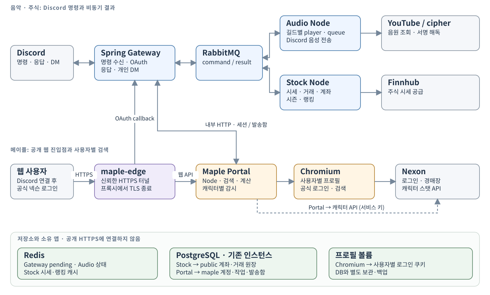

# DIS · 음악·모의투자·메이플 마켓 Discord 봇

DIS는 음성 채널에서 음악을 재생하고, 채팅에서 주식 모의투자와 메이플 경매장 검색을 이용할 수 있는 봇이다. Discord 명령을 받는 Gateway와 음악·주식 worker, 사용자별 브라우저로 경매장을 조회하는 메이플 포털을 분리했다.

[아키텍처](#아키텍처) · [사용자 흐름](#사용자가-보는-흐름) · [보안](#보안-경계) · [빠른 시작](#빠른-시작) · [명령어](#주요-명령어) · [테스트](#테스트와-검증-범위) · [전체 문서](docs/README.md)

메이플 기능은 [포털 안내](apps/maple-portal/README.md)와 [운영 가이드](docs/operations/MAPLE_DISCORD_SETUP.md)를 따른다. 이전 로컬 인수인계 기록은 [문서 보관함](docs/archive/maple-local-handoff-2026-10/README.md)에 남겼다.

메이플은 `maple` Compose 프로필로 켜는 선택 서비스다. 현재 인증·검색·알림 흐름은 [메이플 아키텍처](docs/reference/MAPLE_ARCHITECTURE.md)에, 과거 설계는 내부 기록에 구분했다.

인바운드 연결이 막힌 Ubuntu 서버의 배포 절차는 [아웃바운드 전용 배포 안내](docs/operations/OUTBOUND_ONLY_DEPLOY.md)를 따른다.

## 아키텍처



[확대해서 보기](docs/diagrams/system-overview.svg) · [수정 가능한 Mermaid 원본](docs/diagrams/system-overview.mmd) · [상세 아키텍처](docs/reference/CURRENT_ARCHITECTURE.md)

| 실행 경계 | 담당 | 연결 방식 |
| --- | --- | --- |
| Spring Gateway | Discord 명령·응답, 메이플 Discord OAuth·개인 DM | 음악·주식은 RabbitMQ, 메이플은 내부 HTTP |
| Spring Audio Node | 길드별 재생 큐·음성 연결·후속 재생 실패 | RabbitMQ·Redis·YouTube/cipher·Discord Voice |
| Spring Stock Node | 시세·가상 계좌·거래·시즌·랭킹 | RabbitMQ·Redis·PostgreSQL·Finnhub |
| Node Maple Portal | 사용자별 Chromium, 캐릭터 선택, 검색·장비 비교·감시 | Gateway 내부 HTTP·넥슨·PostgreSQL |
| maple-edge | 메이플 공개 웹 요청의 단일 라우팅 지점 | TLS는 신뢰한 외부 프록시/터널에서 종료. 내부 API 공개 차단 |

**상태 저장:** Redis는 응답 대기·음악 상태·주식 캐시를 보관한다. 기존 PostgreSQL의 `public`에는 주식 데이터, 별도 `maple` 스키마에는 계정·캐릭터별 검색·작업·감시·발송함을 저장한다. 넥슨 로그인 쿠키는 사용자별 Chromium 프로필 볼륨에 남는다. [주식 스키마](docs/reference/POSTGRESQL_STOCK_SCHEMA.md) · [메이플 스키마](docs/reference/MAPLE_PORTAL_SCHEMA.md)

음악·주식 메시지 흐름과 메이플 HTTP 흐름은 다르다. 메이플 검색을 Spring/RabbitMQ worker가 처리한다고 설명하지 않는다. 세 앱의 Java 실행 모듈과 별도 npm 포털은 [모듈 구조](docs/reference/MODULE_STRUCTURE.md)를 따른다.

## 사용자가 보는 흐름

| 기능 | 입력에서 결과까지 |
| --- | --- |
| 음악 | 음성 채널 입장 → `/play` → 요청 접수 → 검색·재생 → 실패 시 원 응답 수정. 접수 성공과 실제 청취는 별도 |
| 주식 | `/stock` → 시세 freshness·계좌 검증 → 잔고·보유 종목·거래 내역을 DB transaction으로 반영 → Discord 응답 |
| 메이플 | `/maple connect` → Discord OAuth → 포털 → 공식 넥슨 로그인 → 캐릭터·교체 장비·조건 선택 → 조회/감시 → 상위 10위 변화 개인 DM |

메이플은 감시를 끄면 한 번만 조회한다. 잠재·에디 조건은 여러 최소치를 함께 지정하고, 옵션 상한·최대 스타포스는 수집 후 로컬 필터로 적용한다. 반지 4칸·펜던트 2칸 중 교체 대상을 선택하며 확인 가능한 일반·럭키 세트 변화를 반영한다. 로그인만으로 검색을 시작하지 않는다.

**계산·운영 한계:** 기대 피해 계수 증가율과 경매장 전투력 참고값은 다르다. 전 직업·전 장비의 환산 점수나 실전 DPM을 보장하지 않으며 미지원 조건은 사유로 표시한다. 외부 검색 quota는 유지되고 등록 사용자 한도는 동시 처리량 지표가 아니다. [사용법](apps/maple-portal/PORTAL.md) · [계산 명세](apps/maple-portal/DAMAGE_MODEL.md)

## 보안 경계

- 공개 HTTPS는 메이플 edge에만 연결한다. DB·Redis·RabbitMQ·Actuator·Grafana·로그·exporter 포트는 기본 호스트 loopback이며 공개 터널로 전달하지 않는다.
- Discord 연결 티켓의 서명·만료·사용자 일치, 포털 쿠키, 변경 요청의 Origin·CSRF·소유권을 검사한다. Discord 인증과 넥슨 인증은 별개다.
- 실제 키·비밀번호·세션 URL·브라우저 프로필·DB 덤프·HAR는 커밋하거나 이슈에 첨부하지 않는다. `.env.example`은 개발용이며 운영 비밀번호로 사용할 수 없다.
- 코드의 검사 존재와 운영 검증 완료를 구분한다. 프록시 error log·터널 트래픽 캡처, Docker socket 권한, 기존 계정 비밀번호와 API 권한은 운영에서 확인해야 한다.

[공개/내부 경계와 보안 운영](docs/operations/SECURITY.md) · [메이플 배포 전 12항목](docs/operations/MAPLE_SECURITY_PREFLIGHT.md)

## 주요 명령어

| 기능 | 사용 예 | 응답 공개 범위 |
| --- | --- | --- |
| 전체 사용법 | `/man` | 본인에게만 표시 |
| 음악 검색·재생 | `/play query:백일` | 본인에게만 표시 |
| 자동 재생 | `/play query:백일 autoplay:true` | 본인에게만 표시 |
| 재생 제어 | `/pause`, `/resume`, `/skip`, `/stop` | 본인에게만 표시 |
| 대기열·음성 연결 | `/queue`, `/clear`, `/join`, `/leave` | 본인에게만 표시 |
| 효과음 | `/sfx name:gsuck.mp3` | 본인에게만 표시 |
| 시세·종목 목록 | `/stock quote symbol:AAPL`, `/stock list` | 본인에게만 표시 |
| 모의 매매 | `/stock buy symbol:AAPL quantity:1`, `/stock sell symbol:AAPL quantity:1` | 채널에 공개 |
| 계좌 조회 | `/stock balance`, `/stock portfolio`, `/stock history` | 본인에게만 표시 |
| 수익률 순위 | `/stock rank period:day` | 채널에 공개 |
| 이미지 | `/pizza` | 채널에 공개 |
| 메이플 경매장 연결·상태·중지 | `/maple connect`, `/maple status`, `/maple stop job:작업ID` | 본인에게만 표시 |

음악을 재생하려면 먼저 사용자가 음성 채널에 들어가야 한다. `/stop`은 재생과 대기열을 함께 비운다. 명령 옵션의 최신 기준은 봇의 `/man`과 [명령 카탈로그](apps/gateway-app/src/main/java/discordgateway/gateway/presentation/discord/DiscordCommandCatalog.java)다.

모의투자는 `Asia/Seoul` 기준 월 시즌제로, 시즌 시작 자금은 10,000이다. 정수 주식 수량으로 거래하고 매수 시 1~50배 레버리지를 선택할 수 있다. 기본 시세 공급자는 `mock`이지만 자동 캐시 갱신은 Finnhub 모드에서만 동작하므로, 새 환경의 가격 조회·거래에는 Finnhub 설정 또는 테스트 시세 준비가 필요하다. 종목은 DB watchlist로 관리한다. [주식 앱 안내](apps/stock-node-app/README.md)에서 시세·청산 정책을 설명한다.

## 빠른 시작

필요한 도구는 **JDK 21**, Docker Engine 또는 Docker Desktop, **Docker Compose v2**다. Gradle 8.8은 저장소의 wrapper를 사용한다. 모든 명령은 저장소 루트에서 실행한다.

### 1. 환경 변수 준비

```bash
cp .env.example .env
```

Windows PowerShell에서는 `Copy-Item .env.example .env`를 사용한다. `.env`에서 다음 값을 설정한다.

| 변수 | 설정 방법 |
| --- | --- |
| `DISCORD_TOKEN` | Discord Developer Portal의 봇 토큰으로 교체 |
| `DISCORD_DEV_GUILD_ID` | 개발 서버에 명령을 등록하려면 해당 서버 ID 지정. 비우면 전역 등록 |
| `RABBITMQ_USERNAME`, `RABBITMQ_PASSWORD` | RabbitMQ와 앱이 함께 사용할 계정 |
| `POSTGRES_DB`, `POSTGRES_USER`, `POSTGRES_PASSWORD` | 개발 기본값만 제공. 운영은 별도 임의 비밀번호와 기존 DB 계정 설정 확인 |
| `INFRA_BIND`, `OBSERVABILITY_BIND`, `MAPLE_EDGE_BIND` | 기본 `127.0.0.1` 유지. 공개 웹은 edge에 연결한 HTTPS 프록시 사용 |
| `STOCK_QUOTE_PROVIDER` | 첫 실행은 `mock`. 실시간 시세는 `finnhub`와 `FINNHUB_API_KEY` 설정 |

봇을 서버에 초대할 때 `bot`, `applications.commands` scope와 텍스트 응답·음성 채널 연결·말하기 권한이 필요하다. 토큰은 `.env`에만 두고 커밋하지 않는다. YouTube 인증·cipher와 전체 설정은 [로컬 개발 안내](docs/operations/LOCAL_DEVELOPMENT.md)에 있다.

개발용 `.env.example`을 그대로 운영에 쓰지 않는다. 운영 설정 검사는 `node ops/security/preflight.mjs --production --env-file <환경파일>`로 실행하며 비밀값 자체는 출력하지 않는다. 이미 생성된 PostgreSQL·RabbitMQ·Grafana 계정은 환경 파일 수정만으로 비밀번호가 변경되지 않는다.

### 2. JAR 빌드와 컨테이너 시작

Linux/macOS 셸:

```bash
bash ./gradlew bootJarAll
docker compose --env-file .env config --quiet
docker compose --env-file .env up -d --build --wait --wait-timeout 180
```

Windows PowerShell:

```powershell
.\gradlew.bat bootJarAll
docker compose --env-file .env config --quiet
docker compose --env-file .env up -d --build --wait --wait-timeout 180
```

Dockerfile은 미리 빌드한 JAR를 복사하므로 Gradle 빌드가 먼저 필요하다. 기본 구성에는 Gateway, 음악·주식 worker, Redis, RabbitMQ, PostgreSQL, YouTube cipher가 포함된다.

### 3. 정상 작동 확인

```bash
docker compose --env-file .env ps
docker compose --env-file .env logs --tail=100 gateway audio-node stock-node
curl -fsS http://localhost:8081/actuator/health
curl -fsS http://localhost:8082/actuator/health
curl -fsS http://localhost:8083/actuator/health
```

PowerShell에서는 HTTP 확인에 `curl.exe`를 사용할 수 있다. health 응답을 확인한 뒤 Discord에서 `/man`, `/stock list`, 음성 채널의 `/play`를 순서대로 확인한다. 음악은 접수 응답 이후에도 다운로드·재생 오류가 생길 수 있으므로 실제 소리까지 확인한다.

종료는 `docker compose --env-file .env down`이다. 기본 명령은 데이터 volume을 보존한다. 상세 장애 대응은 [운영 런북](docs/operations/OPERATIONS_RUNBOOK.md)을 본다.

## 테스트와 검증 범위

```bash
# Gateway의 명령·응답과 음악 코어 테스트
bash ./gradlew :apps:gateway-app:test :modules:common-core:test

# 설정·시크릿 검사 회귀 테스트: Docker Compose CLI 필요, daemon 불필요
node --test ops/security/config.test.mjs
node ops/maple-db/check-doc-links.mjs

# 메이플 테스트: Node.js 22 이상 필요
npm --prefix apps/maple-portal ci --ignore-scripts
npm --prefix apps/maple-portal test

# Java 전체 테스트·패키징. Docker/Testcontainers 필요
bash ./gradlew clean test bootJarAll --no-daemon
```

Windows에서는 `bash ./gradlew`를 `.\gradlew.bat`로 바꾼다. 테스트에는 `/man` 비공개 응답, 음악 재생 실패 통지·OAuth/cipher 설정, 주식 계좌·거래·메시징 통합 검사가 포함된다. 실행 결과는 각 모듈의 `build/reports/tests/test/index.html`에서 확인한다.

자동 테스트와 health check만으로 실제 Discord 음질이나 최대 동시 처리량을 검증한 것은 아니다. 테스트 종류·실제 Discord 확인 절차·성능 측정 기록 기준은 [테스트 가이드](docs/operations/CI_TESTING.md)를 본다.

## 운영과 배포

- 관측성 시작: `docker compose --env-file .env --profile observability up -d --build`
- 대시보드: Grafana `http://localhost:3000`, Prometheus `http://localhost:9090`
- 앱 HTTP 포트: Gateway `8081`, audio `8082`, stock `8083`
- 전체 포트와 설정: [로컬 개발 안내](docs/operations/LOCAL_DEVELOPMENT.md), [관측성 안내](ops/observability/README.md)
- 배포: [Build Bot Release](.github/workflows/cicd-deploy.yml)가 `main` push 또는 수동 실행 시 테스트·이미지 빌드·체크섬 포함 릴리스를 만든다. 서버의 systemd timer가 아웃바운드로 릴리스를 받아 검증·백업·마이그레이션 후 Compose를 갱신한다. [현재 배포 가이드](docs/operations/OUTBOUND_ONLY_DEPLOY.md)를 확인한다.

## 코드·문서 탐색

- [apps](apps/README.md): Gateway·음악·주식·메이플 앱
- [modules](modules/README.md): Java 공용 음악 구현·주식 메시지 계약
- [ops](ops/README.md): 릴리스 배포·관측성·DB·보안 점검
- [docs](docs/README.md): 현재 구조·운영 절차와 과거 기록

Java 21, Spring Boot 3.5.5, JDA 6.3.1, Node.js 22 이상, Playwright/Chromium, Redis 7, RabbitMQ 3.13, PostgreSQL 16을 사용한다. 정확한 버전은 [Gradle](modules/common-core/build.gradle), [npm](apps/maple-portal/package.json), [Compose](docker-compose.yml)가 기준이다. YouTube 의존성의 공식 릴리스·해시 검증은 [공급 안내](gradle/README.md)에 기록했다.

## 문서 수정 기준

README는 소개와 첫 실행 경로를 유지하고, 상세 절차는 목적별 문서로 연결한다. 문서 품질·검증 기준은 [문서 작성 기준](docs/DOCUMENTATION_GUIDE.md)에 정리했다. 과거 계획과 작업 보고서는 [내부 기록](docs/internal/README.md)에서 구분해 보관한다.
