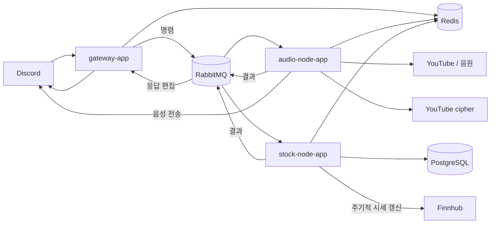

# DIS · 음악과 모의투자를 함께 쓰는 Discord 봇

DIS는 음성 채널에서 음악을 재생하고, 채팅에서 주식 모의투자를 할 수 있는 봇이다. Discord 명령을 받는 Gateway와 음악·주식 worker를 분리하고, RabbitMQ로 명령과 결과를 전달한다.

[빠른 시작](#빠른-시작) · [명령어](#주요-명령어) · [아키텍처](#아키텍처) · [테스트](#테스트와-검증-범위) · [전체 문서](docs/README.md)

## 주요 명령어

| 기능 | 사용 예 | 응답 공개 범위 |
| --- | --- | --- |
| 전체 사용법 | `/man` | 본인에게만 표시 |
| 음악 검색·재생 | `/play query:백일` | 본인에게만 표시 |
| 자동 재생 | `/play query:백일 autoplay:true` | 본인에게만 표시 |
| 재생 제어 | `/pause`, `/resume`, `/skip`, `/stop` | 본인에게만 표시 |
| 대기열·음성 연결 | `/queue`, `/clear`, `/join`, `/leave` | 본인에게만 표시 |
| 효과음 | `/sfx name:gsuck.mp3` | 본인에게만 표시 |
| 시세·종목 목록 | `/stock quote symbol:AAPL`, `/stock list` | 본인에게만 표시 |
| 모의 매매 | `/stock buy symbol:AAPL quantity:1`, `/stock sell symbol:AAPL quantity:1` | 채널에 공개 |
| 계좌 조회 | `/stock balance`, `/stock portfolio`, `/stock history` | 본인에게만 표시 |
| 수익률 순위 | `/stock rank period:day` | 채널에 공개 |
| 이미지 | `/pizza` | 채널에 공개 |

음악을 재생하려면 먼저 사용자가 음성 채널에 들어가야 한다. `/stop`은 재생과 대기열을 함께 비운다. 명령 옵션의 최신 기준은 봇의 `/man`과 [명령 카탈로그](apps/gateway-app/src/main/java/discordgateway/gateway/presentation/discord/DiscordCommandCatalog.java)다.

모의투자는 `Asia/Seoul` 기준 월 시즌제로, 시즌 시작 자금은 10,000이다. 정수 주식 수량으로 거래하고 매수 시 1~50배 레버리지를 선택할 수 있다. 기본 시세 공급자는 `mock`이지만 자동 캐시 갱신은 Finnhub 모드에서만 동작하므로, 새 환경의 가격 조회·거래에는 Finnhub 설정 또는 테스트 시세 준비가 필요하다. 종목은 DB watchlist로 관리한다. [주식 앱 안내](apps/stock-node-app/README.md)에서 시세·청산 정책을 설명한다.

## 빠른 시작

필요한 도구는 **JDK 21**, Docker Engine 또는 Docker Desktop, **Docker Compose v2**다. Gradle 8.8은 저장소의 wrapper를 사용한다. 모든 명령은 저장소 루트에서 실행한다.

### 1. 환경 변수 준비

```bash
cp .env.example .env
```

Windows PowerShell에서는 `Copy-Item .env.example .env`를 사용한다. `.env`에서 다음 값을 설정한다.

| 변수 | 설정 방법 |
| --- | --- |
| `DISCORD_TOKEN` | Discord Developer Portal의 봇 토큰으로 교체 |
| `DISCORD_DEV_GUILD_ID` | 개발 서버에 명령을 등록하려면 해당 서버 ID 지정. 비우면 전역 등록 |
| `RABBITMQ_USERNAME`, `RABBITMQ_PASSWORD` | RabbitMQ와 앱이 함께 사용할 계정 |
| `POSTGRES_DB`, `POSTGRES_USER`, `POSTGRES_PASSWORD` | 로컬 기본값 제공. 앱과 DB에 같은 값 적용 |
| `STOCK_QUOTE_PROVIDER` | 첫 실행은 `mock`. 실시간 시세는 `finnhub`와 `FINNHUB_API_KEY` 설정 |

봇을 서버에 초대할 때 `bot`, `applications.commands` scope와 텍스트 응답·음성 채널 연결·말하기 권한이 필요하다. 토큰은 `.env`에만 두고 커밋하지 않는다. YouTube 인증·cipher와 전체 설정은 [로컬 개발 안내](docs/operations/LOCAL_DEVELOPMENT.md)에 있다.

### 2. JAR 빌드와 컨테이너 시작

Linux/macOS 셸:

```bash
bash ./gradlew bootJarAll
docker compose --env-file .env config --quiet
docker compose --env-file .env up -d --build --wait --wait-timeout 180
```

Windows PowerShell:

```powershell
.\gradlew.bat bootJarAll
docker compose --env-file .env config --quiet
docker compose --env-file .env up -d --build --wait --wait-timeout 180
```

Dockerfile은 미리 빌드한 JAR를 복사하므로 Gradle 빌드가 먼저 필요하다. 기본 구성에는 Gateway, 음악·주식 worker, Redis, RabbitMQ, PostgreSQL, YouTube cipher가 포함된다.

### 3. 정상 작동 확인

```bash
docker compose --env-file .env ps
docker compose --env-file .env logs --tail=100 gateway audio-node stock-node
curl -fsS http://localhost:8081/actuator/health
curl -fsS http://localhost:8082/actuator/health
curl -fsS http://localhost:8083/actuator/health
```

PowerShell에서는 HTTP 확인에 `curl.exe`를 사용할 수 있다. health 응답을 확인한 뒤 Discord에서 `/man`, `/stock list`, 음성 채널의 `/play`를 순서대로 확인한다. 음악은 접수 응답 이후에도 다운로드·재생 오류가 생길 수 있으므로 실제 소리까지 확인한다.

종료는 `docker compose --env-file .env down`이다. 기본 명령은 데이터 volume을 보존한다. 상세 장애 대응은 [운영 런북](docs/operations/OPERATIONS_RUNBOOK.md)을 본다.

## 아키텍처



Gateway는 명령 수신·응답을, 각 worker는 도메인 처리를 담당한다. Redis에는 pending 응답·음악 상태·캐시를, PostgreSQL에는 모의투자 계좌·포지션·원장을 저장한다. [현재 아키텍처](docs/reference/CURRENT_ARCHITECTURE.md)에서 재생과 시세 갱신 흐름을 자세히 설명한다.

| 디렉터리 | 역할 |
| --- | --- |
| [apps/](apps/README.md) | 실행 가능한 Gateway·음악·주식 앱과 코드 진입점 |
| [modules/](modules/README.md) | 음악 공용 구현과 주식 메시지 계약 |
| [ops/](ops/README.md) | 운영 점검, DLQ 재처리, cipher·관측성 설정 |
| [docs/](docs/README.md) | 구조·계약·개발·운영 문서와 과거 작업 기록 |

기술 구성은 Java 21, Spring Boot 3.5.5, JDA 6.3.1, LavaPlayer 2.2.4, youtube-source 1.18.2, Redis 7, RabbitMQ 3.13, PostgreSQL 16이다. 변경 시 [Gradle 설정](modules/common-core/build.gradle)과 [Compose](docker-compose.yml)를 함께 확인한다.

## 테스트와 검증 범위

```bash
# Gateway의 명령·응답과 음악 코어 테스트
bash ./gradlew :apps:gateway-app:test :modules:common-core:test

# CI와 같은 전체 테스트·패키징. Docker/Testcontainers 필요
bash ./gradlew clean test bootJarAll --no-daemon
```

Windows에서는 `bash ./gradlew`를 `.\gradlew.bat`로 바꾼다. 테스트에는 `/man` 비공개 응답, 음악 재생 실패 통지·OAuth/cipher 설정, 주식 계좌·거래·메시징 통합 검사가 포함된다. 실행 결과는 각 모듈의 `build/reports/tests/test/index.html`에서 확인한다.

자동 테스트와 health check만으로 실제 Discord 음질이나 최대 동시 처리량을 검증한 것은 아니다. 테스트 종류·실제 Discord 확인 절차·성능 측정 기록 기준은 [테스트 가이드](docs/operations/CI_TESTING.md)를 본다.

## 운영과 배포

- 관측성 시작: `docker compose --env-file .env --profile observability up -d --build`
- 대시보드: Grafana `http://localhost:3000`, Prometheus `http://localhost:9090`
- 앱 HTTP 포트: Gateway `8081`, audio `8082`, stock `8083`
- 전체 포트와 설정: [로컬 개발 안내](docs/operations/LOCAL_DEVELOPMENT.md), [관측성 안내](ops/observability/README.md)
- 배포: [Deploy Bot](.github/workflows/cicd-deploy.yml)이 **`main` push 또는 수동 실행 시 테스트·이미지 빌드·서버 배포**를 수행한다. [배포 가이드](docs/operations/SERVER_DEPLOY_SCRIPT.md)를 확인한다.

## 문서 수정 기준

README는 소개와 첫 실행 경로를 유지하고, 상세 절차는 목적별 문서로 연결한다. 문서 품질·검증 기준은 [문서 작성 기준](docs/DOCUMENTATION_GUIDE.md)에 정리했다. 과거 계획과 작업 보고서는 [내부 기록](docs/internal/README.md)에서 구분해 보관한다.
