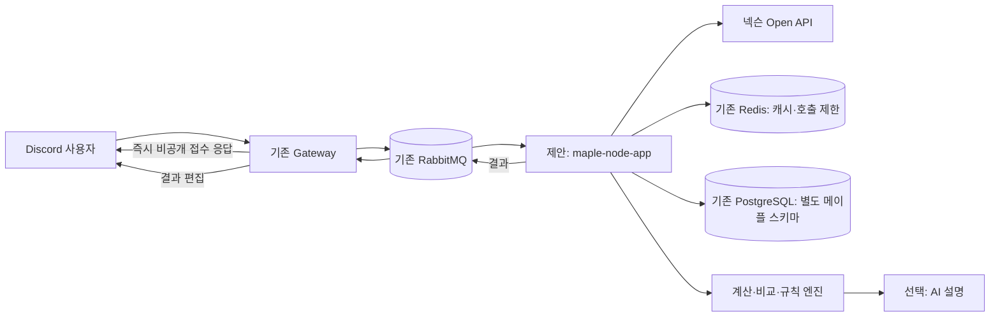

# 메이플스토리 API 기능 조사 및 제안

작성일: 2026-10-22 · 대상: 한국 PC 메이플스토리(KMS) · 상태: 조사·설계 제안, 미구현

후속 확인(2026-10-23): [환산주스탯 공식 약관·외부 API 조사](MAPLESCOUTER_API_CHECK_2026-10-23.md)에서 자동 접근·타 서비스 백엔드 사용 금지 규정을 확인했다. 본문의 환산 연동 가능성은 이 조건을 반영해 검토해야 한다.

DIS에 추가할 기능 후보를 사용자 불편, 공개 구현 사례, API 데이터 구조로 검토한 보고서다. **첫 구현은 성장일지와 보스 파티 관리**, AI 실험은 **연무장 리플레이 코치**를 추천한다. 자동 숙제 확인은 유용하지만 본인 데이터 접근 권한을 먼저 검증해야 한다.

## 1. 조사 범위와 근거의 강도

이 환경의 네트워크 정책으로 넥슨 Open API 웹사이트, 검색 엔진, 인벤, MapleScouter, maple.gg의 직접 접속이 차단됐다. 접근 가능한 GitHub의 공개 README, 구현 코드, 이슈를 읽었다. 따라서 **인벤·디시 이용자 여론을 조사한 보고서나 전체 이용자의 수요 순위는 아니다.**

- **직접적인 불편 표현**: 체크리스트 제작자의 설명, 사용자 이슈에 적힌 요청.
- **개발자의 문제 정의와 구현 사례**: 환산 보조 확장, 기존 봇, 계산기 README와 코드. 실제 이용자 수나 효과를 검증한 자료는 아니다.
- **우리 서비스에 대한 가설**: 사례를 DIS에 적용한 제안. 특히 연무장 AI 코치의 이용 의사는 아직 검증하지 않았다.
- **API 기술 근거**: 비공식 SDK의 요청 경로·DTO·주석과 별도 공개 프로젝트를 대조했다. SDK는 공식 문서와 주석을 동기화한다고 설명하지만 넥슨 공식 배포물은 아니다.[S1] 인증된 API 호출은 수행하지 않았다.

해외 도구의 입력·저장 방식은 UX 참고에 한정한다. GMS의 직업, 확률, 가격, 초기화 일정을 KMS에 그대로 적용하지 않는다. 아래 예시 명령과 응답은 제안이며 실제 봇에 추가된 명령이 아니다.

## 2. 사례에서 확인한 불편

| 불편 | 확인한 사례 | 해결 기회와 해석의 한계 |
| --- | --- | --- |
| 여러 캐릭터의 숙제를 잊는다 | `Maple_Check_list` 제작자가 “숙제하다 자꾸 까먹어서 만들었다.”라고 명시했다.[S5] 별도 메이플 보스 봇에는 캐릭터별 숙제·개인 목표·미완료 알림이 있다.[S6] | 개인별 미완료 항목을 한곳에서 확인하는 기능. 불편의 직접 표현과 구현 사례가 함께 있다. |
| 환산 입력값을 다시 넣거나 다른 기기에서 이어 보기 번거롭다 | `maplescouter-sync`는 브라우저에 묶인 프리셋을 다른 기기에서 가져오는 문제를 설명한다. 작성자는 서버가 아직 배포되지 않았다고 명시한다.[S9] 같은 제작자의 확장에는 자동 저장·캐릭터 전환·이력이 있다.[S10] | Discord 계정에 연결한 캐릭터·목표·측정 이력의 재사용. 두 저장소는 같은 제작자의 사례이므로 독립된 수요 두 건으로 세지 않는다. 환산 사이트의 현재 동작은 직접 확인하지 못했다. |
| 보스 파티 명단과 회차별 기록이 흩어진다 | BeTa 봇은 보스별 파티 등록·조회·삭제를 제공한다.[S7] 별도 보스 기록 사이트는 회차별 참여자·드롭·분배액·주간 캘린더를 관리한다.[S8] | 모집부터 출석·정산까지 Discord에서 연결할 기회. 불편의 빈도는 모르지만 이를 위한 독립 도구가 존재한다. |
| 다음 스펙업과 비용을 판단하기 어렵다 | `maple-api`는 같은 직업·비슷한 전투력의 실제 업그레이드 이력으로 다음 단계를 제안한다.[S11] `maple-optimizer`는 매물 비교·직작 비용 분포·예산 최적화를 설명한다.[S12] | 개인 장비와 예산을 함께 보는 의사결정 지원. 두 프로젝트의 계산 정확도와 추천 효과는 이번 조사에서 검증하지 않았다. |
| 정보 조회만으로는 성장·플레이 개선 방향을 알기 어렵다 | 루시드로이드는 경험치 평균·레벨업 예측을, 라라 봇은 방무·비약·솔 에르다 계산을 제공한다.[S13][S14] SDK에는 연무장 결과와 스킬 타임라인이 있다.[S4] | 관측값을 다음 행동으로 연결하는 기능. 기존 계산 기능은 확인했지만 AI 딜사이클 코치에 대한 직접 수요 근거는 부족하다. |

추가로 `ms-dailies`에는 “일일 Maple Tour 누락”, “이벤트 일일 항목 추가” 요청이 있다.[S15] 2020년 해외 사례이므로 현재 KMS 콘텐츠 목록의 근거로 쓰지 않고, 고정 체크리스트에 누락·변경 대응이 필요하다는 설계 참고로만 사용한다.

## 3. API로 얻을 수 있는 것과 따로 준비할 것

모든 경로의 공통 앞부분은 `https://open.api.nexon.com/maplestory/v1`이다. 다음은 확인한 SDK 및 사례 코드 기준이며, 출시 전 공식 명세·약관·실제 키로 최종 확인해야 한다.[S1][S2][S3][S4]

| 데이터 | 확인한 경로·필드 | 설계에서의 취급 |
| --- | --- | --- |
| 캐릭터 식별·기본·능력치 | `/id`, `/character/basic`, `/character/stat` | 닉네임 → OCID → 공개 프로필 조회. 닉네임 검색 성공을 캐릭터 소유 인증으로 취급하지 않는다. |
| 장비·성장 상태 | `/character/item-equipment`, `/character/symbol-equipment`, `/character/hexamatrix`, `/character/skill`, `/user/union-raider` | 프리셋별 장비, 심볼, 코어·스킬, 유니온 정보를 정규화한다. 현재 장착 상태와 목표 세팅을 구분한다. |
| 스케줄러 수행 현황 | `/scheduler/character-state`의 `daily_contents`, `weekly_contents`, `boss_contents`, `now_count`, `max_count`, `registration_flag`, `complete_flag` | 자동 숙제 확인의 후보 데이터. 공개 봇은 각 사용자의 본인 키가 필요하다고 안내한다.[S6] 우리 서비스 키로 모든 이용자의 수행 현황을 볼 수 있다고 가정하지 않는다. |
| 계정 캐릭터·강화 이력 | `/character/list`, `/history/starforce`, `/history/potential` | 계정 범위 데이터와 공개 프로필을 구분한다. 소유자 키 또는 적합한 승인·인증 절차가 필요한 기능으로 설계한다. 강화 이력은 커서 페이지네이션과 제공 기간 제한도 확인한다. |
| 연무장 리플레이 | `/battle-practice/replay-id`, `/battle-practice/result`, `/battle-practice/skill-timeline`, `/battle-practice/character-info` | 등록된 리플레이가 있어야 한다. 결과에는 DPS·스킬별 점유율·사용 횟수, 타임라인에는 경과 시간(ms), 입장 정보에는 당시 장비·능력치가 있다.[S4] |
| 경매장 매물·가격, 보유 메소·재료, 실제 보스 플레이 전체 로그 | 위에서 확인한 일반 API만으로 확보하지 못함 | 매물·가격·재료는 사용자 입력으로 시작한다. 연무장 기록을 실제 보스전의 이동·회피·생존 기록으로 확장 해석하지 않는다. |

**데이터가 전부 하루 전 자료라는 전제는 맞지 않는다.** SDK의 캐릭터·연무장 주석은 평균 15분 후 확인 가능하다고 설명한다. 캐릭터의 과거 날짜 조회는 전일 자료가 다음날 오전 2시부터 제공된다고 설명한다.[S1] 평균 지연은 실시간 보장이나 모든 엔드포인트의 동일한 SLA가 아니다. 응답에는 조회 기준일·수집 시각·캐시 여부를 표시한다.

본인 키 방식과 Nexon Friends를 구분해야 한다. SDK의 Friends 지원은 **승인된 서비스 전용**이며 별도 Bearer 인증 경로가 있다.[S1] Friends 승인을 받았다는 이유로 모든 일반 API의 권한이 자동 해결된다고 가정하지 않는다. 특히 숙제 데이터 접근 가능 범위는 별도 검증 항목이다.

개발·서비스 키의 현재 호출 한도, 데이터 보관·갱신 조건, 출처 표시 의무는 공식 원문에 접속하지 못해 확정하지 않았다. 다른 프로젝트에 적힌 숫자나 약관 해석을 공식 정책처럼 인용하지 않는다.

## 4. 기능 제안 5개

### ① 캐릭터 성장일지와 변경 요약

**사용 장면**: “지난주보다 강해졌는데 어떤 변경이 있었지?”, “본캐와 부캐 상태를 매번 다시 검색하기 귀찮다.”

**화면 제안**: `/메이플 성장 닉네임 기간:7일` → 경험치·심볼·코어·장비 변경과 확인이 필요한 세팅을 본인에게 표시한다. 개인 목표와 사용자가 직접 넣은 환산 결과 링크도 함께 보관한다. 프리셋 저장 문제와 기존 성장 예측·스펙 이력 사례를 참고한다.[S9][S10][S11][S13]

**구현 메커니즘**:

1. 닉네임으로 OCID를 조회하고 사용자의 관심 캐릭터로 등록한다. 소유 확인 전에는 “내 캐릭터 인증 완료” 대신 “관심 캐릭터”로 표시한다.
2. 기본·스탯·장비·HEXA·심볼을 수집해 `ocid + 기준일/수집시각 + 프리셋 + 데이터 버전`으로 스냅샷을 저장한다. 과거 날짜가 지원되는 항목은 필요한 범위만 조회한다.
3. 동일한 프리셋과 비교 가능한 필드끼리 차이를 계산한다. 사냥 프리셋에서 보스 프리셋으로 바뀐 것을 성장·퇴보로 판정하지 않는다.
4. 확정된 변경 목록을 카드로 만든다. AI를 붙이면 이 목록과 관리자가 검토한 직업별 설명만 입력해 쉬운 요약을 생성한다.
5. 목표 달성 여부를 갱신하고 다음 비교 때 입력을 재사용한다.

**응답 예시 — 가상 데이터**:

> 지난 기록 대비 장갑 스타포스 17→18, 심볼 레벨 1 상승을 확인했습니다. 현재 장착 프리셋이 달라 전투력 증감의 직접 원인은 판단하지 않았습니다.

API 관측 변화와 원인 추론을 구분한다. 장비 여러 부위와 버프가 함께 변했다면 특정 변경의 딜 상승률을 분리해 말할 수 없다. 환산주스탯의 계산식·점수를 재현한다고 약속하지 않고, 사용자 제공 결과나 허용된 외부 링크를 연결한다.

**검증 방법**: 동일 시각·프리셋의 인게임 정보와 대조하고, 장비 하나만 바꾼 사례 및 프리셋만 전환한 사례에서 변경 요약이 맞는지 본다. 이용자에게 다시 검색·입력하는 시간이 줄었는지 확인한다.

### ② 다캐릭 숙제·보스 현황과 선택형 알림

**사용 장면**: “본캐 일퀘는 했는데 부캐 주간 보스가 남았는지 모르겠다.” 체크리스트 제작자의 직접적인 불편 표현과 기존 숙제 봇을 근거로 한다.[S5][S6]

**화면 제안**: `/메이플 숙제` → 캐릭터별 미완료 항목만 표시. `/메이플 알림`에서 원하는 시각·항목·캐릭터를 선택한다.

**구현 메커니즘**:

1. 본인 키의 캐릭터 목록과 선택한 OCID를 대조하는 연결 절차를 만든다. 키는 공개 채팅·명령 원문에 남기지 않는 연결 화면에서 받고, 서버에서 암호화해 저장한다. 메시지 큐와 로그에는 키 대신 자격 증명 ID만 전달한다.
2. `/scheduler/character-state`를 가져와 `registration_flag`, 콘텐츠별 완료 횟수·상태·개인 목표로 완료 여부를 계산한다.[S3] 인게임 등록 여부와 우리 봇의 추적 대상을 구분한다.
3. KST 기준 콘텐츠별 초기화 주기를 적용한다. 모든 콘텐츠를 목요일 리셋으로 일괄 처리하지 않는다.
4. 알림 시각에 최신 상태를 확인하고 미완료 항목만 모아 한 번 보낸다. `사용자 + 캐릭터 + 항목 + 주기 + 알림시각`으로 중복을 막는다.
5. 사용자가 알림을 켠 경우에만 지정 채널이나 DM으로 보낸다. DM 차단은 사용자 설정 화면에서 알리고, 다른 공개 채널로 자동 전환하지 않는다.

**API 접근 검증 전의 MVP**는 수동 체크리스트다. 이를 자동 확인처럼 표시하지 않는다. SDK에 수행 현황 필드가 있으므로 “보스 완료 데이터는 API에 아예 없다”라고 단정하는 것도 부정확하다. 핵심은 **대상·권한·반영 지연**이다.

기존 참고 봇은 키를 평문 파일에 저장한다고 안내한다.[S6] 기능 흐름은 참고하되 개인 키 저장 방식은 그대로 가져오지 않는다. 연결 해제 때 자격 증명을 삭제하고, 다른 사용자의 데이터에 접근하지 못하게 한다.

**검증 방법**: 본인·다른 계정·미등록 콘텐츠·리셋 직전과 직후를 구분해 실제 응답을 확인한다. 캐시 지연으로 이미 끝낸 숙제를 다시 알리는 비율과 알림 해제율을 본다.

### ③ 보스 파티 모집·준비 확인·회차별 정산

**사용 장면**: “금요일 파티에 누가 오는지, 어떤 캐릭터로 오는지, 지난번 드롭 분배가 끝났는지 채팅을 뒤져야 한다.” BeTa의 파티 명단 관리와 별도 보스 기록 사이트의 회차·분배 모델을 참고한다.[S7][S8]

**화면 제안**: `/메이플 파티 생성 보스:… 시간:…` → 참가·불참·대기·출석 버튼. 개인 준비 상태는 본인에게, 공유 명단은 지정 채널에 표시한다.

**구현 메커니즘**:

1. `길드/Discord 서버 → 파티 → 예정 회차 → 참가자`를 저장한다. 게임 길드와 Discord 서버는 별개의 소속으로 관리한다.
2. 참가자가 공개 프로필을 불러오거나 등록한 캐릭터를 선택한다. 직업·레벨·포스·장비 및 사용자가 제시한 환산 링크·클리어 경험을 준비 카드에 묶는다.
3. 운영자가 정한 모집 조건과 참가 가능 시간으로 후보를 좁힌다. 직업별 전투력이나 환산 수치를 단순 합산해 성공 확률을 계산하지 않는다.
4. 버튼 클릭을 DB 트랜잭션으로 처리해 정원 초과와 중복 참가를 막고, 회차 시작 때 실제 참가자 명단을 고정한다.
5. 클리어 후 운영자가 드롭·판매 금액·분배 방식을 입력한다. **그 회차 참가자**를 기준으로 정산하고 수정 내역을 남긴다. 이후 파티 탈퇴가 과거 정산을 바꾸지 않게 한다.

API는 준비 자료를 채우고, 출석·실제 판매가·분배 합의는 Discord에서 입력받는다. 본인 권한으로 검증된 스케줄러가 있으면 완료 상태를 보조 정보로 쓸 수 있지만, 자동으로 그 회차의 참여·전리품을 확정하지 않는다.

**검증 방법**: 동시 참가, 대기자 승격, 파티원 교체, 분배 후 탈퇴 시나리오를 확인한다. 운영자가 기존 방식과 비교해 명단 취합·독촉·정산에 쓰는 시간이 줄었는지 본다.

### ④ 예산별 스펙업·HEXA 목표 비교

**사용 장면**: “예산 안에서 코어 강화, 직작, 완제품 구매 중 무엇을 먼저 비교해야 하지?” 공개 로드맵·최적화 프로젝트와 라라 봇의 솔 에르다 계산 기능을 참고한다.[S11][S12][S14]

**화면 제안**: `/메이플 계획 예산:… 목표:…` → 후보별 비용·재료·불확실성·선택 이유. 초기 버전은 계산을 검증할 수 있는 범위만 지원한다.

**구현 메커니즘**:

1. API로 현재 장비·세트·코어·스킬 상태를 읽는다. 보유 메소·조각과 매물 가격·옵션은 직접 입력받는다. 이미 캐릭터에 반영된 효과와 새 효과를 중복 합산하지 않는다.
2. 직업·스킬·패치 버전별 비용 및 효과 표를 별도로 유지한다. API에 현재 상태가 있다는 사실과 목표 단계의 정확한 비용표가 확보됐다는 사실을 구분한다.
3. 초기에는 HEXA 목표까지 필요한 재료, 입력한 매물의 옵션 차이, 예산 충족 여부를 계산한다. 딜 계산 모델이 검증되기 전에는 “딜 8% 상승” 같은 수치를 생성하지 않는다.
4. 강화 확률·비용표를 검증한 뒤 확률 시뮬레이션을 추가한다. 평균 비용뿐 아니라 중앙값·상위 비용 구간·파괴 위험을 보여 준다. 재현을 위해 표 버전·난수 시드를 기록한다.
5. AI는 계산기의 결과를 설명하고 사용자의 목표·위험 선호에 맞춰 후보를 정리한다. 가격·확률·효율 수치는 도구 결과에서만 인용한다.

같은 직업의 다른 유저가 자주 선택한 업그레이드는 참고 신호다. 인기, 유저의 예산, 표본 편향, 동시 장비 변경을 통제하지 못하면 내 캐릭터의 최적해나 인과적인 상승 효과가 아니다. 자동 추천 초기에는 개인 내 비교를 우선한다.

경매장 가격을 공식 API에서 자동 수집할 수 있다고 약속하지 않는다. 환산 사이트의 내부 API를 무단 호출하는 연동도 전제하지 않는다. 기존 사용자 입력·공식 허용 범위로도 비교 MVP를 만들 수 있다.

**검증 방법**: 지원하는 직업·단계를 제한하고 알려진 계산 사례 및 인게임 변화와 대조한다. 모델 밖 직업·세트·패치는 지원하지 않음을 표시한다. 이용자가 후보를 이해하고 최종 선택하는 데 도움이 되는지 평가한다.

### ⑤ 연무장 리플레이 기반 AI 코치

**사용 장면**: “비슷한 스펙인데 내 딜이 왜 낮은지 모르겠다”, “내 이전 연습과 비교해서 무엇이 달라졌는지 알고 싶다.” 이는 이번 조사의 **신규 제품 가설**이며 실제 수요 조사가 더 필요하다.

기술 근거는 비교적 구체적이다. SDK에는 리플레이 식별자·결과·스킬 사용 타임라인·입장 시점 정보가 있고,[S4] 별도 최적화 프로젝트도 연무장 스킬 점유율을 읽는다.[S12] 따라서 일반적인 직업 설명만 생성하는 챗봇보다 개인 관측값에 근거한 분석을 설계할 수 있다.

**화면 제안**: `/메이플 연습분석 닉네임:…` → 이전 측정 대비 요약, 사용 간격, 스킬별 점유율·횟수, 확인할 행동 1~3개. 기본 응답은 본인에게만 보인다.

**구현 메커니즘**:

1. OCID로 등록된 `replay_id` 목록을 조회하고 사용자가 분석할 기록을 선택한다. 등록 기록이 없으면 등록 방법을 안내한다.
2. 해당 기록의 `result`, `character-info`, `skill-timeline`을 읽는다. 타임라인의 `total_page_no`까지 가져온 뒤 페이지 누락 여부를 확인한다.[S4]
3. 결정적인 계산은 코드로 한다. 스킬별 사용 횟수·평균 사용 간격·긴 공백, 측정 시간으로 정규화한 DPS·점유율을 계산한다. 점유율은 API 결과 기준이며, 타임라인만으로 각 순간의 피해량을 만들어내지 않는다.
4. 이전 기록과 직업·스킬·장비·측정 길이·설정을 대조한다. 입장 스냅샷에 없는 대상 조건·버프 등은 사용자에게 입력받고, 조건이 다르면 비교 제한을 표시한다.
5. 검토한 직업별 규칙과 계산 결과를 AI에 전달한다. `관측 사실 → 가능한 해석 → 다음 연습에서 확인할 행동` 순서로 작성하고 근거 시각·필드를 붙인다.

**응답 예시 — 가상 데이터**:

> A스킬의 두 사용 사이 간격은 132초였습니다. 입력한 목표 간격보다 길지만 원인은 기록만으로 확정할 수 없습니다. 다음 연습에서는 버프 시작 시점과 A스킬 사용 시점을 함께 확인해 보세요.

이론 쿨타임과 실제 사용 간격의 차이를 곧바로 실수로 판정하지 않는다. 쿨타임 감소·초기화·사용 조건·측정 중단을 반영해야 한다. 연무장 성적에서 실제 보스 클리어 시간·생존·숙련도를 보장하지 않는다.

**검증 방법**: 자발적인 소수 이용자의 같은 조건 전후 기록을 모으고 숙련자가 분석을 검토한다. 필드와 숫자의 일치, 잘못된 지적, 사용자가 실행할 수 있는 피드백인지 평가한다. 패치 전후 기록은 분리한다.

## 5. 현재 DIS에 붙이는 구조

현재 DIS는 Gateway → RabbitMQ → 음악·주식 worker → 결과 회신 구조이며 Redis와 PostgreSQL을 사용한다. 코드 기준은 [현재 아키텍처](../../reference/CURRENT_ARCHITECTURE.md)와 [모듈 구조](../../reference/MODULE_STRUCTURE.md)다. 아래의 메이플 노드·계약·테이블은 **새로 제안하는 구성**이다.

| 구성 | 제안 책임 |
| --- | --- |
| `modules/maple-core` | 명령·결과 DTO 및 버전 계약. API 키·DB 구현·JDA 의존성은 넣지 않는다. |
| `apps/maple-node-app` | Nexon 클라이언트, 정규화, 스냅샷, 숙제·파티·계산 서비스, 예약 작업. 음악 재생 스레드와 분리한다. |
| 기존 Gateway | slash 명령·버튼·본인 확인, 공개 범위, 비공개 접수·결과 회신. 파티 공유는 사용자가 지정한 채널에 한정한다. |
| PostgreSQL의 메이플 전용 스키마 | 캐릭터 연결, 스냅샷·목표, 자격 증명 참조, 알림 설정, 파티·회차·분배 기록. 주식 Flyway 이력과 독립적으로 소유·관리한다. |
| Redis | `지역 + 자격 증명 범위 + OCID + endpoint + date/최신` 캐시 키, 동시 중복 조회 합치기, 키별·사용자별 제한. 개인 데이터를 공용 캐시에 섞지 않는다. |

처음부터 AI를 모든 요청에 붙일 필요는 없다. 성장일지·숙제·파티 응답은 일반 코드로 완성하고, AI는 저장된 계산 결과를 설명할 때만 호출한다. AI 응답 실패가 기본 조회 실패로 이어지지 않게 한다.

### 호출량과 데이터 품질

성장 스냅샷을 기본·스탯·장비·HEXA·심볼 **5개 요청**으로 구성하고 OCID를 재사용한다고 가정하면, 캐릭터 100명을 하루 한 번 수집할 때 500회, 네 번이면 2,000회다. 이는 호출량 계산 예시이며 공식 허용량이 아니다. 최초 식별 조회, 사용자 수동 갱신, 재시도와 다른 기능 호출은 추가된다.

한도는 키 유형별 공식 설정을 확인한 후 정하고, 단순 초당 제한과 일일 예산을 함께 관리한다. 초과 응답에는 백오프·캐시 응답을 적용하고 대규모 과거 조회는 요청당 기간·캐릭터 수를 제한한다. 연무장 타임라인은 페이지 수만큼 호출이 늘어난다.

장기 미접속 캐릭터에서 필드가 `null`이라 역직렬화가 실패한 이슈와, 만료일이 날짜가 아니라 `expired` 문자열인 사례가 실제로 있었다.[S16] 해당 이슈는 과거에 보고·종료된 사례다. 현재도 SDK 버그가 남아 있다는 주장은 아니다. 우리 쪽에서는 nullable 필드·만료 상태·부분 조회 실패를 정상 상태로 다루고, 원문 출처·스키마 버전과 오류를 추적한다.

### AI 분석의 신뢰성

AI 입력은 검증된 수치와 관리자가 검토한 규칙으로 제한한다. 결과에는 데이터 시각, 비교 조건, 모델·규칙 버전, 근거 필드 또는 시각을 붙인다. 설명 속 수치가 계산 결과와 다르면 버리고 기본 카드로 대체한다. API 키와 불필요한 Discord 식별자는 모델로 보내지 않는다.

강화 기대값·분배액·목표 재료 수는 코드가 계산한다. AI는 설명과 후보 정리를 맡는다. “점유율 감소”와 “딜 손실의 원인”, “관측된 장비 변경”과 “그 장비의 단독 효과”를 구분한다. 서비스의 외부 AI API 사용료는 이용자의 ChatGPT Plus 구독에 포함된다고 가정하지 않는다.

## 6. 구현 순서와 다음 검증

난이도와 우선순위는 이번 조사에 따른 개발 판단이며 실제 기간 추정이나 이용자 선호 순위가 아니다.

| 기능 | 난이도 | 먼저 해결할 불확실성 | 제안 순서 |
| --- | --- | --- | --- |
| ① 성장일지 | 중 | 프리셋·지연·누락 필드를 구분한 비교 | 첫 MVP |
| ③ 보스 파티 | 중 | 실제 길드의 모집·출석·정산 방식 | 첫 MVP에 작은 범위로 연결 |
| ② 자동 숙제 | 중~상 | 본인 키 권한, 연결 절차, 스케줄러의 실제 응답·반영 지연 | 접근 검증 후. 그전에는 수동 체크 |
| ⑤ 연무장 AI 코치 | 상 | 기록 제공 범위, 비교 조건, 피드백의 정확성·수요 | 한 직업으로 소규모 실험 |
| ④ 예산 비교 | 상 | 패치별 비용·효과·확률, 지원 직업별 계산 검증 | 재료 계산부터 좁게 확장 |

기존 봇에도 단순 캐릭터 검색·계산 기능은 이미 있다. DIS는 **저장한 내 기록, Discord에서의 파티 행동, 검증 가능한 개인 분석**을 연결하는 쪽을 추천한다. 첫 MVP의 범위는 `/메이플 등록`, `/메이플 성장`, `/메이플 파티`로 제한하고, 자동 숙제와 AI는 데이터 검증 결과에 따라 붙인다.

후속 조사에서는 공식 명세·약관·키별 한도를 원문으로 확인하고, 자동 숙제의 본인/타인 접근, 연무장 페이지·등록 조건을 실제 응답으로 검증한다. 이후 KMS 이용자에게 현재 쓰는 체크리스트·파티 공지·스펙업 질문 사례를 받아, 중복 입력 시간과 놓친 숙제·파티 운영 시간을 확인해야 한다. 실제 이용자 인터뷰나 커뮤니티 표본을 확보하기 전에는 “가장 원하는 기능”이라는 표현을 쓰지 않는다.

## 7. 확인한 자료

열람일은 모두 2026-10-22다. README·코드는 가능한 한 확인한 커밋으로 고정했다. 날짜는 해당 커밋 또는 이슈의 날짜이며 서비스 출시일·활성 사용자 수를 뜻하지 않는다.

- **[S1] 비공식 MapleStory OpenAPI SDK** — [프로젝트의 범위·비공식 표기·Friends 안내](https://github.com/SpiralMoon/maplestory.openapi/blob/3143c8fb320b6d43d0906d2468268dfaec9e4479/README.md), [Java KMS 클라이언트의 날짜·평균 지연·계정·연무장 메서드](https://github.com/SpiralMoon/maplestory.openapi/blob/3143c8fb320b6d43d0906d2468268dfaec9e4479/java/src/main/java/dev/spiralmoon/maplestory/api/kms/MapleStoryApi.java). 확인 커밋: 2026-07-06.
- **[S2] 캐릭터·유니온 요청 경로** — [CharacterApi](https://github.com/SpiralMoon/maplestory.openapi/blob/3143c8fb320b6d43d0906d2468268dfaec9e4479/java/src/main/java/dev/spiralmoon/maplestory/api/kms/template/CharacterApi.java), [UnionApi](https://github.com/SpiralMoon/maplestory.openapi/blob/3143c8fb320b6d43d0906d2468268dfaec9e4479/java/src/main/java/dev/spiralmoon/maplestory/api/kms/template/UnionApi.java). S1과 같은 커밋.
- **[S3] 스케줄러 요청·완료 필드** — [SchedulerApi](https://github.com/SpiralMoon/maplestory.openapi/blob/3143c8fb320b6d43d0906d2468268dfaec9e4479/java/src/main/java/dev/spiralmoon/maplestory/api/kms/template/SchedulerApi.java), [응답 DTO](https://github.com/SpiralMoon/maplestory.openapi/blob/3143c8fb320b6d43d0906d2468268dfaec9e4479/python/maplestory_openapi/api/kms/dto/scheduler/scheduler_character_state.py). S1과 같은 커밋.
- **[S4] 연무장 요청·분석 필드** — [BattlePracticeApi](https://github.com/SpiralMoon/maplestory.openapi/blob/3143c8fb320b6d43d0906d2468268dfaec9e4479/java/src/main/java/dev/spiralmoon/maplestory/api/kms/template/BattlePracticeApi.java), [측정 결과](https://github.com/SpiralMoon/maplestory.openapi/blob/3143c8fb320b6d43d0906d2468268dfaec9e4479/python/maplestory_openapi/api/kms/dto/battle_practice/battle_practice_result.py), [타임라인과 페이지 수](https://github.com/SpiralMoon/maplestory.openapi/blob/3143c8fb320b6d43d0906d2468268dfaec9e4479/python/maplestory_openapi/api/kms/dto/battle_practice/battle_practice_skill_timeline.py), [입장 시점 정보](https://github.com/SpiralMoon/maplestory.openapi/blob/3143c8fb320b6d43d0906d2468268dfaec9e4479/python/maplestory_openapi/api/kms/dto/battle_practice/battle_practice_character_info.py). S1과 같은 커밋.
- **[S5] 숙제를 잊는다는 직접 설명** — [JIHyeopKim/Maple_Check_list README](https://github.com/JIHyeopKim/Maple_Check_list/blob/f09958199db6da5039e7b8ee0c55ecb78b40c60f/README.md). 확인 커밋: 2023-06-22.
- **[S6] 숙제·개인 목표·알림 봇** — [sdjgfnlsf/discord-boss-bot README](https://github.com/sdjgfnlsf/discord-boss-bot/blob/0c415667d9aaa0ca6e486ce5acc8e1a21c9cd1ec/README.md), [API 요청 코드](https://github.com/sdjgfnlsf/discord-boss-bot/blob/0c415667d9aaa0ca6e486ce5acc8e1a21c9cd1ec/lib/nexonApi.js). 확인 커밋: 2026-09-29. 일부 통계는 검증 전이라고 작성자가 명시하므로 검증된 완성 서비스의 근거로 쓰지 않는다.
- **[S7] Discord 보스 파티 명단** — [bae7491/BeTa README](https://github.com/bae7491/BeTa/blob/cc7bb100ce459775ace47f6d95c6e8f45bdbcb38/README.md). 확인 커밋: 2026-02-23.
- **[S8] 보스 회차·참가자·전리품 기록** — [soondoree07/maple-boss README](https://github.com/soondoree07/maple-boss/blob/7e2be9d95dd391f7c401bae6fbb16b3666ad3a49/README.md). 확인 커밋: 2026-05-03.
- **[S9] 환산 프리셋의 기기 간 저장 문제** — [tomerh2001/maplescouter-sync README](https://github.com/tomerh2001/maplescouter-sync/blob/adb3c619e3c1806e1d16ecf7550aa7b7c4e0d42f/README.md). 확인 커밋: 2026-07-14. 비공식 보조 도구이며 작성자가 미배포 상태를 명시한다.
- **[S10] 환산 보조 확장의 저장·이력·입력 도움** — [maplescouter-enhancements README](https://github.com/tomerh2001/maplescouter-enhancements/blob/9da3f32959c297685f90e44b512ffa0c08778325/README.md). 확인 커밋: 2026-10-15. GMS 중심 기능과 제작자의 주장이며 환산 공식 문서로 취급하지 않는다.
- **[S11] 스펙업 이력 기반 로드맵** — [ehfql6363/maple-api README](https://github.com/ehfql6363/maple-api/blob/e7f0d8058573d8225925dfb2b4a31407ea5a77b8/README.md). 확인 커밋: 2026-10-12. 프리셋 차이·표본 수집·확률표 검증 필요 사항도 함께 읽었다.
- **[S12] 예산·매물·연무장 정보 활용** — [bat1120/maple-optimizer README](https://github.com/bat1120/maple-optimizer/blob/55c91fdad042d1602590f47dfafc47ec6fb4357c/README.md), [연무장 결과를 읽는 클라이언트](https://github.com/bat1120/maple-optimizer/blob/55c91fdad042d1602590f47dfafc47ec6fb4357c/nexon/client.py). 확인 커밋: 2026-10-17. 계산 정확도·공식 약관 해석·외부 연동의 적합성을 보증하는 자료는 아니다.
- **[S13] 루시드로이드** — [lime-story/Maplestory-Discord-BOT README](https://github.com/lime-story/Maplestory-Discord-BOT/blob/b146e6b3950d9406f15f7e4a428a4b3cb7b37ed4/README.md). 확인 커밋: 2025-10-28. 캐릭터·유니온·길드·경험치 예측·알림 사례.
- **[S14] 라라 봇** — [raindropstudio/lara-discord-bot README](https://github.com/raindropstudio/lara-discord-bot/blob/66b9d1e619ccd6e3f89e7f10a541ff6e801b8e38/README.md). 확인 커밋: 2024-07-12. 캐릭터·방무·비약·솔 에르다 계산 사례.
- **[S15] 체크리스트 누락·이벤트 요청** — [ms-dailies #1](https://github.com/Recour/ms-dailies/issues/1), [#2](https://github.com/Recour/ms-dailies/issues/2). 작성: 2020-09-14. 과거 해외 사례로만 사용.
- **[S16] 데이터 누락·만료 표현 문제** — [SDK #85: 장기 미접속 캐릭터 역직렬화](https://github.com/SpiralMoon/maplestory.openapi/issues/85), [#75: `expired`·nullable 필드](https://github.com/SpiralMoon/maplestory.openapi/issues/75). 작성: 각각 2025-05-11, 2025-03-11. 열람 시 두 이슈 모두 종료 상태.

### 공식 원문 재확인 위치 — 이번 환경에서 본문 미열람

- [NEXON Open API 메이플스토리](https://openapi.nexon.com/game/maplestory/): 현재 엔드포인트·조건·키별 한도 확인.
- [Nexon Friends 소개](https://openapi.nexon.com/ko/friends/introduction/): 승인 절차·인증 범위 확인.
- [MapleScouter](https://maplescouter.com/): 실제 입력·프리셋·공유 방식과 허용된 연동 방법 확인.

[분석 기록 목록](README.md) · [전체 문서](../../README.md)

[S1]: https://github.com/SpiralMoon/maplestory.openapi/blob/3143c8fb320b6d43d0906d2468268dfaec9e4479/java/src/main/java/dev/spiralmoon/maplestory/api/kms/MapleStoryApi.java
[S2]: https://github.com/SpiralMoon/maplestory.openapi/blob/3143c8fb320b6d43d0906d2468268dfaec9e4479/java/src/main/java/dev/spiralmoon/maplestory/api/kms/template/CharacterApi.java
[S3]: https://github.com/SpiralMoon/maplestory.openapi/blob/3143c8fb320b6d43d0906d2468268dfaec9e4479/python/maplestory_openapi/api/kms/dto/scheduler/scheduler_character_state.py
[S4]: https://github.com/SpiralMoon/maplestory.openapi/blob/3143c8fb320b6d43d0906d2468268dfaec9e4479/java/src/main/java/dev/spiralmoon/maplestory/api/kms/template/BattlePracticeApi.java
[S5]: https://github.com/JIHyeopKim/Maple_Check_list/blob/f09958199db6da5039e7b8ee0c55ecb78b40c60f/README.md
[S6]: https://github.com/sdjgfnlsf/discord-boss-bot/blob/0c415667d9aaa0ca6e486ce5acc8e1a21c9cd1ec/README.md
[S7]: https://github.com/bae7491/BeTa/blob/cc7bb100ce459775ace47f6d95c6e8f45bdbcb38/README.md
[S8]: https://github.com/soondoree07/maple-boss/blob/7e2be9d95dd391f7c401bae6fbb16b3666ad3a49/README.md
[S9]: https://github.com/tomerh2001/maplescouter-sync/blob/adb3c619e3c1806e1d16ecf7550aa7b7c4e0d42f/README.md
[S10]: https://github.com/tomerh2001/maplescouter-enhancements/blob/9da3f32959c297685f90e44b512ffa0c08778325/README.md
[S11]: https://github.com/ehfql6363/maple-api/blob/e7f0d8058573d8225925dfb2b4a31407ea5a77b8/README.md
[S12]: https://github.com/bat1120/maple-optimizer/blob/55c91fdad042d1602590f47dfafc47ec6fb4357c/README.md
[S13]: https://github.com/lime-story/Maplestory-Discord-BOT/blob/b146e6b3950d9406f15f7e4a428a4b3cb7b37ed4/README.md
[S14]: https://github.com/raindropstudio/lara-discord-bot/blob/66b9d1e619ccd6e3f89e7f10a541ff6e801b8e38/README.md
[S15]: https://github.com/Recour/ms-dailies/issues/1
[S16]: https://github.com/SpiralMoon/maplestory.openapi/issues/85
