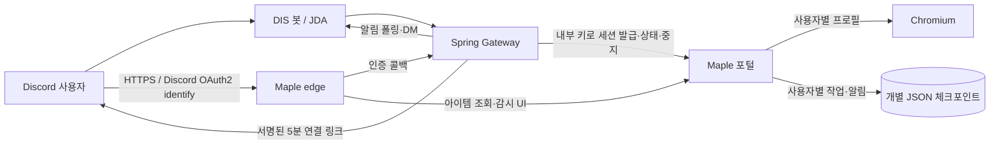

# 메이플 경매장 ↔ DIS Discord 봇 통합

## 구현한 구조

Spring Boot Gateway가 Discord 명령, 연결 링크, Discord OAuth2 인증 콜백, 개인 DM을 처리한다. 기존 Node 포털은 경매장 브라우저와 검색 실행기로 유지한다. 경매장 프로토콜을 Spring에 복제하지 않으므로 기존 검색·계산·시세 기능이 그대로 쓰인다. Gateway와 포털은 같은 Compose 내부망에서 비밀 키를 가진 HTTP로만 통신한다.

## 사용자 절차

1. `/maple connect`로 본인에게만 보이는 연결 링크를 받는다. 링크에는 Discord 사용자 ID가 HMAC으로 서명되고 5분 뒤 만료된다.
2. 웹에서 Discord OAuth2 `identify`로 인증한다. 콜백의 Discord ID와 링크의 ID가 일치할 때만 해당 ID의 포털 세션 쿠키를 발급한다. 같은 사용자가 재연결하면 이전 쿠키는 폐기된다.
3. 넥슨 공식 로그인 화면에서 본인 계정을 연결하고 캐릭터를 고른다. 웹에서 검색, 시세 조회, 감시, 삭제를 사용한다.
4. `/maple status`로 본인 작업을 보고 `/maple stop job:<ID>`로 본인 작업을 중지한다. 새 매물 감시 알림은 해당 Discord 사용자에게 DM으로 보낸다.

## 격리와 동시성

| 경계 | 적용된 규칙 |
| --- | --- |
| Discord ↔ 웹 | 실제 OAuth2 ID를 서명된 링크의 ID와 비교한다. 사용자 ID를 URL 파라미터만으로 신뢰하지 않는다. |
| 웹 세션 | 사용자마다 별도 쿠키 해시·CSRF 토큰·포털 기록·Chromium 프로필 디렉터리를 쓴다. 작업 API는 자신의 세션에서만 작업을 찾는다. |
| 넥슨 계정 | 로그인에서 관측한 계정 식별자 해시를 사용자 소유권과 비교한다. 두 사용자가 같은 계정에 연결하려 하면 거부한다. 같은 프로세스 안의 동시 연결도 예약 맵으로 막는다. |
| 검색·감시 | 한 사용자 흐름의 조회 및 감시는 직렬 실행한다. 서로 다른 사용자는 포털의 설정된 접속 상한 내에서 실행된다. 검색 POST의 재시도 규칙은 기존 포털의 체크포인트를 따른다. |
| Discord 상태·중지 | Gateway가 interaction의 사용자 ID를 내부 요청에 넣는다. 작업 ID만 알아서는 다른 사용자의 작업을 조작할 수 없다. 응답은 비공개(ephemeral)이다. |
| 알림 | 사용자별 체크포인트에 알림 대기함을 먼저 저장한다. Gateway가 DM을 보낸 후 전달 상태를 기록한다. Discord DM 거부 시 최대 3회 시도 후 중지하며 웹 작업 기록은 남는다. |

현재 배포는 **포털 1개 + Gateway 1개** 구조다. 포털 데이터 볼륨을 여러 포털 인스턴스가 동시에 열면 계정 예약과 브라우저 프로필 잠금이 공유되지 않는다. 수평 확장에는 PostgreSQL의 계정 유일 제약, 작업 lease, 분산 알림 claim이 추가로 필요하다. DM은 at-least-once이며 전송 직후 확인 기록이 실패하면 중복 전달될 수 있다.

## 용량과 배포

- 기본 `MAPLE_PORTAL_USERS=2`는 저장된 사용자 기록 수 상한이다. 새 사용자가 들어오려면 운영자가 메모리·CPU와 상한을 함께 조정해야 한다. 자동 퇴장/유휴 프로필 회수는 아직 없다.
- `maple-portal`의 Chromium은 사용자별로 분리되지만 메모리를 사용한다. 현재 Compose 제한은 3 GiB, 2 CPU이다. 사용자 수만 높여서 공개하지 않는다.
- 공개 다인 서비스에는 HTTPS 도메인과 그 주소로 가는 역방향 프록시가 필요하다. 기본 `127.0.0.1:18877`은 로컬 시험용이다.
- OAuth2 redirect URI를 Discord 개발자 포털에 정확히 등록한다. 봇 토큰, OAuth2 client secret, 링크 서명 키, 내부 API 키, Nexon API 키는 저장소에 넣지 않는다.
- 기존 `compose.portal.yaml` 독립 포털은 유지하며, 새 Discord 구성은 메인 `docker-compose.yml`의 `maple` 프로필에서 켠다.

## 검증과 잔여 작업

- 단위·HTTP 테스트: 링크 위변조/만료, OAuth2 사용자 불일치, 세션 회전, 2 사용자 용량, 사용자별 기록·API 격리, 계정 충돌, 작업 상태/중지, 알림 저장·확인.
- 실 배포 확인: Discord 개발자 설정과 공개 HTTPS 주소를 받은 뒤 개발 길드에서 `/maple connect → 로그인 → 캐릭터 선택 → 조회/감시 → DM → stop`을 실제로 실행한다.
- 확대 운영 전: 자동 유휴 사용자 회수, 동시 브라우저·검색 한도와 제공자 쿼터 통제, 중앙 DB/분산 lease, 중복 없는 DM claim, 관측 지표 및 백업.

설정과 실행 절차: [운영 가이드](../../operations/MAPLE_DISCORD_SETUP.md). Discord 참고: [OAuth2](https://docs.discord.com/developers/topics/oauth2), [interaction 응답](https://docs.discord.com/developers/interactions/receiving-and-responding).
