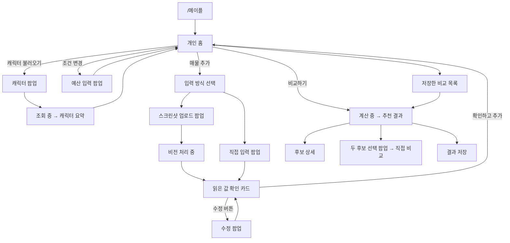
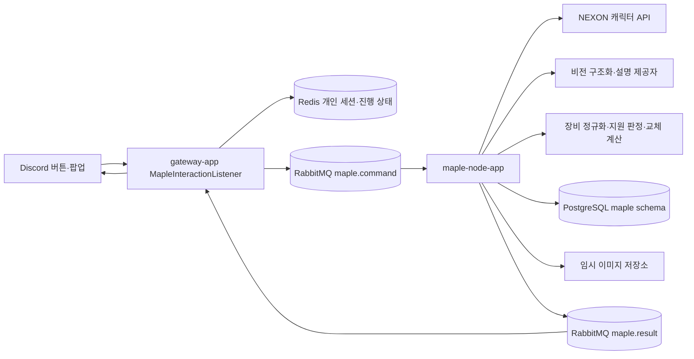

> 이전 V1 설계 보관본입니다. 현재 설계는 [V2 명세](MAPLE_GEAR_FEATURE_SPEC_2026-10-23.md)를 사용합니다.

# 메이플 장비 비교실 — 기능·Discord 인터랙션 명세

작성일: 2026-10-23. **이 문서는 구현 계획이다. 실제 봇에는 아직 추가하지 않았다.**

목표는 `/메이플` 한 번으로 개인 패널을 열고, 이후에는 버튼·선택 메뉴·팝업으로 장비 후보를 비교하는 것이다. 추천은 사용자가 확보한 매물에 한정한다. 환산 사이트의 템환산을 재현하거나 실시간 경매장 전체를 검색한다고 표시하지 않는다.

- [클릭 가능한 화면 시안](maple-gear-ui/index.html)
- [Figma 스타일 화면 보드](maple-gear-ui/design-board.png)
- 선행 조사: [공개 계산식 범위](MAPLESCOUTER_GEAR_FORMULA_CHECK_2026-10-23.md), [환산 API·약관](MAPLESCOUTER_API_CHECK_2026-10-23.md), [경매장·AI 사례](MAPLE_AUCTION_AI_CASES_2026-10-23.md)

## 1. 이번에 정한 제품 범위

| 기능 | 첫 버전의 동작 | 완료 기준 |
| --- | --- | --- |
| 진입·공개 범위 | `/메이플` → 본인만 보는 패널 | 공개 채널에 캐릭터·매물이 자동 게시되지 않음 |
| 캐릭터 선택 | 닉네임 팝업 → API 조회 → 월드·직업·장비·데이터 기준 시점 확인 | API 실패 시 이전 데이터와 새 데이터를 섞지 않고 재시도 제공 |
| 조건 설정 | 부위·추천 기준은 선택 메뉴, 예산은 팝업 | 예산 단위 명시, 0·음수·비정상 금액 거절 |
| 매물 입력 | 스크린샷 또는 직접 입력, 한 비교에 확인 완료된 후보 최대 10개 | 한 이미지에 여러 매물이 있으면 후보별로 분리하고 불확실한 값은 미확인 처리 |
| 이미지 확인 | OCR/비전이 읽은 가격·옵션·기본 능력치를 사용자에게 확인받음 | 확인 전에는 추천에 포함하지 않음. 보이지 않는 값은 추측하지 않음 |
| 교체 평가 | 현재 장비 100점 기준의 개인 교체점수와 계산 근거 | 계산기 버전·캐릭터 snapshot·비교 조건이 결과에 연결됨 |
| 추천 | 가성비·예산 내 최대 성능·최소 지출을 함께 제공 | 같은 성능에 더 비싼 매물은 이유를 달아 제외 |
| 상세·직접 비교 | 후보 상세, 후보 2개의 추가 비용·추가 성능 비교 | 총점/가격으로 가성비를 계산하지 않음 |
| 저장·복원 | 조건·확인한 후보·결과 저장/불러오기/삭제 | 다른 사용자 결과 접근 불가, 저장 당시 시점 표시 |
| 화면 갱신 | 기존 개인 패널 편집을 기본으로 사용 | 버튼을 누를 때마다 채팅 메시지가 누적되지 않음 |

### 첫 계산 모델의 지원 범위

UI와 저장 구조는 직업·부위 확장을 고려한다. **첫 검증·출시 모델은 히어로의 장갑, 같은 아이템 계열·세트·스타포스·작·추옵·에디·기타 기본 능력치를 유지한 윗잠재 교체**로 한정한다. 앞서 계산한 예제를 자동 검증할 수 있는 작은 범위부터 연다.

이 조건을 벗어나는 매물은 목록·입력은 보존하되 `현재 계산 미지원`으로 표시하고 수치 추천에서는 제외한다. 장비 기본 능력치·세트 변경과 직업별 특수 효과는 검증 후 지원표를 확장한다. 같은 장갑이라는 이유로 능력치가 같다고 추정하지 않는다.

| 후속 확장 | 필요한 추가 검증 |
| --- | --- |
| 다른 일반 직업·방어구 | 주·부스탯, 직업 패시브, 퍼센트 적용 범위, 장비별 적용 규칙 |
| 스타포스·추옵·에디 변경 | 원천 스탯 재구성 및 교체 후 전체 능력치 재계산 |
| 무기·보조·엠블렘 | 공격력%, 보공, 방무, 장비 종류·세트 효과 |
| 쿨감·버프 지속·특수 직업 | 직업/스킬별 모델. 단순 주스탯 공식 적용 금지 |
| 여러 부위의 예산 최적화 | 조합 전체 재평가. 개별 상승률을 단순 합산하지 않음 |
| 자동 경매장 후보 수집 | 제공자·접근 권한·갱신 시점이 확인된 데이터 연동 |

자동 구매, 매물 확보 보장, MapleScouter 내부 API 호출, AI가 임의로 만든 딜 점수는 첫 버전에 포함하지 않는다.

## 2. JDA 6.3.1 확인 결과

저장소의 의존성은 `modules/common-core/build.gradle`의 `net.dv8tion:JDA:6.3.1`이다. 공식 JDA **v6.3.1 소스**와 Discord 공식 API 문서를 확인했다. 최신 API에만 존재하는 기능을 현재 SDK에서 쓸 수 있다고 가정하지 않았다.

| 원하는 화면 | 실제 JDA 구성 | 적용 |
| --- | --- | --- |
| 채팅 속 카드 박스 | `Container`, `TextDisplay`, `Separator`, 필요 시 `Section` | 개인 홈·확인·결과 |
| 버튼 | `Button`, `ActionRow`, `ButtonInteractionEvent` | 입력창 열기·확인·저장·뒤로 |
| 드롭다운 | `StringSelectMenu`, `StringSelectInteractionEvent` | 부위·정렬·상세 후보 선택 |
| 텍스트 입력 팝업 | `Modal`, `Label`, `TextInput`, `ModalInteractionEvent` | 캐릭터명·예산·매물 수정 |
| 팝업의 파일 선택 | `AttachmentUpload`를 `Label` 안에 배치 | 매물 스크린샷 제출 |
| 제출된 파일 조회 | `ModalMapping.getAsAttachmentList()` | worker에 이미지 처리 작업 전달 |
| 본인만 보기 | `setEphemeral(true)` / `deferReply(true)` | 기본 공개 범위 |
| 같은 박스 내용 교체 | `editMessageComponents`, `deferEdit`, hook 편집 | 화면 전환·비동기 완료 |

`AttachmentUpload`는 봇이 파일을 보내는 `utils.FileUpload`와 다른, 사용자가 팝업에 파일을 넣는 컴포넌트다.

### 설계에 반영한 제한

- Components V2 메시지는 `useComponentsV2()`를 사용한다. 일반 `content`/`embeds`와 혼합하지 않고 본문도 `TextDisplay`로 만든다. 기존 음악·주식의 메시지 형식은 바꾸지 않는다.
- V2 메시지는 전체 컴포넌트 트리 최대 40개, 텍스트 합계 4,000자다. 결과는 상위 3개 요약과 상세 화면으로 나눈다.
- 버튼은 ActionRow 하나에 최대 5개, 선택 메뉴는 행 하나를 사용한다. String Select 옵션은 최대 25개다. 후보는 제품 정책상 최대 10개로 제한한다.
- Modal은 최상위 컴포넌트 최대 5개다. 텍스트 필드는 채팅 카드 안에 직접 넣지 않고 팝업에 배치한다.
- Modal 하단의 제출 버튼은 Discord 클라이언트 기본 UI다. 봇이 임의로 `분석하기` 등으로 바꿀 수 있다고 가정하지 않는다. 시안은 한국어 `제출`로 표현했다.
- 파일 업로드 컴포넌트는 최대 10개 첨부를 지원하지만 첫 버전은 이미지 1~3개, 파일당 최대 8MiB로 제한한다. 이는 제품 제한이며 Discord 전체 업로드 상한을 뜻하지 않는다.
- 최초 응답/ACK는 3초 이내다. API·비전·계산은 먼저 ACK한 뒤 비동기 처리한다. `replyModal` 자체가 ACK이므로 **defer 후 같은 interaction에 Modal을 열지 않는다**.
- Modal 제출에 다시 Modal로 응답할 수 없다. 제출 후 카드에 `수정` 버튼을 만들고, 그 버튼의 새 interaction에서 수정 팝업을 연다.
- 각 interaction 토큰은 15분 유효하다. 버튼 클릭은 새 interaction을 만든다. 화면 수명과 토큰 수명을 동일시하지 않는다.
- 개인 세션은 제품 정책상 **마지막 조작 뒤 10분** 유지한다. 만료 후 버튼을 누르면 새 개인 응답으로 `/메이플` 재진입을 안내한다. 저장한 비교는 다시 불러올 수 있다. 만료 시 기존 메시지를 항상 편집할 수 있다고 보장하지 않는다.
- Discord 내부에 임의 HTML/웹뷰, 자유 배치 대시보드, 슬라이더를 삽입하는 설계는 사용하지 않는다. 시안의 바깥 설명 패널은 설계 보조 UI다.

## 3. 화면과 사용자 동작



### S0 / S1 — 시작·개인 홈

신규 사용자는 `캐릭터 불러오기` 버튼으로 시작한다. 재방문자는 마지막 캐릭터와 저장한 비교를 선택할 수 있다. 닉네임 조회는 게임 계정 소유 인증을 의미하지 않는다.

캐릭터가 준비되면 다음을 한 카드에 보여준다.

```text
메이플 장비 비교실
예시히어로 · 히어로 · 스카니아
데이터 기준: 조회 결과의 기준 시점
현재 장갑: STR 21%

[ 교체 부위: 장갑                         ▼ ]
[ 추천 기준: 가성비                      ▼ ]
예산 30억 메소 · 확인한 매물 0/10

[조건 변경] [매물 추가] [비교하기]
[저장한 비교] [캐릭터 변경]
```

`비교하기`는 확인한 후보가 없으면 비활성화한다. 첫 버전에서 미지원인 부위는 선택 가능한 정상 기능처럼 보이지 않게 한다. 부위를 바꾸는 기능을 확장할 때 기존 후보는 해당 부위별로 분리한다.

### S2 — 조건 입력

예산 변경은 숫자 입력 팝업으로 연다. 첫 UI는 `예산(억 메소)` 단위를 표시한다. 선택 메뉴의 `가성비`/`최대 성능`은 추천 순서를 바꾸며 두 지표 자체는 모두 보여준다. 목적은 첫 모델에서는 보스로 고정해 사냥 모델까지 지원하는 것처럼 보이지 않게 한다.

조건 변경 시 기존 결과는 이전 조건의 결과로 표시한다. 예산만 바꾸면 이미 계산된 성능을 재사용해 다시 필터링할 수 있다. 캐릭터 snapshot이나 옵션이 바뀌면 결과를 무효화하고 다시 계산한다.

### S3 — 입력 방식·매물 팝업

- 스크린샷: 이름(선택), 이미지 1~3개. 이름이 없으면 `매물 1`처럼 부여한다.
- 직접 입력: 이름, 가격, 윗잠재 3줄, 기본 조건 일치 여부, 출처/메모(선택). 최대 5개의 Label을 사용한다.
- 스크린샷에는 가격·이름·전체 비교 옵션이 보여야 한다. 누락되면 사용자 수정이 필요하다.
- 기존 장비의 합산값과 세부 옵션을 동시에 읽어 중복 가산하지 않는다. 같은 장비의 여러 스크린샷을 별도 후보로 무작정 세지 않는다.

### S4 — 읽은 값 확인

가격, 아이템명, 잠재 3줄, 스타포스·작·추옵·에디 등 비교 조건 일치 상태를 보여준다. 읽지 못한 항목은 `미확인`으로 표시한다. 출처는 `사용자 스크린샷` 또는 `직접 입력`, 시간은 입력 시점으로 표시한다. 이를 실제 매물 갱신 시점으로 둔갑시키지 않는다.

버튼은 `수정` / `확인하고 추가` / `취소`다. 미확인 필수값이 있으면 확인 버튼을 비활성화한다. 기본 조건이 다르면 첫 모델의 계산 미지원 이유를 설명한다. AI의 신뢰도 백분율은 근거 없이 만들지 않는다.

### S5 — 추천 결과

후보를 예산·착용 조건·모델 지원 여부로 분류한 뒤 요약한다.

```text
장갑 비교 결과
가져온 매물 3개 · 예산 30억

B · 가성비 추천
14억 · 103.17점 · 모델 성능 +3.17%
1억당 +0.226점

C · 최대 성능
29억 · 105.16점 · 모델 성능 +5.16%

A · 최소 지출
9억 · 101.59점 · 모델 성능 +1.59%

[ 자세히 볼 매물 선택                   ▼ ]
[두 개 비교] [조건 변경] [결과 저장]
[돌아가기] [매물 추가]

현재 장비 100점 기준 · 자체 모델
```

위 수치는 설명용 가상 매물의 계산 결과이며 실제 시세가 아니다. 실제 화면에도 자체 모델과 현재 장비 100점 기준임을 명시한다.

### S6 — 상세·직접 비교

상세에는 교체 전후 STR/크뎀, 점수 변화, 가격 효율, 추천 이유, 미반영 조건, 입력 출처·기준 시점을 보여준다. AI 설명 실패 시 숫자와 템플릿 설명은 유지한다.

`두 개 비교`는 Modal의 다중 String Select(`min=2`, `max=2`)를 사용한다. B→C라면 `추가 15억`, `현재 기준 +1.99점`, `B 착용 대비 모델 성능 +1.93%`를 구분한다. 좌우 가변 대시보드 대신 모바일에서도 읽히는 세로 요약을 사용한다.

### S7 — 저장·만료·오류

저장 대상은 캐릭터 snapshot, 조건, 사용자 확인한 후보, 계산 결과, 모델 버전, 입력 출처·시점이다. 저장 데이터를 불러오면 `저장 당시 결과`로 표시한다. 새 시세나 새 장비를 자동 반영했다고 표시하지 않는다.

| 상태 | 사용자에게 보이는 처리 |
| --- | --- |
| 캐릭터 없음/API 지연 | 입력한 이름 보존, 오류 설명, 재시도 버튼 |
| 이미지에서 가격 누락 | `가격 미확인` → 수정 버튼, 추천 전 확인 필수 |
| 예산 내 후보 없음 | 억지 추천 대신 조건 변경·후보 추가 버튼 |
| 입력 옵션/기본 조건 미지원 | 보존하되 점수 `계산 미지원`, 제외 이유 표시 |
| 계산/비전 제한시간 초과 | 처리 중 표시 종료, 재시도. 뒤늦은 이전 결과로 새 화면을 덮지 않음 |
| 중복 클릭·이전 화면 버튼 | operation id와 session revision으로 중복 작업/이전 결과 적용 차단 |
| 세션 만료 | 새 개인 응답으로 재진입 안내, 저장 데이터 복원 |
| 다른 사용자 세션 ID 사용 | 거절. 결과·이미지·토큰을 노출하지 않음 |

## 4. 점수·추천 계약

첫 예제 모델은 크리 확률 100%, 공격력·보공·방무·세트·기타 효과가 같다는 조건을 검증한다.

```text
S = percentEligibleSTR × (1 + totalSTRPercent/100) + nonPercentSTR
P = (4×S + DEX) × (1.35 + criticalDamage/100) × unchangedFactors
replacementScore = 100 × P_after / P_before
gainPoints = replacementScore - 100
efficiency = gainPoints / purchasePriceInEok
pairwiseGainPercent = 100 × (P_moreExpensive / P_other - 1)
```

캐릭터 API의 표시 합계만으로 원천 스탯이 모두 복원된다고 가정하지 않는다. 필요한 원천값을 재구성하고 현재 장비의 표시 능력치와 정합성을 확인하는 단계가 선행돼야 한다. 복원 불가 상태는 점수 계산을 막고 이유를 표시한다. 첫 모델의 수치는 실전 보스 DPS·환산 사이트 템환산으로 치환하지 않는다.

추천은 양의 개선량이 있는 지원 후보를 대상으로 한다. 같은 성능·조건에서 비싼 후보는 우선순위에서 제외한다. 예산 기준은 총 매입가이며 기존 장비 판매 수익은 기본으로 포함하지 않는다. 동점 정렬은 가격 낮은 순, 후보 ID 순으로 고정한다.

AI는 이미지 구조화와 숫자에 근거한 설명을 담당한다. 계산·지원 여부 판정·필터링·순위는 결정적인 계산 엔진이 담당한다. 사용자가 가져온 후보 중 추천이라는 범위를 항상 유지한다.

## 5. 현재 저장소에 추가할 구조



- `modules/maple-core`: commands/results, candidate/snapshot/score DTO, 모델 지원 표. JDA·외부 AI SDK 의존 없음.
- `apps/maple-node-app`: 캐릭터 제공자, 이미지 작업, 정규화, 모델·추천, 저장. Discord 연결 없음.
- `apps/gateway-app`: `MapleInteractionListener`, `MaplePanelRenderer`, session router, result listener. 기존 음악/주식 listener에 거대한 분기를 추가하지 않는다.
- 현재 `InteractionResponseEditor`는 문자열 편집 계약이다. Maple용 component renderer/editor를 별도로 추가해 기존 음악·주식 응답과 분리한다.
- `custom_id`: `mg:{sessionId}:{revision}:{action}`. ID는 상태 조회 키일 뿐 인증 수단이 아니다. 서버에서 사용자·길드·세션 소유권을 검사한다. 100자 이내.
- 비동기 command/result에 `operationId`, `sessionId`, `revision`, `responseTargetNode`를 포함한다. interaction을 ACK한 뒤 발행하고, 결과를 받은 gateway가 최신 개인 패널을 갱신한다.
- 운영용 Nexon API 키와 AI 키는 서버 설정으로 관리한다. 기본 캐릭터 조회에 개인 키 제출을 요구하지 않는다. 별도 본인 인증/개인 키가 필요한 API는 추후 인증 흐름을 설계한다. Discord Modal에 비밀번호 마스킹이 있다고 가정하지 않는다.
- 원본 이미지는 개인 비교 작업용으로 한정해 임시 보관(계획 TTL 24시간)한다. 결과 저장 시 원본까지 영구 저장하지 않는다. 보고서에는 확인한 옵션과 필요한 출처 정보만 남긴다.

## 6. 구현 순서와 완료 조건

| 순서 | 작업 | 다음 단계로 넘어가는 조건 |
| --- | --- | --- |
| 1 | 현재 문서·프로토타입 검토 기준 고정 | S0~S7, 제품 범위, 지원 모델 확정 |
| 2 | JDA 개인 패널·버튼·선택 메뉴·Modal·세션 | fixture로 처음부터 저장/복원까지 동작, 3초 ACK와 사용자 격리 확인 |
| 3 | Nexon 캐릭터 snapshot·정규화·직접 입력 | 표시 합계/원천값 정합성 확인, 실패·미지원 상태 표현 |
| 4 | 히어로 장갑 계산·추천 | 아래 회귀 fixture 재현, 예산/지배 후보/미지원 조건 검증 |
| 5 | 스크린샷 비전·수정/확인 | 가려진 가격·누락 옵션·여러 이미지·중복 업로드를 확정 전 후보와 구분 |
| 6 | worker 저장·비동기 결과·운영 관측 | 지연/실패/중복 결과/만료를 격리하고 재시작 후 저장 결과 복원 |
| 7 | 비공개 Discord 테스트 서버에서 실제 UI 확인 | PC·모바일 Modal 업로드, 연속 선택, 재시도, 기존 음악·주식 영향 확인 |

필수 숫자 fixture:

| 매물 | STR% / 크뎀 추가 | 가격 | 점수 | 1억당 개선점수 |
| --- | --- | --- | --- | --- |
| 현재 | 21 / 0 | — | 100 | — |
| A | 30 / 0 | 9억 | 101.592646 | 0.176961 |
| B | 18 / 8 | 14억 | 103.170294 | 0.226450 |
| C | 9 / 16 | 29억 | 105.160302 | 0.177941 |
| D | 18 / 8 | 22억 | B와 동일 | B보다 비효율 |
| E | 12 / 16 | 45억 | 예산 30억에서 제외 | — |

원천 STR 7,200, 다른 STR% 300%, 비적용 STR 10,000, DEX 1,500, 기본 추가 크뎀 80%를 사용한다. B→C 추가 성능은 약 1.928857%다. 테스트는 UI 렌더 구현을 그대로 복제하기보다 이 수치와 상태 전이·데이터 격리·지연 결과 차단을 검증한다.

## 7. 조사 출처

2026-10-23 확인. Javadoc 호스트는 이 환경의 네트워크 정책으로 접근되지 않아 **공식 GitHub 저장소의 동일 버전 소스**를 읽었다. API 문서는 공식 Discord 저장소에서 확인했다.

- [JDA v6.3.1 Container](https://github.com/discord-jda/JDA/blob/v6.3.1/src/main/java/net/dv8tion/jda/api/components/container/Container.java)
- [JDA v6.3.1 Modal](https://github.com/discord-jda/JDA/blob/v6.3.1/src/main/java/net/dv8tion/jda/api/modals/Modal.java)
- [JDA v6.3.1 AttachmentUpload](https://github.com/discord-jda/JDA/blob/v6.3.1/src/main/java/net/dv8tion/jda/api/components/attachmentupload/AttachmentUpload.java)
- [JDA v6.3.1 ModalMapping](https://github.com/discord-jda/JDA/blob/v6.3.1/src/main/java/net/dv8tion/jda/api/interactions/modals/ModalMapping.java)
- [JDA v6.3.1 MessageRequest / V2](https://github.com/discord-jda/JDA/blob/v6.3.1/src/main/java/net/dv8tion/jda/api/utils/messages/MessageRequest.java)
- [Discord 공식 컴포넌트 명세, 확인 커밋](https://github.com/discord/discord-api-docs/blob/aaef8ae4c3398fcdabeec0d1dd5a3e69be587ad8/developers/components/reference.mdx)
- [Discord 공식 interaction 응답·제한, 확인 커밋](https://github.com/discord/discord-api-docs/blob/aaef8ae4c3398fcdabeec0d1dd5a3e69be587ad8/developers/interactions/receiving-and-responding.mdx)

[분석 문서 목록](README.md)
