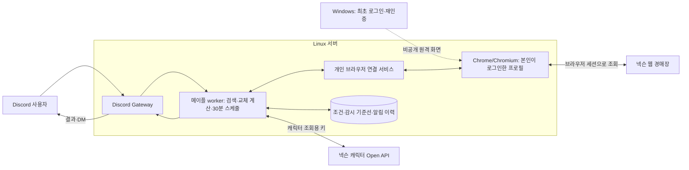

# Windows를 꺼도 경매장을 감시할 수 있는가

2026-10-23 KST · 본인 계정으로 사용하는 개인용 Discord 봇 기준. 공개 공식 문서·공개 클라이언트 코드·공개 프로젝트를 조사했다. 실제 넥슨 로그인·쿠키 추출·인증된 매물 조회·운영 서버 배포는 수행하지 않았다.

## 판단

**리눅스 서버에 브라우저도 함께 운영하고, 사용자가 그 브라우저에 직접 로그인하는 구성이 개인용 검증 후보로 가장 현실적이다.** Windows는 최초 로그인/재인증 때 서버 브라우저 화면에 접속하는 용도로 쓰고, 이후에는 서버의 브라우저·검색 worker·Discord 봇이 계속 실행되는 구조다.

이는 브라우저 없이 호출하는 공식 경매장 서버 API를 찾았다는 뜻이 아니다. **Linux에서의 실제 넥슨 인증·검색 성공, 서버 IP의 이용 가능 여부, 세션 유지 시간, 자동 조회 허용 범위는 미검증이다.** 서버 브라우저 운영 기술의 존재와 Nexon 서비스 지원을 구분한다.

앞선 설명에서 “Windows를 끄려면 공식 서버용 API를 확보해야 한다”고만 말한 것은 범위를 좁혀 설명한 것이다. 브라우저를 Linux 서버에 두는 대안도 있다. 반대로, API 키나 Open ID 토큰이 있으면 브라우저 없이 경매장 검색을 계속할 수 있다는 근거는 찾지 못했다.

## 1. 새로 확인한 근거

| 근거 | 확인한 내용 | 증명하지 않는 내용 |
| --- | --- | --- |
| [공식 메이플 Open API 페이지](https://openapi.nexon.com/ko/game/maplestory/)의 YAML 8개 재조회 | 총 56개 경로. 조사 범위에 경매장 검색·신규 매물 구독 경로 없음 | 비공개 제휴 API까지 없다는 뜻은 아님 |
| [공식 이용 가이드](https://openapi.nexon.com/ko/guide/) 공개 응답의 한국어 Open ID scope 표 | 메이플 scope 7종: 캐릭터 목록·스타포스·잠재·큐브·업적·스케줄러·소울 잠재 이력. 경매장 scope 미확인 | Open ID 로그인으로 경매장 웹 세션을 발급할 수 있다는 근거가 아님 |
| [공식 웹 경매장의 공개 코드](https://auction.maplestory.nexon.com/assets/index-DPLLR4h6.js) | 브라우저 세션 생성, `credentials` 기반 요청, OTP·그린메이플ID 안내, 다른 환경 접속 시 세션 종료 안내, 검색 100회/일·자정 초기화 | 공식 서버 간 인증 계약·갱신 보장·자동 조회 허가가 아님 |
| [lilllee/maple-auction README](https://github.com/lilllee/maple-auction/blob/3ae0bf31b8ff762739e5af3db60484d861d9232f/README.md)·[browser.ts](https://github.com/lilllee/maple-auction/blob/3ae0bf31b8ff762739e5af3db60484d861d9232f/src/nexon/browser.ts) | persistent Chromium profile, 화면 있는 브라우저, 사용자의 수동 로그인/OTP, 브라우저 내부 요청으로 감시하는 공개 구현 | README의 운영 대상은 Windows 회사 PC. Linux에서 인증 성공한 실증 자료가 아님 |
| 같은 프로젝트의 [감시 loop](https://github.com/lilllee/maple-auction/blob/3ae0bf31b8ff762739e5af3db60484d861d9232f/src/watch/loop.ts) | 잔여량 확인, 세션 복구 시도, 실패하면 재로그인 안내, 중첩 실행 방지 | 모든 환경에서 무인 복구된다는 보장이 아님 |
| [Selenium 공식 Docker 프로젝트](https://github.com/SeleniumHQ/docker-selenium/blob/7d9aaf4cd13f119dce64eb258d665149131de011/README.md#using-your-browser-no-vnc-client-is-needed) | Linux에서 Chrome/Chromium을 실행하고 noVNC로 실제 브라우저 화면에 원격 접속하는 표준 구성 제공 | 해당 브라우저에서 넥슨 로그인이 허용·성공한다는 증거는 아님 |

공식 웹 코드의 초기 호환성 검사에서 iOS/Android 버전 판별을 확인했으며, 그 함수에는 Linux만을 차단하는 분기가 없다. 이것만으로 로그인 SDK·OTP·기기 검증을 통과한다고 결론 내리지 않는다. `signin.nexon.com` SDK 본문은 환경 프록시가 403으로 거절해 확인하지 못했다.

## 2. 인증 방식별 결론

| 방식 | Windows 종료 후 운영 | 현재 판단 |
| --- | --- | --- |
| 일반 Nexon Open API 키 | 캐릭터 조회·계산 데이터는 서버 처리 가능 | 키만으로 경매장 검색은 확인되지 않음 |
| NEXON Open ID | 지원 scope의 사용자 데이터는 토큰 기반 서버 호출 가능 | 공개 scope 표에 경매장 없음. access/refresh token을 경매장 쿠키처럼 취급하지 않음 |
| Windows Chrome → 서버 연결 | Windows/Chrome이 계속 실행돼야 함 | 구현이 단순한 대안이지만 PC를 끄고 싶다는 요구를 충족하지 못함 |
| **Linux Chrome/Chromium + 본인 직접 로그인** | 서버 브라우저의 세션이 유효하면 구조상 Windows 없이 실행 가능 | **개인용 검증 권장안. Linux Nexon 로그인·검색 실증이 먼저 필요** |
| 쿠키를 복사해 서버 HTTP 클라이언트에 입력 | 기술적 공개 구현은 존재 | 공식 인증 계약·장기 유지 근거가 아님. 현재 앱은 쿠키 추출·서버 이전 방식으로 전환하지 않음 |

쿠키 기반 직접 호출 사례는 [kyu0204/MapleAuction의 서버 코드](https://github.com/kyu0204/MapleAuction/blob/f7956de473a47c39f8e85af22f66990507d512de/server.js)에서 확인했다. 이 프로젝트는 로그인 쿠키와 웹 거래소 세션을 구분하고 갱신을 시도한다. 코드 주석의 ‘웹 세션 3시간’은 독립 개발자의 설명이며, Nexon 공식 수명·우리 환경의 보장값으로 사용하지 않는다. 로그인 쿠키를 `.env`에 보관하는 이 구현을 우리 앱에 복사하지 않았다.

**일반 API 키, Open ID grant, 웹 경매장 로그인 세션은 서로 다른 인증 수단이다.** Open ID 프렌즈 호출량 표의 높은 한도를 웹 경매장 검색 100회/일에 적용해서도 안 된다.

## 3. 권장하는 개인용 구성

아래는 제안이며 운영 구현/배포 완료 상태가 아니다. Chrome을 포함하는 개인 연결 서비스를 기존 봇과 분리한다.

- 비공개 원격 화면은 noVNC/원격 데스크톱 등을 쓰고, 관리용 접속은 SSH 터널이나 허용된 사설망으로 제한한다. 브라우저 제어 포트를 공개 서비스 API로 노출하지 않는다.
- 전용 브라우저 프로필은 서버의 지속 볼륨에 둔다. Windows 프로필·쿠키를 복사하는 대신 **Linux 브라우저에서 사용자가 정상 로그인**한다.
- 로그인 비밀번호·OTP를 봇이나 LLM에 맡겨 자동 처리하지 않는다. 별도 사람이 필요한 인증이 나오면 해당 계정 감시를 멈추고 재인증을 안내한다.
- 검색 요청은 정상 로그인한 브라우저 안에서 수행한다. User-Agent 위장·CAPTCHA 우회·위조 세션 발급을 전제로 하지 않는다.
- 로그아웃·철회·세션 무효화가 감지되면 이전 세션으로 계속 요청하지 않는다. 프로필 저장은 세션 유효성 보장이 아니다.

Selenium Docker의 noVNC는 브라우저를 보거나 조작할 수 있는 기술 예시다. 현재 로컬 프로토타입에 Selenium 의존성이 필요하다고 확정한 것은 아니다. 브라우저와 Node 연결기를 같은 실행 환경에 두는지, private 통신으로 연결하는지에 따라 구현을 결정한다. 브라우저 자동화 세션 자체의 idle timeout과 Linux 컨테이너 재시작 정책도 별도 관리해야 한다.

## 4. 사용자에게 보이는 사용 과정

1. 최초 한 번 서버 브라우저의 비공개 화면에 접속한다.
2. **공식 넥슨 페이지에서** 본인 계정 로그인·OTP 등 요구되는 인증을 직접 완료한다.
3. 본인 캐릭터 목록에서 `에반이였솜`을 확인해 선택한다.
4. 접속 화면을 닫는다. Windows를 꺼도 Linux의 브라우저와 worker는 유지하는 구조다.
5. Discord `/아이템`에서 부위·아이템·예산·옵션을 선택한다.
6. Linux worker가 서버 브라우저로 매물 조회 → 캐릭터 데이터와 교체 계산 → Discord 개인 응답을 처리한다.
7. 감시를 켜면 Linux가 30분마다 새 검색을 생성하고 기존 매물·중복을 제외해 DM을 발송한다.
8. 세션 만료나 다른 환경의 웹 경매장 로그인으로 연결이 끊기면 감시를 일시중지하고 재로그인을 안내한다. 필요할 때 1~2단계를 반복한다.

정상 세션인 동안 사용자의 Windows가 실행될 필요를 없애는 구성이다. 한 번 로그인한 뒤 영구 무인 운영되는 서비스라고 표현하지 않는다. 동일 계정의 다른 웹 경매장 접속이 서버 세션에 주는 영향도 실험해야 한다.

## 5. 개인용과 여러 사용자용 서비스의 차이

본인 한 계정은 브라우저 프로필 한 개로 작은 검증을 시작할 수 있다. 여러 사용자의 로그인 세션을 맡는 서비스는 별개다.

- 사용자별 브라우저 프로필·접속 화면·검색 결과·캐릭터·한도를 격리해야 한다.
- Discord ID와 브라우저 계정 확인 결과를 결합해야 하며, Open ID 연결만으로 경매장 세션 소유권을 대신하지 않는다.
- 사용자마다 OTP·세션 만료·다른 환경 접속이 발생할 수 있다. 브라우저 프로필 수와 운영 비용도 늘어난다.
- 일반 공개 서비스로 제공하려면 경매장 자동 조회·서버 이용의 허용 범위와 정식 인증 경로를 제공자에게 확인해야 한다. 공개 코드의 MIT 라이선스는 Nexon API의 사용 허가를 대신하지 않는다.

따라서 지금 목표인 **본인용 Linux 검증**과 이후 **불특정 다수에게 제공하는 정식 봇**을 같은 완료 상태로 취급하지 않는다.

## 6. 실제 Linux에서 통과해야 하는 검증

현재 작업에서는 아래를 실행하지 않았다. 실제 본인 계정의 공식 화면 조작이 필요한 검증이다.

| 순서 | 실험 | 판정 |
| --- | --- | --- |
| 1 | Linux 서버의 정상 Chrome/Chromium에서 공식 페이지 열기 | 로그인·OTP 화면 정상 표시, 환경/IP 제한 여부 확인 |
| 2 | 사용자 직접 로그인 후 본인 계정·캐릭터 목록 조회 | `에반이였솜`의 소유 계정·월드 확인 |
| 3 | 조건 한 개로 실제 매물 조회·착용 장비 대조 | 가격·옵션·월드 정합성, 계산 지원 여부, 한도 차감 확인 |
| 4 | Windows의 원격 화면을 닫은 뒤 30분 후 조회 | 서버 브라우저·worker가 단독으로 처리하는지 확인 |
| 5 | 3시간·6시간·24시간 운영 관측 | 계정 세션 유지·공식 페이지를 통한 복구·재인증 필요 시점 기록. 3시간은 보장 수명이 아님 |
| 6 | 연결 종료·서버 재시작·다른 환경 접속 상황 확인 | 잘못된 계정 결과·중복 DM 없이 중지/복구하는지 확인 |

30분마다 조건 한 개를 새 검색하면 정기 검색 **48회/일**에 최초·수동 검색이 추가된다. 여러 조건이나 시세 조회는 같은 집계 한도를 더 사용한다. 이 간격만으로 대량 감시가 가능해지는 것은 아니다.

## 7. 현재 코드에서 추가할 부분

[개인용 프로토타입](../../../tools/maple-local-prototype/README.md)은 Windows 확장 방식과 [Linux 도커 브라우저 방식](../../../tools/maple-local-prototype/DOCKER.md)을 지원한다. 도커의 headed Chromium·noVNC·검색 어댑터·계산·30분 감시를 실행했고, 모의 데이터로 전체 흐름을 검증했다. 실제 계정 인증은 아직 검증 전이다. 이 클라우드에서는 `signin.nexon.com/sdk/inface.js` 연결이 프록시 CONNECT 403으로 차단되어 있다.

서버 브라우저/원격 화면, 프로필 볼륨, 계정 변경·인증 만료 시 감시 무효화와 재인증 안내는 개인용 도커 구성에 추가했다. 남은 구현은 기존 Linux Discord 봇으로 결과 전달·DM, 감시/기준선의 DB 복원이다. 현재 프로토타입의 메모리 감시 상태는 재시작하면 사라지므로 이를 그대로 운영 서버 완료본으로 취급하지 않는다. 정확한 검증 범위는 [검증 기록](../../../tools/maple-local-prototype/VALIDATION.md)을 따른다.

현재 연결기가 `127.0.0.1`로 제한된 것은 로컬 도구의 구현 선택이다. 경매장 API가 Windows를 본질적으로 요구해서 넣은 제한은 아니다. 그렇다고 브라우저 없이 서버 HTTP 호출로 바꾸면 된다는 뜻도 아니다.

## 8. 공식 제공자에게 확인할 질문 초안

다음은 검토용 초안이며 문의를 실제 발송하지 않았다. 공식 [Open API 지원/FAQ](https://openapi.nexon.com/ko/support/faq/)에서 지원 경로를 확인할 수 있다.

1. 본인 계정으로 정상 로그인한 브라우저에서 30분 간격의 개인용 경매장 조회·알림이 허용되는가?
2. Linux 서버의 Chrome/Chromium에서 사용자가 직접 로그인하는 운영 환경을 지원하는가? 서버 IP·해외 리전 관련 제한이 있는가?
3. 외부 개발자용 경매장 검색 API 또는 프렌즈/제휴 경로가 있는가? 있다면 별도 scope·심사·계약·일일 한도는 무엇인가?
4. 웹 세션의 만료·갱신·동시 접속 정책과 자동 조회 중 재인증 처리 기준은 무엇인가?
5. 여러 사용자용 Discord 봇에 사용자별 검색·감시 결과를 제공하려면 어떤 승인/이용 조건이 필요한가?

## 조사 한계·출처

- `https://openapi.nexon.com/ko/game/maplestory/` 및 여기서 연결한 YAML 8개를 다시 읽었다. 총 56개 경로에 경매장 관련 정의 미확인.
- Open ID 표는 접속 가능한 공식 이용 가이드가 내려준 한국어 `__NEXT_DATA__`의 `docsPage.openIdDevelopmentGuide.dataApiTable`을 확인했다. 지정 프렌즈·공개 서비스 검수 조건은 기존 [Open ID 조사](MAPLE_OPENID_LOGIN_CHECK_2026-10-23.md)와 동일하다.
- 경매장 번들 URL은 사이트 배포 시 바뀔 수 있다. 공개 코드 관찰은 서버 인증 계약이나 실제 로그인 응답의 증명이 아니다.
- Playwright 공식 문서 사이트·Chrome 지원 페이지·넥슨 로그인 SDK는 이 환경의 목적지 정책으로 본문을 읽지 못했다. 브라우저 컨테이너 근거는 접속에 성공한 Selenium 공식 GitHub 문서다.
- 공개 감시 프로젝트와 쿠키 프록시 프로젝트는 코드를 읽었으며 실행·로그인하지 않았다. 제공자 허용 여부와 독립 개발자의 동작 설명을 구분했다.
- 현재 Codex 클라우드 브라우저의 확장 설치 차단은 이 환경의 관리자 정책이다. 이를 모든 Linux 서버의 제한이라고 일반화하지 않는다.

[검색 API 상세](MAPLE_AUCTION_SEARCH_API_REFERENCE_2026-10-23.md) · [기술 명세](MAPLE_MARKET_TECH_SPEC_2026-10-23.md) · [분석 목록](README.md)
