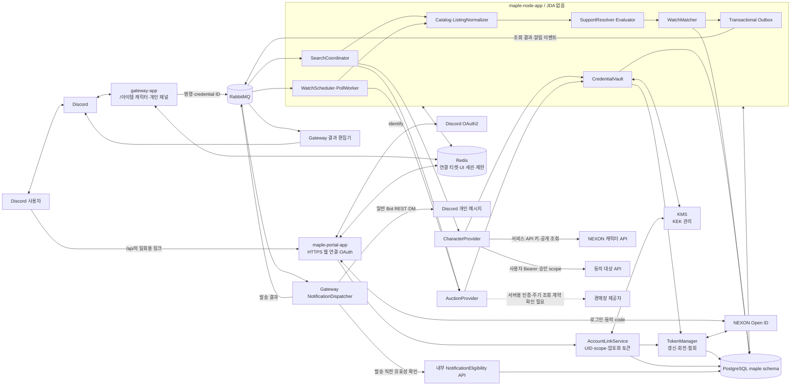
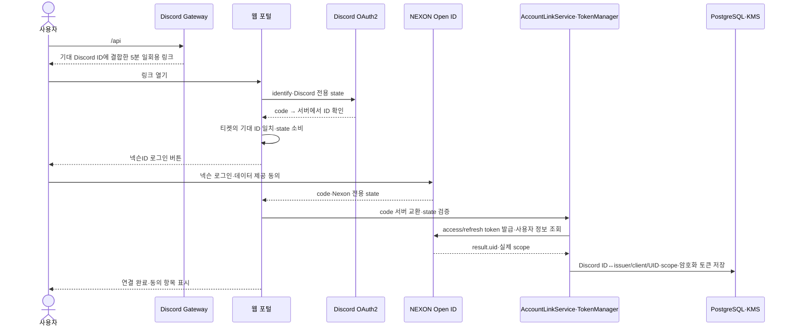
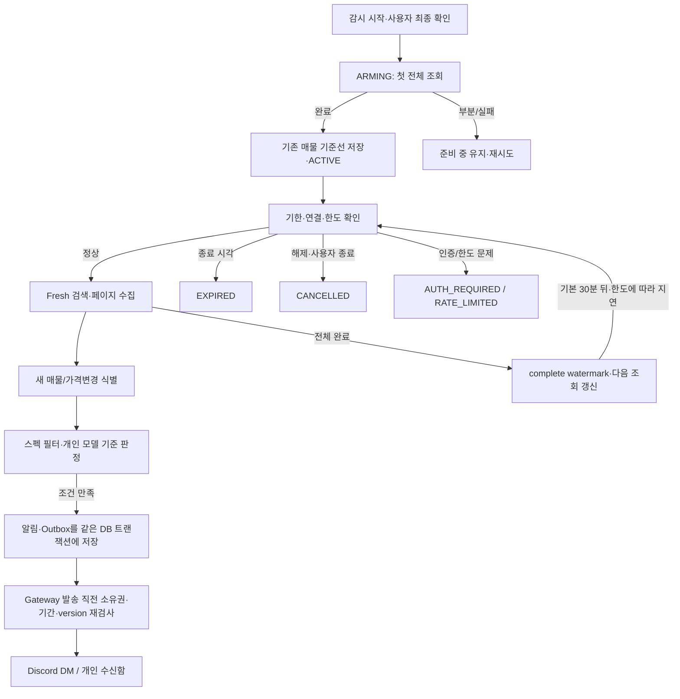

# 메이플 매물 검색·알림 — 기술 명세·아키텍처 V3

2026-10-23 · 설계 문서, 실제 서비스 미구현. [기능 명세](MAPLE_GEAR_FEATURE_SPEC_2026-10-23.md), [외부 API 확인 근거](MAPLE_MARKET_API_CHECK_2026-10-23.md).

후속 [Linux 운영 가능성 조사](MAPLE_LINUX_AUCTION_FEASIBILITY_2026-10-23.md)에서 본인이 Linux의 브라우저에 직접 로그인하고 서버가 브라우저를 유지하는 개인용 구성을 검증 후보로 정했다. Windows를 계속 켜두는 방식과 구분하며, 실제 Nexon Linux 로그인·검색·세션 유지 성공을 확인한 것은 아니다.

## 1. 설계 전제와 외부 계약

확정 요구는 `/아이템 캐릭터:닉네임` 기준 공개 조회, `/api` 웹의 Discord·NEXON Open ID 연결, 사용자별 암호화 토큰 보관, 아이템 다중 선택·±30% 검색·기간 DM 알림이다. 일반 공개 조회는 서비스 소유 API 키, 동의 대상은 사용자 Bearer 토큰을 사용한다. [Open ID 조사](MAPLE_OPENID_LOGIN_CHECK_2026-10-23.md)를 기준으로 개인 키 필수 입력 V2를 수정했다.

`CharacterProvider`와 `AuctionProvider`를 별도 포트로 둔다. 캐릭터 조회·Open ID 로그인 성공을 경매장 연결 성공으로 해석하지 않는다. 실제 활성화 조건:

1. Open ID 사용에는 프렌즈 접근·client 등록·scope 선택·테스트 사용자·공개 검수를 확인. 공개 조회용 서비스 키는 해당 앱의 이용 조건·한도를 준수.
2. 경매장 제공자의 서버 검색·주기 조회 및 필요한 인증 계약 확인.
3. 안정적인 매물 ID, 옵션·가격·월드·판매 상태, 카탈로그, 페이지·갱신 의미, 호출 한도 검증.

로그인된 브라우저 연결형을 지원하게 된다면 별도 `BrowserSessionProvider`로 표시하고 세션/브라우저의 가용성에 의존함을 노출한다. 사용자 쿠키 추출·가짜 헤더·접근 제한 우회를 구현 경로로 삼지 않는다. 공급자 미설정 상태에서는 `AUCTION_PROVIDER_UNAVAILABLE`을 반환한다. 존재하지 않는 공식 경매장 엔드포인트를 만들어 호출하지 않는다.

## 2. 서비스 아키텍처

아래 Mermaid가 V3의 기준이다. [이전 V2 키 등록 컨셉 그림](maple-market-ui/architecture.png)은 보관 자료이며 현재 인증 흐름은 아래의 넥슨 Open ID 분기를 사용한다.



배포 단위는 기존 gateway/audio/stock에 `maple-portal-app`, `maple-node-app`을 추가한다. NotificationDispatcher는 gateway 내부 컴포넌트다. 새 Maple worker는 Discord/JDA 세션을 만들지 않는다. KMS는 선택한 인프라의 외부 키 관리 서비스이며, 이번 문서 작업에서 실제 생성하지 않았다.

포털은 외부 HTTPS로 노출하고 worker·DB·broker·내부 NotificationEligibility API는 내부망으로 제한한다. `maple.example.com`은 설계용 예시 도메인이며 실제 배포 주소가 아니다.

## 3. `/api`와 넥슨 로그인 연결



- Discord와 Nexon OAuth의 state는 분리하며 각각 웹 세션·기대 사용자에 결합한다. 한번 사용하면 재사용하지 않는다. 임의 query/body user ID로 매핑하지 않는다.
- Nexon UID는 검증된 사용자 정보 조회 응답 `result.uid`를 사용한다. 닉네임·OCID·브라우저가 보내준 UID를 계정 식별자로 믿지 않는다. issuer/client ID와 함께 namespace를 보관한다.
- PKCE/OIDC id_token을 사용할 경우 제공자 지원·검증 계약을 별도 확인한다. 이번 공개 자료에서 확인한 사용자 정보 API 경로와 UID를 기본으로 하며 미확인 id_token claim으로 계정을 연결하지 않는다.
- 최소 scope만 요청한다. 계정 캐릭터 목록에는 `maplestory.characterlist`, 다른 개인 이력은 필요한 scope를 추가로 승인·동의받는다. 공개 장비 조회나 경매장을 이 scope가 자동 허용한다고 간주하지 않는다.
- 토큰·인가 코드는 백엔드에서만 사용한다. URL code는 callback 처리 직후 소비·정리하며 로그·분석 도구·브라우저 저장·큐·AI 입력에 넣지 않는다.
- 세션 쿠키는 Secure/HttpOnly/SameSite=Lax, 연결 해제·재동의에는 CSRF 검증. Discord/Nexon client secret은 서비스 비밀 설정으로 관리한다. 넥슨 비밀번호나 웹 경매장 쿠키는 받지 않는다.
- Open ID 승인 전 UI는 연결 준비 상태로 표시한다. 일반 사용자 개인 API 키 발급·수집은 V3 기본 경로에서 제외한다. BYOK는 기존 V2의 별도 검토 경로로 보존한다.

## 4. 암호화·토큰 갱신·지속 연결

공개 API용 **서비스 키**, Nexon **client secret**, 사용자별 **access/refresh token**, 경매장 제공자 인증은 구분한다. 서비스 키는 사용자마다 발급하거나 개인 소유로 매핑하지 않는다.

사용자 토큰은 AES-256-GCM + KMS envelope encryption으로 보관한다. token bundle을 쓰는 경우 access/refresh와 각 만료를 함께 versioning한다. 각 쓰기마다 새 DEK·96비트 nonce를 사용하고 AAD에 owner Discord ID·grant ID·provider/client·grant version을 결합한다. DB에는 암호문·nonce·tag·wrapped DEK·KEK version만 저장한다. gateway와 NotificationDispatcher는 복호화 권한을 갖지 않는다.

가이드 설명은 access 30분·refresh 14일이다. 실제 만료는 `expires_in`, `refresh_token_expires_in` 응답과 서버 발급 시각으로 계산한다. 예시 JSON의 숫자를 고정 수명으로 복사하지 않는다.

```text
token 만료 임박 → grant별 단일 갱신 lock
→ 서버에서 refresh 요청
→ 새 access token + 새 refresh token + 만료 정보를 하나의 TX/CAS로 교체
→ 새 grant version으로 대기 작업 재검사
```

실제 구현에서는 refresh 응답의 회전된 토큰을 버리거나 이전 refresh token을 계속 재사용하지 않는다. 여러 worker가 동시에 같은 refresh token을 쓰지 않게 한다. 프로세스 장애·응답 유실·회전 후 저장 실패 시 제공자 계약에 따라 복구하며 임의의 무제한 refresh 재시도를 하지 않는다.

Discord↔Nexon UID 연결 자체와 현재 인증 상태는 독립적이다. 상태는 CONNECTED/REFRESHING/REAUTH_REQUIRED/REVOKED를 둔다. refresh 만료·동의 철회 때 해당 grant가 필요한 작업만 중지하고 재로그인을 안내한다. 공개 캐릭터 조회·경매장 인증의 의존성을 별도로 기록한다. 계정 전체 삭제 요청은 관련 감시 전체를 종료한다.

연결 해제 시 토큰 사용을 먼저 차단하고 가능한 공식 철회 절차를 적용한 뒤 토큰 암호문을 삭제한다. 백업 삭제 시점은 보존 정책에 따른다. Open ID 동의 scope는 실제 응답을 저장하며 애플리케이션에서 요청했다는 이유로 승인됐다고 간주하지 않는다.

## 4.1. `/아이템 캐릭터`와 대상 구분

```text
Discord interaction의 요청자 ID
  → 필수 캐릭터 옵션 trim·길이 검증
  → 서비스 API 키로 character_name → OCID
  → 해당 OCID의 기본/스탯/장비 snapshot
  → target_ocid를 고정한 검색 profile·감시
```

요청자 Discord ID는 결과·감시 소유자다. 대상 OCID는 비교할 캐릭터이며 넥슨 UID와 다르다. 다른 캐릭터를 조회해도 이전 감시의 target_ocid를 바꾸지 않는다. 닉네임이 바뀌더라도 저장한 OCID 기준으로 갱신하고 표시 이름을 따로 업데이트한다. 캐릭터 목록 scope를 동의받고 목록에 대상 OCID가 있을 때만 본인 캐릭터로 표시한다.

## 5. 외부 Provider 포트

다음은 **우리 내부 인터페이스**이며 넥슨에 존재하는 API 경로를 뜻하지 않는다.

```text
CharacterProvider
  resolvePublicCharacter(serviceKeyRef, characterName) -> OCID
  fetchPublicSnapshot(serviceKeyRef, ocid) -> CharacterSnapshot
  fetchConsentedData(grantRef, scope, target) -> ApprovedData

AuctionProvider
  capabilities(authorizationScope) -> ProviderCapabilities
  listCatalog(world, job, slot, cursor) -> ItemCatalogPage
  createFreshSearch(query, credentialRef) -> SearchHandle
  fetchPage(handle, cursor) -> ListingPage
  revalidateListing(listingKey, credentialRef) -> Availability
```

`ProviderCapabilities`에 서버 사용/주기 조회 허용, 인증 방식, stable listing ID, 원본 URL, 등록 시각 유무, item batch 제한, 실제 데이터 갱신 방식, 페이지·최대 검색 범위, 요청/검색별 비용, 최소 간격, 일일 한도·리셋 시점을 기록한다. 모르는 항목은 unknown으로 두고 필요한 기능을 비활성화한다.

`Listing`의 필수 정규화 항목은 provider·authorization scope·world·stable listing ID·item ID·variant·slot·가격(메소 정수)·수량·판매 상태·세부 옵션·observedAt이다. 등록 시각은 제공될 때만 기록한다. 이름만으로 후보를 합치거나 옵션의 총합과 세부 값을 이중 가산하지 않는다.

카탈로그 ID와 경매장 검색 ID가 다르면 `CatalogMapping`으로 변환한다. 계정별 조회 권한이 다른 제공자는 검색 결과와 캐시를 다른 사용자에게 공유하지 않는다. 공용 캐시를 허용하는 제공자만 계약 범위 안에서 사용한다.

검색 핸들이 결과 snapshot이면 이전 핸들의 첫 페이지를 다시 읽어 신규 등록을 감지할 수 없다. 제공자가 보장하는 fresh search/refresh를 사용한다. 공개 예제의 searchKey 재사용을 상시 감시의 freshness 보장으로 복사하지 않는다.

## 6. 검색과 평가 흐름

```text
소유권·연결 capability 확인
→ 조건 version·캐릭터 snapshot·카탈로그 version 고정
→ 선택 아이템과 예산 범위를 provider 제약에 맞춰 분할
→ 페이지 수집·중복 정규화·수집 범위 기록
→ 월드/부위/아이템/가격/스펙 필터
→ 모델 지원 판정 → 지원 후보 평가
→ 개인 가성비/최대 성능/최소 지출 정렬
→ 결과 outbox → gateway의 최신 개인 패널 편집
```

가격은 DB `BIGINT`, 경계 계산은 Java `BigDecimal`/검증된 정수 산술로 처리한다. `%`는 ±30 고정의 제품 기본값이며 UI에서 실제 범위를 명시한다. 표시용 소수 반올림 전에 비교·순위·임계값을 판정한다.

개인 점수는 `100 × P_after/P_before`, 개선점수는 `score-100`, 가성비는 `개선점수/가격(억)`이다. 현재 점수를 가격으로 나누지 않는다. 지원 모델 없는 후보를 0점으로 오인시키지 않고 `UNSUPPORTED`로 둔다. 필수 원천 능력치 복원·정합성이 확인되지 않으면 개인 점수 계산을 거절한다.

아이템 선택 전체는 `selected_item_ids`로 저장한다. UI 페이지 변경 시 서버가 각 페이지의 선택을 합성한다. `전체 선택`은 필터된 카탈로그 전체를 snapshot으로 저장하며 provider batch 제한과 분리한다. 선택한 아이템을 다음 페이지에서 조용히 잃지 않도록 한다.

## 7. 감시 스케줄·기준선



- 스케줄러는 DB 시각(UTC)의 `next_poll_at`, `expires_at`, status로 실행 대상을 선택한다. 표시만 KST로 변환한다.
- 다중 worker에서는 `FOR UPDATE SKIP LOCKED`와 lease로 claim한다. 작업별 `poll_run_id`를 생성하고 발행도 outbox를 사용한다. 긴 네트워크 호출 동안 DB 트랜잭션을 잡지 않는다.
- `watchId + revision + pollRunId`를 작업에 넣고 결과 저장 시 revision을 비교한다. 이전 조건의 지연 응답은 최신 결과·알림을 덮지 않는다.
- 최초 전체 조회는 기존 매물 기준선이다. 생성 시각이 없으면 이를 완료한 이후의 최초 관측을 신규로 정의한다. 원래 경매장 등록 시각이라고 표현하지 않는다.
- 부분 페이지 조회는 성공 전체 조회로 처리하지 않고 complete watermark를 전진시키지 않는다. 초기 기준선이 완성되지 않으면 신규 알림을 시작하지 않는다.
- 페이지가 live하게 변하면 overlap window·ID 중복 제거·가능한 cursor를 사용한다. provider가 전체 범위·일관성을 보장하지 않으면 등록된 모든 매물을 빠짐없이 감지한다고 보장하지 않는다.
- 안정적인 ID가 없다면 content hash로 완전한 재등록/가격변경 구분을 보장할 수 없다. 이 상태에서 신뢰 가능한 신규 알림을 활성화하지 않는다.
- 캐릭터 snapshot과 조건은 감시 revision에 고정된다. 조건 수정·캐릭터 갱신은 revision을 올리고 새 기준선을 만든다. 종료 시각을 조용히 연장하지 않는다.

### 호출량과 지연

기본 poll 간격은 사용자 요청에 따라 **30분(1,800초)**으로 한다. 최초 기준선 조회 후 정기 조회를 예약하며, 실제 간격은 `max(30분, 제공자 최소 간격, 할당 가능한 한도에 따른 간격)`에 음수가 아닌 jitter/backoff를 더한다. 지연된 실행을 따라잡으려고 누락 회차를 몰아서 호출하지 않는다. 429는 Retry-After 우선, 인증 실패는 재연결 상태, 반복 5xx는 circuit breaker로 처리한다.

30분 간격은 조건별 정기 조회 **48회/일**이다. 매 회차 새 검색 POST가 필요한 경우 조건 1개는 48회, 2개는 96회, 3개는 144회이므로, 공개 웹 안내의 검색 100회/일에 맞추려면 조건 수와 실제 잔여량을 함께 계산해야 한다. 최초 기준선·사용자 수동 검색·시세 조회·키 재생성·재시도에서 발생하는 비용도 포함한다. 기존 searchKey 재사용은 제공자의 허용 범위와 freshness 검증 후 적용하며, GET 비용을 POST 비용과 구분한다. 한도가 부족하면 실행 전 `next_poll_at`을 늦추거나 `RATE_LIMITED`로 대기시킨다.

예를 들어 감시 50개 × 아이템별 검색 3회 × 회차당 HTTP 요청 2회(검색 생성 1회 + 결과 페이지 1회) × 하루 48회라면 정기 요청량은 **14,400회/일**이다. 이 예의 검색 생성은 7,200회이며 최초 조회·재시도는 별도다. 같은 인증 범위·동일 query fingerprint만 허용 범위 안에서 합쳐 조회한다. 키·앱·계정의 집계 한도도 함께 적용한다.

관측 뒤 발송 대기 시간과 원본 등록부터 관측까지 지연을 분리한다. 초기 운영 목표는 정상 상태에서 관측 후 DM 처리 p95 60초 이내이며, 실측·부하 테스트 전의 목표다. 30분 간격이면 등록부터 다음 확인까지 약 0~30분의 대기가 생길 수 있고, 제공자 반영·페이지 수집·한도·오류 지연은 추가된다. 원본 등록 후 60초 알림이나 모든 매물 감지를 보장하지 않는다.

## 8. 중복·알림 발송

```text
NEW eventKey
= watchId / revision / providerScope / world / listingId / NEW

PRICE_DROP eventKey
= watchId / revision / providerScope / world / listingId / priceRevision
```

`notifications.event_key`에 UNIQUE를 걸고 알림·outbox를 한 트랜잭션에 저장한다. 마지막 통지 가격, 이벤트 종류, 기간 상태를 영속 저장한다. Redis TTL 키만으로 중복 방지를 끝내지 않는다.

RabbitMQ는 at-least-once다. gateway는 발송 직전에 내부 Eligibility API에서 watch status·revision·credential status·종료 시각·수신 동의를 확인하고 발송 claim을 얻는다. 이미 처리된 이벤트는 재발송하지 않는다. DM 내용에는 키·토큰·비밀 계정 정보를 넣지 않는다.

**지연 알림은 interaction hook을 사용하지 않는다.** 기존 interaction 토큰은 15분 유효하므로 정규 bot REST로 개인 채널을 열어 메시지를 보낸다. 새 JDA worker를 만들지 않고 gateway의 NotificationDispatcher가 담당한다.

Discord가 메시지를 받았지만 응답이 유실된 경우 DB UNIQUE만으로 정확히 한 번 전달을 보장할 수 없다. 이 상태는 `DELIVERY_UNKNOWN`으로 남기고 무한/맹목 재시도를 하지 않는다. 제공자가 지원하는 nonce/중복 억제 기능은 실제 JDA/REST 계약 검증 뒤 사용한다. 개인 수신함은 항상 기록을 제공한다.

발송 직전의 상태 검사 이후 취소 요청과 Discord 전송이 겹치는 극소 구간은 외부 API와 원자적으로 묶을 수 없다. 이미 접수된 DM을 취소 가능하다고 보장하지 않는다. 이후 대기 알림은 취소한다. DM 차단은 `DELIVERY_BLOCKED`로 표시하고 공개 채널로 자동 대체하지 않는다.

## 9. 데이터 모델 초안

Discord snowflake는 문자열 ID로 보관한다. 아래는 논리 스키마이며 migration을 작성·실행하지 않았다.

| 테이블 | 핵심 컬럼·제약 |
| --- | --- |
| `maple_users` | discord_user_id PK, created_at |
| `nexon_account_links` | id, owner Discord FK, issuer, client_id, nexon_uid, link_status, verified_at. 활성 링크의 owner/provider/client 제약 |
| `oauth_grants` | id, link_id, actual_scopes, encrypted token bundle, nonce/tag/wrapped_dek/kek_version, access_expires_at, refresh_expires_at, grant_version, status |
| `service_credentials` | 공개 조회용 서비스 API 키·OAuth client secret 참조. 사용자 개인 키와 구분 |
| `auction_credentials` | provider별 인증 참조·owner/scope·capabilities·status. Nexon Open ID와 자동 동일시하지 않음 |
| `character_snapshots` | id, request_owner, auth_type, optional grant_id, target_ocid, input_name, observed_name, world, job, captured_at, source_data_at, model_inputs, normalization_version |
| `catalog_snapshots` | provider, authorization_scope, catalog_version, world/job/slot, item mapping |
| `search_profiles` | id, owner Discord ID, target_ocid, character_snapshot_id, catalog_version, slot, selected_item_ids, budget_meso, min/max_price_meso, filters_json, auth_dependencies, revision |
| `search_runs` | id, profile_id, revision, provider_scope, status, coverage, cursor, started/completed_at, result_snapshot |
| `watches` | id, owner, target_ocid, profile_snapshot, snapshot_id, auth_dependencies/serviceKeyRef/grantRef/auctionCredentialRef, predicate, status, revision, starts/expires_at, next_poll_at, last_attempt_at, last_complete_poll_at, lease_until |
| `poll_runs` | id, watch_id, revision, query_fingerprint, state, pagination_state, complete flag, error_code |
| `watch_seen` | watch_id/revision/listing_key UNIQUE, first_seen_at, last_seen_at, baseline flag, last_price, last_notified_price |
| `notifications` | id, owner, watch_id, revision, event_key UNIQUE, payload, status, provider_listing_id, observed_at, sent_at, delivery_message_id |
| `outbox_events` | id, event_type, aggregate_id/revision, payload without secrets, publish_state, attempts, next_attempt_at |
| `credential_audit` | owner, auth_type, auth_ref, action, actor, timestamp, result. API 키·토큰 원문·전체 헤더 미포함 |

인덱스는 `watches(status,next_poll_at)`, `notifications(owner,created_at)`, `outbox_events(publish_state,next_attempt_at)`를 우선한다. webhook·OAuth 토큰을 search profile에 섞지 않는다. credential version을 바꿔도 과거 점수 snapshot은 별도로 설명 가능하게 유지한다.

## 10. 우리 웹·내부 API 초안

아래 경로는 **새로 만들 우리 서비스의 API**다. 넥슨의 외부 API로 오인하지 않는다.

| 경로 | 책임 |
| --- | --- |
| `GET /connect/{ticket}` | 일회용 링크 진입·웹 세션 시작 |
| `GET /oauth/discord/start`, `/callback` | Discord 로그인·state·기대 ID 검증 |
| `GET /oauth/nexon/start`, `/callback` | 넥슨 로그인·동의·전용 state·코드 교환·UID 확인 |
| `GET /api/v1/connections` | 본인 연결 상태·실제 scope·만료/재동의 상태 |
| `DELETE /api/v1/connections/nexon` | 사용자 grant 해제·관련 의존 작업 중지 |
| `POST /api/v1/searches` | 소유권·조건 검증 후 비동기 검색 접수 |
| `GET /api/v1/searches/{id}` | 소유자 결과·수집 상태 |
| `POST /api/v1/watches` | 최종 확인된 조건으로 감시 생성 |
| `PATCH /api/v1/watches/{id}` | pause/resume/update/cancel, version 검사 |
| `GET /api/v1/notifications` | 본인 알림 수신함 |
| `POST /internal/notifications/{id}/claim` | gateway 전용 발송 전 검사·claim. 외부 공개 안 함 |

요청의 owner는 로그인 세션 또는 검증된 Discord interaction에서 얻는다. body의 user ID를 권한 근거로 사용하지 않는다. 생성/수정에는 idempotency key와 optimistic revision을 적용한다.

## 11. JDA·현재 코드 연결

- `modules/common-core/build.gradle`의 JDA 6.3.1 → 6.7.0 업그레이드가 필요하다. 계획만 정했으며 현재 파일을 수정하지 않았다.
- `/api`는 연결 관리, `/아이템`은 필수 문자열 옵션 `캐릭터`로 catalog에 추가하고 전용 `MapleInteractionListener`로 분리한다. `/메이플`은 관리 허브다. 기존 `DiscordBotListener`에 모든 UI를 넣지 않는다.
- `modules/maple-core`에는 DTO·command/result·지원 모델 계약, `apps/maple-node-app`에 검색·감시·계산, `apps/maple-portal-app`에 웹 인증·키 관리.
- Modal 알림 설정은 5개의 Label 이내. Checkbox/RadioGroup은 Modal 전용, 카드에는 버튼·선택 메뉴를 사용한다. 아이템 선택의 전체 상태는 서버에서 보관한다.
- 초기 ACK 3초 이내. Modal은 `replyModal`이 ACK이고 defer 후 Modal을 열지 않는다. Modal 제출 후 추가 입력은 카드의 새 버튼에서 연다.
- Components V2는 본문도 TextDisplay로 만들고 일반 content/Embed와 혼합하지 않는다. 최대 40 components/4,000자 제한에 맞춰 페이지화한다.
- 기존 문자열 `InteractionResponseEditor`와 별개 Maple component editor를 둔다. `custom_id`는 session/revision/action만 포함하고 키는 넣지 않는다.

## 12. 검증·운영 완료 조건

| 영역 | 필수 검증 |
| --- | --- |
| 웹 인증 | 다른 Discord ID의 티켓 거절, state 재사용·만료·CSRF 거절, query/body user ID 변조 거절 |
| 토큰 암호화·갱신 | DB 암호문만으로 복구 불가, nonce/AAD, refresh 단일 실행·회전 토큰 원자 교체·동의 철회·만료 재동의 |
| 캐릭터 대상 | `/아이템`의 입력 → OCID 고정, 로그인 없이 서비스 키 공개 조회, 계정 UID/요청자 ID/대상 OCID 혼동 방지 |
| 가격·선택 | 30억 → 21~39억 포함 경계, 엄격 상한 옵션, 메소 오버플로, 25개 초과 선택/전체 선택/페이지 유지 |
| 공급자 | 인증별 scope 격리, fresh search 의미, 429·한도 리셋·부분 페이지·중복 매물·판매 종료·옵션 누락 |
| 계산 | 앞선 A/B/C 점수 fixture, 25억/105.160302점 → 가성비 0.206412점/억, 미지원 모델 거절 |
| 감시 | 초기 기준선 알림 억제, 동일 ID 반복, 조건 revision 변경, 재시작, lease 중복, 만료·pause·키 해제 |
| 발송 | Outbox 재발행, DM 차단, 전송 후 ACK 유실, 취소와 발송 경합, 공개 채널 fallback 없음 |
| 기존 기능 | JDA 업그레이드 뒤 음악·음성/DAVE·주식·기존 command 응답 회귀 |

지표는 검색 지연·오류·coverage, provider quota 사용/잔여, poll 지연·마지막 완료 시각, 키 상태, Outbox backlog, 이벤트 중복 억제, DM blocked/unknown/sent를 수집한다. 로그에 API 키·OAuth 토큰·전체 인증 헤더를 넣지 않는다.

검색/감시/알림은 사용자 소유권과 동의가 확인된 조건에만 동작한다. 이 문서는 구현 방향이며 외부 제공자 가동·실제 키 보관·실제 DM 발송을 수행했다는 의미가 아니다.

[기능 명세](MAPLE_GEAR_FEATURE_SPEC_2026-10-23.md) · [분석 목록](README.md)
