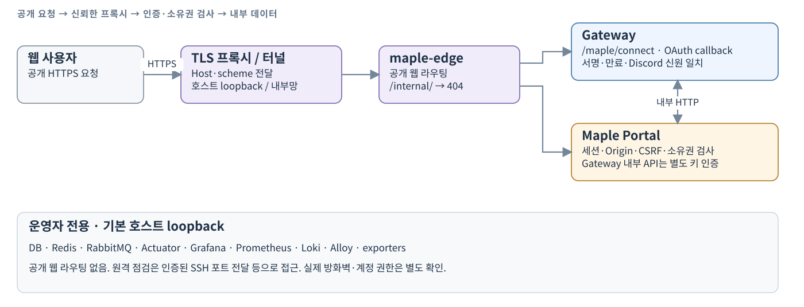

# 공개 경계와 보안 운영

이 문서는 코드에 있는 보호, 안전 기본값, 운영자가 확인할 경계를 구분한다. 보안 검사의 통과가 모든 취약점 제거를 뜻하지 않는다. 현재 사용자 인증 흐름은 [메이플 아키텍처](../reference/MAPLE_ARCHITECTURE.md), 상세 배포 점검은 [메이플 12항목](MAPLE_SECURITY_PREFLIGHT.md)을 따른다.

## 공개되는 경로



[그림 원본](../diagrams/public-boundary.mmd)

| 경계 | 현재 설정·검사 | 남는 운영 조건 |
| --- | --- | --- |
| 외부 HTTPS → edge | 호스트 `127.0.0.1:18877`을 신뢰한 터널에 연결하거나 같은 Docker 네트워크에서 `maple-edge:80` 사용 | TLS는 edge 앞에서 종료. 신뢰한 프록시만 Host·X-Forwarded-Proto 전달 |
| edge → Gateway | `/maple/connect`, `/maple/oauth/callback`만 Gateway로 라우팅 | 다른 관리 포트를 같은 터널에 추가하지 않음 |
| edge → Node | 포털 경로. `/internal/`은 edge에서 404 | 내부 API는 별도 내부 키 필요. Node 포트는 직접 호스트 게시하지 않음 |
| 사용자 API | 세션·사용자 소유권, 변경 요청의 Origin·JSON·CSRF 검사 | 두 사용자·익명 세션으로 접근 거절을 실제 환경에서도 검증 |
| 관리 포트 | `INFRA_BIND`·`OBSERVABILITY_BIND` 기본 loopback | override·방화벽·Docker 버전 확인. loopback은 계정 인증을 대신하지 않음 |

Docker는 호스트 IP 없는 포트를 외부 인터페이스에 게시할 수 있다. 관측성 6개 서비스도 이제 `OBSERVABILITY_BIND=127.0.0.1`을 기본으로 사용한다. 컨테이너 간 서비스명 통신은 그대로 유지된다. Docker 28 이전 버전에서는 동일 L2 네트워크의 localhost 게시 포트 접근 예외도 있어 엔진 버전과 방화벽을 함께 확인한다. [Docker 공식 포트 게시 안내](https://docs.docker.com/engine/network/port-publishing/)

원격 관측은 인증된 SSH 포트 전달·제한된 운영 네트워크를 사용한다. 관리 서비스를 `0.0.0.0`으로 바꾸거나 공개 ngrok URL에 연결하는 것을 기본 해결책으로 삼지 않는다. 포트 변경은 기존 컨테이너에 `restart`만 해서는 적용되지 않으며 Compose 재생성이 필요하다.

## 비밀값·파일·계정

- `.env`, `.env.*`, `*.env`, 비밀 디렉터리·개인키·DB dump·HAR를 Git에서 제외한다. `.env.example` 같은 가짜 값의 템플릿만 유지한다. ignore는 이미 추적한 파일이나 과거 이력을 지우지 않는다.
- `guest`, `stock`, `admin` 예제 암호는 개발용이다. 운영에서는 서비스별 임의 암호를 사용하고 소유자만 환경·키 파일을 읽도록 한다. 기존 DB·RabbitMQ·Grafana 계정 암호는 `.env` 변경만으로 교체되지 않는다. 계정 변경과 앱 설정을 일치시켜야 한다.
- 포털 DB는 세션 토큰의 해시를 보관하지만 넥슨 쿠키는 프로필 볼륨에 남는다. DB 덤프·프로필·체크포인트는 공개 릴리스나 이슈 첨부물이 아니다.
- OAuth Client Secret과 봇 token은 다른 자격 증명이다. 서명 키와 내부 API 키도 서로 독립적으로 생성한다. 공개 도메인만으로 내부 키·서비스 API 키가 전달되지 않도록 한다.
- Alloy의 Docker socket 접근은 높은 호스트 권한을 갖는 경계다. 외부 포트 제한으로 이 권한이 제거되지는 않는다. socket proxy·별도 로그 수집 서비스는 후속 격리 개선 항목이다.

## 로그·화면을 공유할 때

Nginx access log는 `$uri`를 사용해 OAuth 쿼리를 제외한다. 그러나 Nginx **error log**, 터널 Traffic Inspector, 앱 예외·디버그 로그까지 같은 보호가 적용된다고 보장하지 않는다. 운영에서 저장·조회 권한·보관 기간과 쿼리 수집 여부를 별도로 확인한다. 로그를 외부에 공유하기 전에 Authorization·cookie·code·state·ticket·webhook token을 제거한다.

설정 확인은 `docker compose --env-file <환경파일> config --quiet`로 수행한다. 전체 `config`, `docker inspect` 환경 목록, 원본 HAR, 로그인 화면 주소를 그대로 붙이지 않는다. 오류를 보고할 때는 시각·작업 ID·오류 분류·비밀값 없는 로그만 제공한다.

## 재현 가능한 검사

저장소 루트에서 실행한다. Node.js와 Docker Compose CLI가 필요하며 아래 설정 테스트는 Docker daemon이나 실제 운영 서비스를 시작하지 않는다.

```bash
node --test ops/security/config.test.mjs
node ops/maple-db/check-doc-links.mjs
node ops/security/preflight.mjs

# 운영 환경 파일을 선택해 검사. 실제 값은 출력하지 않음
node ops/security/preflight.mjs --production --env-file /path/to/runtime.env
```

| 출력 | 의미 |
| --- | --- |
| PASS | 표시된 검사 범위 안에서 문제를 발견하지 못함 |
| P0 | 알려진 노출·취약 설정. 프로세스가 실패 코드로 종료 |
| SKIP | 파일·빌드·비밀값이 없어 검사하지 못함. 통과가 아님 |
| INFO | 자동 검사 밖의 범위 또는 해석 안내 |

preflight는 `.env` 계열 파일명 이력과 현재 보유 키의 공개 파일 일치를 확인한다. 공개 디렉터리는 하위 폴더와 source map까지 읽는다. **보유하지 않은 키, 변형·인코딩된 값, 이미지, 전체 Git 콘텐츠 이력은 전수 탐지하지 않는다.** 환경 파일의 단순 `KEY=value` 값을 읽으며 실행 프로세스의 최종 환경·비밀 저장소를 대신 조회하지 않는다. production 모드는 기본 암호·짧은 키·공개 바인딩·HTTP 원점·callback 불일치를 추가 검사한다. 16/32자 길이 검사만으로 암호의 난수성을 증명하지는 않는다.

## 노출을 발견한 경우

실제 키가 공개됐으면 현재 파일에서 지우는 것만으로 끝내지 않는다. 해당 제공자의 폐기·재발급, 필요한 세션 무효화, 접근 기록 확인을 먼저 수행하고 이후 이력 정리를 별도 계획한다. 이력 강제 변경은 다른 clone·fork·캐시에 남은 비밀을 회수하지 못한다. 문서 정리 작업에서 운영 키를 임의 회전하거나 Git 이력을 강제로 다시 쓰지 않는다.
