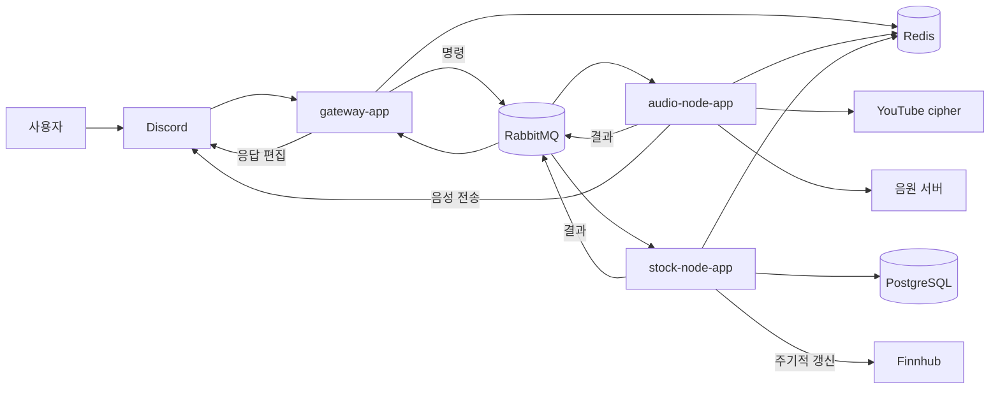
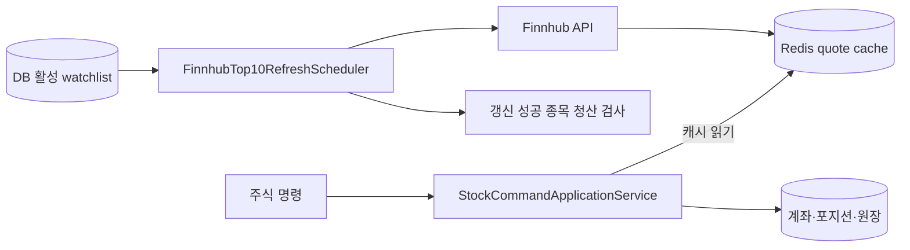

# 현재 아키텍처

DIS는 Discord 음악 봇과 주식 모의투자를 세 앱으로 나눠 실행한다. 명령 수신·응답은 Gateway, 실제 재생·계산은 각 worker가 맡는다. 구성 기준은 [Compose](../../docker-compose.yml), 앱 진입점은 [apps/](../../apps/README.md)에 있다.

## 서비스 연결



Gateway도 음악 autocomplete·음원 조회용 PlayerManager와 cipher 설정을 사용한다. stock은 Discord/JDA에 접속하지 않는다. Gateway와 audio는 같은 봇 계정의 서로 다른 JDA 프로세스다.

| 구성요소 | 저장·처리 책임 |
| --- | --- |
| Gateway | slash command, 공개 범위 결정, pending 저장, 결과 회신. `/man`·`/pizza` 직접 처리 |
| audio | 음악 큐 소비, 음성 연결, LavaPlayer·Opus 재생, 복구·빈 채널 퇴장 |
| stock | 계좌·거래·조회·랭킹, 시세 갱신, 청산 검사 |
| RabbitMQ | 음악·주식 command/result 전달 |
| Redis | pending 응답, 음악 상태·재생 대기열·잠금·중복 처리, 주식 시세·랭킹 캐시·제한 상태 |
| PostgreSQL | 계좌, 포지션, 거래·지급 원장, snapshot, watchlist |
| YouTube cipher | player script 서명·URL 해독. 인증·음원 전송은 담당하지 않음 |

## 명령과 결과

1. `DiscordBotListener`가 옵션을 읽고 ApplicationService로 command envelope를 준비한다.
2. `deferReply` 성공 callback에서 `commandId → interaction context`를 Redis에 저장한다.
3. command bus가 RabbitMQ에 발행한다. worker가 큐를 소비해 업무를 처리하고 result를 발행한다.
4. Gateway의 result listener가 pending을 찾아 원래 응답을 편집한다.

결과는 `responseTargetNode`로 발행한 Gateway에 돌아간다. `APP_NODE_NAME`은 결과 큐 이름과 라우팅에도 사용된다. 큐를 공유한다고 음악 worker를 단순 복제해도 되는 것은 아니다. 재생 중인 길드의 플레이어 소유권·명령 전달을 함께 설계해야 한다.

`/man`은 비공개 직접 응답, `/pizza`는 공개 직접 응답이다. 음악·효과음 및 주식 조회는 비공개이며 `stock buy/sell/rank`는 공개다. 상세 메시지 구조·중복·DLQ 정책은 [이벤트 계약](EVENT_CONTRACT.md)을 본다.

## 음악 재생과 후속 실패

```text
/play → MusicWorkerService → PlayerManager.loadAndPlay
      → TrackScheduler → AudioPlayerSendHandler → Discord 음성
```

길드·채널을 조회하고 음성 연결 후 Redis에 상태를 저장한다. 검색·로드 결과로 접수를 회신해도 음원 다운로드나 디코딩은 이후 실패할 수 있다. `TrackScheduler`는 재생 실패·정체를 결과로 알리고, Gateway는 `PLAYBACK_FAILED`로 원래 interaction 응답을 수정한다.

성공한 play/sfx의 pending은 후속 실패 수신을 위해 유지하고 terminal failure 때 소비한다. 유효 기간은 15분이므로 오래 기다린 곡의 오류는 로그 확인도 필요하다. 재시작 시 Redis 상태로 복구를 시도하며, 기본 빈 채널 퇴장 대기는 5초다.

## 시세·거래·시즌

Finnhub 정기 작업은 `STOCK_MARKET_DATA_ENABLED=true`이고 provider가 `finnhub`일 때만 실행된다.



- 기본 `fixedDelay`는 20초다. 한 실행이 끝난 후 다음 실행까지 기다리므로 호출 소요 시간을 포함한 주기는 더 길 수 있다.
- 초기 watchlist는 V2 migration의 2026-05-01 기준 10종목이다. 종목 순위를 실시간으로 다시 선정하지 않는다.
- quote TTL은 60초, 거래 허용 freshness는 45초다. 명령 처리 중 Finnhub를 직접 호출하지 않는다.
- 기본 `mock` provider를 선택해도 이 정기 작업은 돌지 않는다. 빈 캐시에서는 시세 조회·거래가 준비 안 됨으로 응답하고 종목 목록은 가격 없이 표시할 수 있다.
- 계좌는 길드·사용자·월 시즌별이며 시작 자금은 10,000이다. 시즌은 `Asia/Seoul` 매월 1일 00:00에 전환한다.
- 레버리지 포지션은 시세 갱신 성공 시 고립 증거금을 평가해 청산한다. 시세가 갱신되지 않으면 이 검사도 같은 방식으로 진행되지 않는다.

데이터 모델은 [PostgreSQL 스키마](POSTGRESQL_STOCK_SCHEMA.md), 설정은 [로컬 개발 안내](../operations/LOCAL_DEVELOPMENT.md)를 본다.

## 관측과 검증

앱은 `/actuator/health`, `/actuator/info`, `/actuator/prometheus`를 제공한다. [관측성 profile](../../ops/observability/README.md)은 메트릭을 Prometheus로, Docker 로그를 Alloy·Loki로 수집하고 Grafana에서 보여 준다. 전체 분산 trace는 현재 확장 후보이며 구현됐다고 가정하지 않는다.

컨테이너 준비 상태·명령 결과·실제 음질은 서로 다른 확인 항목이다. [테스트 가이드](../operations/CI_TESTING.md)와 [운영 런북](../operations/OPERATIONS_RUNBOOK.md)에서 각각 검증한다.

[기준 문서 목록](README.md) · [모듈 구조](MODULE_STRUCTURE.md)
