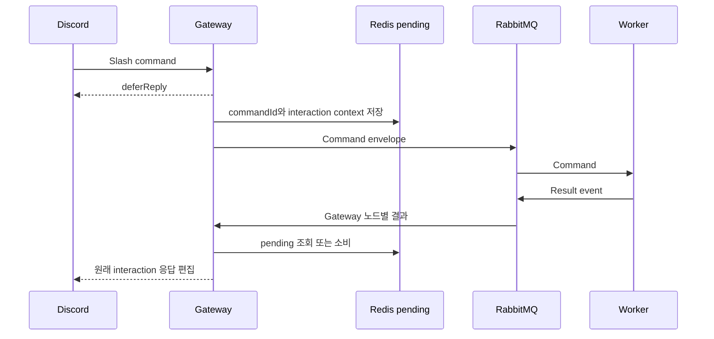

# 명령·결과 이벤트 계약

Gateway와 worker는 JSON 메시지를 RabbitMQ로 주고받는다. 음악과 주식의 schemaVersion은 현재 모두 1이지만 구조·중복 처리·실패 정책은 각각 다르다. 기본 토폴로지는 아래 설정과 코드가 기준이다.

## 타입과 메타데이터

| 계약 | 본문과 메타데이터 | 소스 |
| --- | --- | --- |
| 음악 명령 | `MusicCommandEnvelope` 안의 `message`에 commandId·schemaVersion·sentAtEpochMs·producer·command. envelope에는 responseTargetNode·responseMode | [common/command/](../../modules/common-core/src/main/java/discordgateway/common/command) |
| 음악 결과 | commandId·schemaVersion·producer·targetNode·guildId·success·message·ephemeral·resultType 등 | [MusicCommandResultEvent](../../modules/common-core/src/main/java/discordgateway/common/command/MusicCommandResultEvent.java) |
| 주식 명령 | `StockCommandEnvelope`에 commandId·schemaVersion·sentAtEpochMs·producer·command·responseTargetNode | [StockCommandEnvelope](../../modules/stock-core/src/main/java/discordgateway/stock/command/StockCommandEnvelope.java) |
| 주식 결과 | commandId·schemaVersion·producer·targetNode·guildId·requesterId·success·message·resultType 등 | [StockCommandResultEvent](../../modules/stock-core/src/main/java/discordgateway/stock/event/StockCommandResultEvent.java) |

`commandId`는 로그·pending·결과의 연결 키다. `producer`는 발행 노드, `responseTargetNode`/`targetNode`는 결과 목적지다. 타임스탬프는 epoch milliseconds다. 주식은 Quote·ListQuotes·Buy·Sell·Balance·Portfolio·History·Rank를 지원하며, Buy/Sell 수량은 Gateway에서 정수 입력으로 받는다.

음악의 `MusicEvent`는 Spring 프로세스 내부 이벤트다. RabbitMQ로 보내는 `MusicCommandResultEvent`와 구분한다.

## 기본 RabbitMQ 토폴로지

exchange는 direct, queue는 durable로 선언한다. 이름은 다음 설정과 일치한다.

| 경로 | exchange | queue / routing key |
| --- | --- | --- |
| 음악 command | `music.command.exchange` | queue `music.command.queue`, key `music.command` |
| 음악 result | `music.command.result.exchange` | queue·key `music.command.result.<Gateway node>` |
| 음악 DLQ | `music.command.dlx` | queue `music.command.dlq`, key `music.command.dead` |
| 주식 command | `stock.command.exchange` | queue `stock.command.queue`, key `stock.command` |
| 주식 result | `stock.command.result.exchange` | queue·key `stock.command.result.<Gateway node>` |

예를 들어 Gateway의 `APP_NODE_NAME=gateway-1`이면 결과 queue suffix는 `gateway-1`이다. 음악 이름은 [공통 설정](../../modules/common-core/src/main/resources/application-common.yml), 주식 이름은 [StockMessagingProperties](../../modules/stock-core/src/main/java/discordgateway/stock/messaging/StockMessagingProperties.java)와 앱 설정을 기준으로 한다.

## Gateway 응답 흐름

명령 envelope는 listener에서 준비하며, pending 저장·발행은 ACK 성공 callback 뒤 실행한다. pending 유효 기간은 15분이다. 음악·효과음과 주식 조회는 비공개, stock buy/sell/rank는 공개로 ACK한다. `/man`·`/pizza`는 이 큐 흐름 없이 직접 응답한다.

주식 결과는 pending을 `take()`해 응답한다. 음악 결과는 성공한 play/sfx의 pending을 후속 `PLAYBACK_FAILED` 수신용으로 유지한다. terminal failure가 pending을 소비하므로 늦게 도착한 접수 결과가 실패 안내를 덮어쓰지 않는다. 기준은 [음악 result listener](../../apps/gateway-app/src/main/java/discordgateway/gateway/messaging/RabbitMusicCommandResultListener.java)다.

## 접수·재생 실패·재처리

`success=true`인 명령 결과는 실제 음원 전송·청취의 보증이 아니다. 로드 실패를 사용자 문구로 반환하거나 재생 시작 뒤 다운로드·디코딩·정체 실패를 후속 통지할 수 있다. 성공률을 집계할 때 결과 유형·실패 이벤트·실제 프레임을 함께 확인한다.

[음악 consumer](../../modules/common-core/src/main/java/discordgateway/infra/messaging/rabbit/RabbitMusicCommandListener.java)는 Redis의 processed-command 상태로 commandId 중복 처리를 확인한다. 기본 dedup TTL은 300,000ms다. 처리 중 중복은 실행하지 않고, 완료 중복은 저장 결과를 다시 발행한다. 처리 예외는 실패 결과를 발행하고 requeue 없이 reject해 음악 DLQ로 보낸다.

[주식 consumer](../../apps/stock-node-app/src/main/java/discordgateway/stocknode/messaging/StockCommandListener.java)는 업무 결과 또는 예외의 실패 결과를 발행한다. 현재 stock 토폴로지에는 음악과 같은 DLQ·processed-command 중복 제어를 선언하지 않는다. 전체 시스템이 exactly-once 거래를 보장한다고 해석하지 않는다.

음악 DLQ를 다시 처리할 때는 [운영 런북](../operations/OPERATIONS_RUNBOOK.md)의 재처리 절차를 따른다. 중복·재전달·계약 변경 검증은 [테스트 가이드](../operations/CI_TESTING.md)를 본다.

[기준 문서 목록](README.md) · [모듈 구조](MODULE_STRUCTURE.md)
