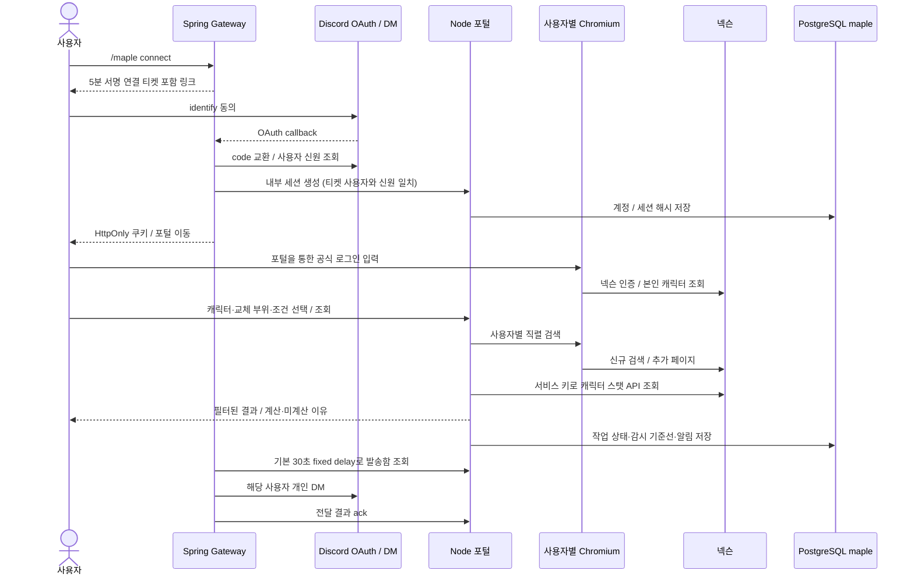

# 메이플 포털: 사용자 흐름과 책임

2026-11-22 문서 점검. 구현 기준은 `29ebb0a`(PR #28)이며 실시간 운영 설정·가용성을 재검증한 기록은 아니다.

## 전체 흐름

## 인증과 사용자 격리

- Discord 연결은 Spring `MapleTicketSigner`·`MapleDiscordService`·`MapleOAuthController` 책임이다. 서명과 만료, OAuth에서 조회한 사용자 ID와 연결 요청 사용자 일치를 검사한다. Discord OAuth는 넥슨 계정 인증을 대신하지 않는다.
- 포털 쿠키는 HttpOnly, HTTPS에서 Secure, SameSite=Lax이며 유효기간은 30일이다. DB에는 SHA-256 해시를 저장한다. 쿠키 만료와 넥슨 세션 만료는 독립적이다.
- Node의 변경 요청은 세션과 Origin·JSON Content-Type·CSRF 토큰을 검사한다. Gateway 내부 API는 별도 내부 키로 인증한다. 공개 edge를 통한 내부 API 접근 경계는 [보안 점검](../operations/MAPLE_SECURITY_PREFLIGHT.md)을 함께 본다.
- 계정별 Chromium 프로필과 캐릭터별 workspace를 분리한다. 넥슨 쿠키는 프로필 볼륨에 존재하므로 볼륨·백업 접근 권한도 보호해야 한다. “인증정보를 어디에도 저장하지 않는다”는 설명은 틀리다.
- 사용자 격리는 계정별 접근·작업 상태에 대한 경계다. 같은 Node 프로세스·서버 자원을 쓰므로 사용자별 완전한 장애·자원 격리나 무제한 동시성을 뜻하지 않는다.

## 검색·복구·알림

로그인이나 캐릭터 선택만으로 검색하지 않는다. 감시 OFF는 한 번 조회하고, ON은 설정한 주기로 실행한다. 사용자 안에서는 작업을 직렬 처리한다. 새 검색 POST가 외부에서 수락됐는지 불분명한 실패는 무조건 재시도하지 않는다. 사용자가 조건을 확인하고 다시 실행한다. 추가 페이지는 기존 검색 결과를 읽으며 외부 한도를 우회하지 않는다.

최소 조건은 경매장 요청과 수집 결과 검증에 사용하고, 잠재·에디 상한과 최대 스타포스는 수집 후 필터다. 상한에 맞는 매물이 전체 시장에 존재해도 외부 수집 범위 밖이면 결과에 없을 수 있다. 판매 중 매물과 최근 14일 판매 완료 시세는 별개다. 솔 에르다 전용 시세와 시드링 발동 비교는 현재 제공하지 않는다.

감시는 초기 상위 10개를 기준선으로 두고 이후 가성비 상위 10위의 신규 진입·순위 변경을 발송함에 기록한다. 순위 변화 없는 전체 매물을 매번 보내지 않는다. Spring은 발송함을 읽어 개인 DM을 보내며 pending/delivered/unavailable·시도 횟수·ack를 관리한다. DM 전송과 DB ack는 하나의 트랜잭션이 아니므로 정확히 한 번 전달을 보장하지 않는다.

중지·삭제는 해당 계정의 작업에 적용한다. 브라우저 복구는 해당 UID와 user-data-dir의 Chromium만 재기동하며 다른 사용자나 전체 서비스를 재시작하지 않는다. 세부 절차는 [포털](../../apps/maple-portal/PORTAL.md)을 따른다.

## 데이터와 복원

기존 PostgreSQL 인스턴스의 별도 `maple` 스키마·`maple_app` 역할·독립 Flyway 이력을 사용한다. [스키마](MAPLE_PORTAL_SCHEMA.md)의 계정 → workspace → 검색/작업 → 감시 ID 소유권과 notification_outbox·audit_event를 따른다. DB는 조건·상태·요약·미전송 알림의 복원 기준이며 전체 매물 상세 원본은 메모리에 있어 다시 조회할 수 있다.

브라우저 프로필 볼륨은 DB와 별도 백업 대상이다. 이전기는 기존 JSON을 읽기만 한다. 운영에서는 PostgreSQL 필수 설정과 단일 포털 advisory lock으로 파일 저장소 fallback·중복 프로세스 실행을 막는다. 여러 Node 복제본을 동시에 실행하는 수평 확장 구조는 아니다. `MAPLE_PORTAL_USERS`는 등록 기록 상한이며 처리량 지표가 아니다.

## 비교 계산과 검증의 한계

API 최종 스탯을 기준값으로 고정하고 사용자가 선택한 슬롯의 장비·잠재·에디·세트 차이를 적용한다. 반지 4칸과 펜던트 2칸을 명시적으로 구분한다. 일반 세트 단계와 확인된 럭키 아이템의 적격 세트 수 변화는 자동 계산한다. 교체와 무관한 미확인 세트가 그대로라면 기존 API 효과를 유지한다.

크확 100%, 상태이상 추가 데미지 적용을 전제로 같은 공격·버프 조건의 기대 피해 계수 증감을 계산한다. 경매장 전투력 참고값, 환산주스탯 점수, 실전 DPM과는 다르다. API에 이미 포함된 스탯 효과를 중복으로 더하지 않으며 스킬 가동률·전투 타임라인을 재현하지 않는다.

데몬어벤져 HP 모델, 제로 특수 무기 효과, 무기 종류 변경, 쿨감·스킬 효과 잠재, 특수 반지, 변경된 미확인 세트, 불완전한 입력 등은 미계산 사유를 반환할 수 있다. 한 매물의 실패가 다른 매물 계산을 지우지 않는다. “쓸만한 스킬 사용 가능” 줄은 버프를 새로 발동시키지 않고 나머지 변화만 계산한다. 정확한 수식·예외는 [DAMAGE_MODEL](../../apps/maple-portal/DAMAGE_MODEL.md), 구현 검증은 [VALIDATION](../../apps/maple-portal/VALIDATION.md)을 따른다.

## 코드 탐색

| 책임 | 위치 |
| --- | --- |
| OAuth·티켓·DM scheduler | [Gateway maple](../../apps/gateway-app/src/main/java/discordgateway/gateway/maple) |
| HTTP·세션·보안·복구 | [portal-server.mjs](../../apps/maple-portal/src/portal-server.mjs) |
| 캐릭터 작업·검색 흐름 | [portal-flow.mjs](../../apps/maple-portal/src/portal-flow.mjs) |
| 검색 엔진 | [domain.mjs](../../apps/maple-portal/src/domain.mjs) |
| DB 제약 | [V1 migration](../../ops/maple-db/migrations/V1__portal_state.sql) |
| 배포 | [아웃바운드 배포](../operations/OUTBOUND_ONLY_DEPLOY.md) |
