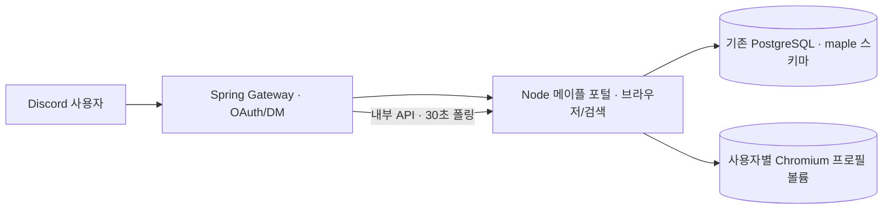

# 메이플 포털 PostgreSQL 스키마

DIS의 기존 PostgreSQL 인스턴스와 `stock` 데이터베이스를 사용한다. 주식 테이블은 `public`에 두고 메이플 테이블과 별도 Flyway 이력은 `maple` 스키마에 둔다. `maple_app` 역할이 메이플 스키마를 소유하며, 포털은 이 역할로 접속한다. 스키마 파일은 [V1 마이그레이션](../../ops/maple-db/migrations/V1__portal_state.sql)이다.

| 테이블 | 저장 내용 | 주요 제약 |
| --- | --- | --- |
| `portal_account` | Discord 사용자, 포털 토큰 해시, 넥슨 계정 식별 해시, 선택 캐릭터, 세션 만료 | Discord ID·토큰 해시 유일. 연결된 넥슨 계정 해시 유일 |
| `character_workspace` | 현재 작업 공간과 캐릭터별 보관 공간 | 사용자·작업 공간 키 유일 |
| `search_config` | 아이템·예산·잠재 조건. 상세 조건은 버전별 JSONB | 사용자·공간·조건 ID·모드 유일 |
| `search_job` | 조회·감시 상태, 결과 요약, 시각 | 사용자·공간·작업 ID 유일 |
| `watch_seen_listing` | 감시에서 이미 본 매물 ID | 사용자·공간·작업·매물 ID 유일 |
| `notification_outbox` | Discord DM 대기·전달·실패 상태 | 이벤트 ID 유일, 대기 인덱스 |
| `audit_event` | 연결 발급, 캐릭터 변경, 검색·감시 변경 | 비밀값 없이 사용자·시각·행동 기록 |

검색 조건과 작업의 세부 필드는 JSONB에 남겨 기존 포털의 버전별 조건을 손실 없이 저장한다. 사용자·작업·알림의 소유 관계와 중복 방지는 관계형 키로 강제한다. 매물의 전체 툴팁·검색 페이지는 현재 조회 중인 프로세스 메모리에 있고, 재시작 후 상세 확인은 다시 조회해야 한다. `search_job`에는 결과 요약만 복원한다.

## 이전·복구

1. 배포 전 `pg_dump -Fc`와 `maple-portal-data`의 JSON 체크포인트를 백업한다. 브라우저 프로필 볼륨은 그대로 유지한다.
2. `maple-db-bootstrap`이 `maple_app` 역할과 `maple` 스키마를 준비한다. 기존 볼륨에는 PostgreSQL 초기화 스크립트가 다시 실행되지 않으므로 별도 일회성 서비스로 처리한다.
3. `maple-db-migrate`가 Flyway V1을 적용한다. 이어 `maple-db-import`가 기존 JSON을 읽기 전용으로 이전한다. 이미 이전된 사용자 ID는 다시 쓰지 않는다.
4. 사용자·캐릭터 작업 공간·작업·감시 중복 ID·미전송 알림의 개수를 대조한다. 진행 중이던 불확실한 검색은 자동 반복하지 않고 사용자의 재조회 확인을 요구한다.
5. 포털을 시작해 두 사용자의 캐릭터와 작업이 분리되는지 확인한다. CI는 별도 PostgreSQL 데이터베이스에 테스트 데이터를 덤프·복원하고 테이블별 건수를 대조한다. 운영 백업은 배포 직후 별도 복원 환경에서 다시 검사한다. 이상이 있으면 포털을 중지하고 이전 릴리스·백업을 사용해 복구한다. DB 스키마를 즉시 삭제하지 않는다.

포털은 PostgreSQL advisory lock으로 단일 인스턴스만 시작한다. 다중 포털 복제는 별도의 작업 선점·브라우저 프로필 분산 설계가 필요하다. Spring Gateway의 DM 폴링은 기존 내부 API를 사용한다.
