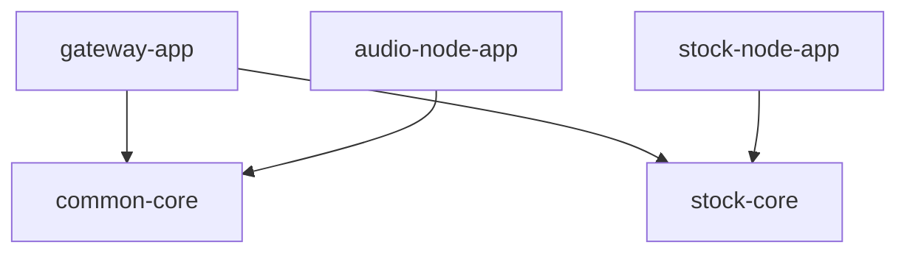

# 모듈과 디렉터리 구조

등록 기준은 [settings.gradle](../../settings.gradle)이다. 루트 Gradle 프로젝트 이름은 `TBot`이며 문서의 프로젝트명은 DIS다. 세 Spring Boot 앱과 두 Java 라이브러리로 구성한다.

```text
apps/                   실행 앱과 앱별 README
  gateway-app/          Discord 진입·회신
  audio-node-app/       음악 worker 조립·복구·수명주기
  stock-node-app/       모의투자 worker·계좌·시세·영속화
modules/                공용 라이브러리
  common-core/          음악 계약·재생 코어·공통 인프라
  stock-core/           주식 메시지 계약
ops/                    운영 스크립트·cipher·관측성 설정
docs/
  reference/            현재 구조·계약·스키마
  operations/           실행·테스트·배포·장애 대응
  internal/             과거 분석·계획·보고서
docker-compose.yml      로컬·서버 서비스 구성
deploy.sh               서버 release 배포
```

## 의존 방향



stock 앱은 common-core나 JDA에 의존하지 않는다. common-core의 이름은 공용이지만 현재 주된 내용은 음악 코어와 Gateway/audio 인프라다. 주식 업무 로직을 이 모듈로 옮기지 않는다.

## 기능별 수정 시작점

| 작업 | 시작 위치 | 함께 확인 |
| --- | --- | --- |
| slash command·도움말·공개 범위 | [gateway-app](../../apps/gateway-app/README.md) | Catalog와 DiscordBotListener, 관련 응답 테스트 |
| 음악 명령·재생 실패·Opus 공급 | [common-core](../../modules/common-core/README.md) | Gateway 발행·audio 조립·음악 테스트 |
| 음성 복구·빈 채널 퇴장 | [audio-node-app](../../apps/audio-node-app/README.md) | Redis 상태와 lifecycle/recovery |
| 주식 명령 메시지 | [stock-core](../../modules/stock-core/README.md) | Gateway 발행·stock 소비·계약 테스트 |
| 거래·계좌·시즌·랭킹·시세 | [stock-node-app](../../apps/stock-node-app/README.md) | application·cache·quote·persistence |
| DB 구조 | [Flyway migrations](../../apps/stock-node-app/src/main/resources/db/migration) | entity·repository·[스키마 문서](POSTGRESQL_STOCK_SCHEMA.md) |
| 컨테이너·관측성·배포 | [ops/](../../ops/README.md) | Compose·워크플로우·운영 문서 |

## 빌드와 산출물

저장소 루트에서:

```bash
bash ./gradlew bootJarAll
```

산출물은 `apps/gateway-app/build/libs/gateway-app.jar`, `apps/audio-node-app/build/libs/audio-node-app.jar`, `apps/stock-node-app/build/libs/stock-node-app.jar`다. 각 Dockerfile이 해당 JAR를 복사한다. 공용 모듈은 독립 서비스나 Boot JAR를 만들지 않는다.

IDE 실행·설정은 [로컬 개발 안내](../operations/LOCAL_DEVELOPMENT.md), 테스트 명령은 [테스트 가이드](../operations/CI_TESTING.md)를 본다.

[기준 문서 목록](README.md) · [현재 아키텍처](CURRENT_ARCHITECTURE.md)
