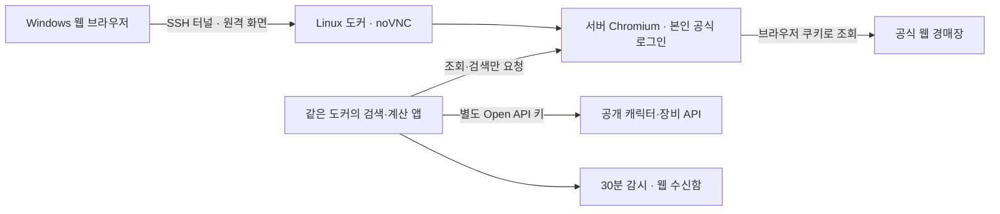

# 도커에서 메이플 프로토타입 실행

Linux 서버 안에서 **브라우저·검색·계산·30분 감시**를 함께 실행한다. Windows에서는 원격 브라우저 화면을 열어 공식 넥슨 로그인·OTP를 직접 처리한다. 로그인 후 Windows의 화면을 닫아도 서버와 컨테이너가 실행 중이면 감시는 계속된다. 세션 만료 시에는 다시 로그인해야 한다.

개인용 프로토타입이다. Discord 계정 연결·DM 발송·공식 OpenID 연동·다중 사용자 서비스는 포함하지 않는다. 기존 봇의 Compose 프로젝트와 독립적이며 운영 봇을 재시작하지 않는다.



## 시작

Docker Engine과 Compose v2가 필요하다. 먼저 저장소의 아래 폴더에서 실행한다.

```bash
cd tools/maple-local-prototype
node docker/setup.mjs
docker compose up -d --build
docker compose ps
```

호스트에 Node가 없으면 비밀번호 생성 단계만 아래 Linux 명령으로 대체한다. 이미 만든 비밀번호는 덮어쓰지 않는다.

```bash
mkdir -p .docker-secrets
chmod 700 .docker-secrets
if [ ! -f .docker-secrets/vnc-password ]; then
  (umask 077; head -c 6 /dev/urandom | base64 > .docker-secrets/vnc-password)
fi
```

최초 이미지는 약 1.4GB이며 한글 폰트와 Chromium을 포함한다. 설정상 CPU 2개, 메모리 최대 3GB, 공유 메모리 1GB다. 권장 시작 사양은 여유 메모리 3GB 이상인 Linux x86_64 서버다. API/알림 처리 용량을 측정한 수치는 아니다.

Windows PC 자체의 Docker Desktop에서도 실행할 수 있다. 그 경우 서버 대신 해당 PC가 계속 켜져 있어야 한다.

### 원격 화면 접속

Linux 서버에서 실행했다면 Windows PowerShell에서 기존 SSH 계정으로 연결한다. `사용자@서버주소`는 실제 값으로 바꾼다.

```powershell
ssh -N -L 17900:127.0.0.1:17900 사용자@서버주소
```

Windows 브라우저에서 **http://127.0.0.1:17900/vnc.html?autoconnect=1&resize=scale** 을 연다. 접속 비밀번호는 실행한 서버의 `.docker-secrets/vnc-password` 파일에서 본인만 확인한다. 비밀번호를 URL·채팅·Git에 넣지 않는다. 포트가 겹치면 `MAPLE_DESKTOP_PORT`를 바꾸고 SSH 터널도 같은 포트로 맞춘다.

외부로 공개하는 포트는 없다. Compose는 `127.0.0.1:17900`에만 바인딩한다. HTTP 원격 화면은 SSH 터널 안에서 사용하며 방화벽에 17900 포트를 열 필요가 없다. VNC 원본 포트와 브라우저 제어 포트는 공개하지 않는다.

## 로그인부터 감시까지

1. 원격 화면 안에는 **메이플 프로토타입**과 **공식 경매장** 탭이 열린다.
2. 공식 탭에서 본인이 넥슨 로그인·OTP·추가 인증을 완료한다. 비밀번호를 봇이나 앱에 입력하지 않는다.
3. 프로토타입 탭으로 돌아와 **연결 확인 · 내 캐릭터 불러오기**를 누른다. 탭이 열렸다는 표시만으로 로그인 성공을 판단하지 않는다.
4. 목록에서 **에반이였솜 → 이 캐릭터로 비교**를 선택한다. 공식 탭을 닫지 않는다.
5. **계산용 넥슨 API 키 설정**에 공개 캐릭터 데이터 키를 입력한다. 키 없이 매물 검색은 가능하지만 교체 점수는 계산하지 않는다. 공식 경매장 로그인과 별개의 권한이다.
6. 장비 조회 후 부위·아이템 이름·예산 등을 정해 **새 검색**한다. 기본 예산 30억은 21억~39억으로 검색한다.
7. 전체 결과가 한 페이지에 들어오는 조건이면 **현재 검색으로 감시 시작**을 누른다. 30분마다 새 검색을 만들고 새로운 조건 충족 매물만 웹 수신함에 남긴다.
8. Windows의 원격 화면과 SSH 터널을 닫아도 Linux 컨테이너는 유지된다. 다시 접속해서 수신함을 확인한다. Discord DM은 아직 연결하지 않았다.

일일 검색 잔여량이 확인되지 않거나 소진되면 검색을 멈춘다. 계정 변경은 검색 POST 전에 재확인하며, 인증 만료·브라우저 연결 변경 시 이전 캐릭터/감시를 무효화한다. 자동 구매·판매나 자동 로그인·OTP 입력은 하지 않는다.

## 저장되는 것

| 위치 | 내용 | 재시작 후 |
| --- | --- | --- |
| `browser-profile` 볼륨 | 브라우저 프로필·공식 로그인 쿠키 | 유지되지만 세션 유효성은 넥슨 정책에 따름 |
| `character-cache` 볼륨 | 공개 캐릭터·장비 API 응답 | 유지 · 새로 갱신 가능 |
| 서버 메모리 | 계산용 API 키·선택 캐릭터·검색 결과·감시·수신함 | 초기화 · 키 재입력 및 감시 재설정 필요 |
| `.docker-secrets/vnc-password` | 개인 원격 화면 접속 비밀번호 | 유지 · Git/이미지 빌드 제외 |

쿠키를 추출해 Node 서버로 옮기지 않는다. 경매장 요청은 로그인한 공식 페이지 안에서 `credentials: include`로 실행한다. 브라우저 프로필에는 로그인 정보가 있으므로 볼륨을 다른 사람과 공유하지 않는다. 재로그인 없이 영구 실행을 보장하지 않는다.

브라우저 프로필은 이 컨테이너만 사용한다. 볼륨 잠금으로 중복 사용을 막고, 재생성 시 남은 Chromium 프로세스 잠금 링크만 정리한다. 쿠키 DB나 프로필 자체를 지우지 않는다.

## 종료와 확인

```bash
docker compose ps
docker compose logs --tail=50 maple-desktop
docker compose restart maple-desktop
docker compose down
```

`down`은 브라우저/캐릭터 볼륨을 남긴다. **로그인 정보까지 완전히 삭제하려는 경우에만** `docker compose down -v`를 쓴다. 앱 종료/재시작은 항상 메모리의 키와 감시를 지운다.

| 증상 | 확인 |
| --- | --- |
| 원격 화면 연결 안 됨 | `ps`의 healthy 상태, 포트·SSH 터널·비밀번호 확인 |
| 공식 사이트 연결 안 됨 | 원격 브라우저의 오류와 서버 네트워크 정책 확인. 로그인 도메인까지 허용되어야 함 |
| 공식 탭 확인 필요 | 공식 경매장 탭을 열고 로그인/새로고침. 브라우저를 완전히 닫았다면 컨테이너 재시작 |
| 로그인 후 캐릭터 조회 실패 | 추가 인증·로그인 계정·내부 API 변경·401/403/426 확인. 반복 검색하지 않음 |
| 재시작 후 감시 없음 | 현재 설계상 정상. 캐릭터/계산 키를 다시 설정한 뒤 새 검색으로 감시 시작 |

이 인터페이스는 공식 공개 경매장 API 계약이 아니므로 변경될 수 있다. 서버에서 실제 로그인·검색·30분 후 신규 매물 확인을 완료하기 전에는 실사용 검증 완료로 보지 않는다.

## Codex 관리형 클라우드에서만

세션 프록시와 CA를 그대로 사용하려면 일반 Compose에 다음 파일을 추가한다. 개인 Linux 서버/Windows에서는 이 파일이 필요 없다.

```bash
docker compose -f compose.yaml -f compose.cloud.yaml up -d --build
```

`CODEX_PROXY_CERT`의 공개 CA는 빌드 시 임시 secret, 실행 시 읽기 전용 secret으로 전달한다. Node와 Chromium에 신뢰를 설정하며 TLS 검증을 끄지 않는다. 실제 로그인 도메인이 환경 정책으로 차단되어 있으면 그 정책의 허용 변경이 필요하다.

검증 범위는 [VALIDATION.md](VALIDATION.md)에 기록한다. 핵심 파일은 `compose.yaml`, `Dockerfile`, `docker/`, `src/browser-transport.mjs`, `src/docker-server.mjs`다.
